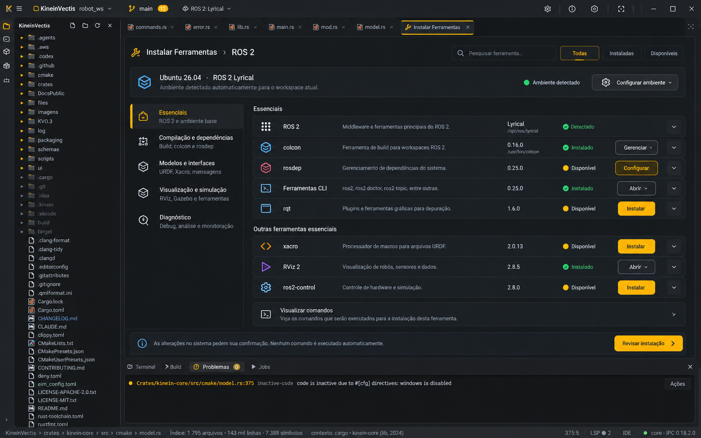
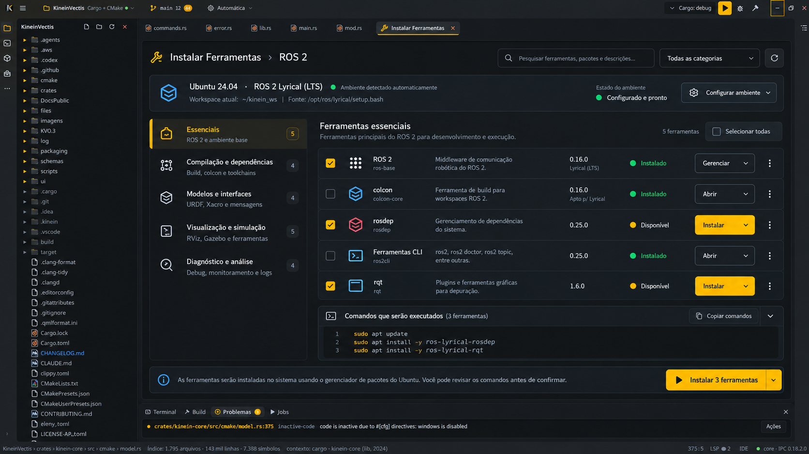

# Instalar Ferramentas — reformulação no painel existente

> **Classe: PLANO / ALVO.** Autor, 2026-10-21: aproveitar a migração de Setup
> para o dock na **0.4.x** para reformular a experiência; a revisão especial
> posterior aprimora os detalhes. Dependências no
> [52 §11.1](../roadmaps/52-arquitetura-executavel-da-0.4.md#111-fluxo-de-execução-reorganizado--2026-10-21).
> As imagens são referências conceituais, não telas já implementadas.

**Esclarecimento posterior do autor em 2026-10-21:** o desenho de frontend
deste estudo é **rascunho**, sem aprovação visual final. Evoluir a UI real
da IDE e seus componentes; não copiar as imagens. A imagem não demonstra
estado do produto nem substitui a aprovação do autor. A inclusão de Setup
na 0.4.x permanece decidida; organização, controles e acabamento propostos
abaixo seguem a [regra comum de aprovação visual](arquitetura-de-frontend-0.3-em-diante.md#11-aprovação-visual-e-referências--decisão-de-2026-10-21).

## 1. Base e referências

Conferência de código em 2026-10-21: `SetupController`, `SetupPanelHost`,
`SetupPanel` e `SetupToolRow`, em `ui/qml/setup/`, apresentam o guia oficial
por distribuição; `setup.list` fornece as ferramentas e a disponibilidade.
O host atual usa `KvPanelFrame`. O contrato real é
[setup.*](../arquitetura/03-dominios/setup.md): hoje **não** fornece toda a
taxonomia, versões, seleção em lote ou um instalador automático das imagens.

Referências fornecidas pelo autor:





A primeira informa hierarquia, categorias, linhas e detalhes sob demanda;
a segunda informa seleção e revisão dos comandos. São alternativas para
adaptar aos componentes reais, não duas telas a implementar. Distribuições,
versões, caminhos, pacotes, contagens e estados são ilustrativos, inclusive
combinações conflitantes entre as imagens. Não constituem matriz de suporte
Ubuntu/ROS, comando oficial ou licença para instalar seus exemplos.

## 2. Encaixe e conteúdo inicial

Preservar barra superior, explorador, editor, painel inferior e status.
Reusar os hosts/docks existentes. Instalar Ferramentas é uma superfície
acoplada de trabalho, aberta sob demanda, com retorno ao editor e sem janela
funcional flutuante paralela. Menu de seleção, tooltip e confirmação continuam
compactos. Largura/tamanho devem ser provados no host real, sem reservar
permanentemente espaço ao redor do editor.

Na 0.4.x, aplicar a organização às ferramentas **já suportadas**, incluindo
embarcados e os pré-requisitos do Quality Center. A categoria ROS 2 das
imagens só entra quando a integração pós-0.4.9 possuir dados e comandos
verificados; reformular Setup não antecipa a frente ROS 2.

| Área | Proposta de organização a refinar na UI atual |
| --- | --- |
| Cabeçalho | Título, busca, filtro de disponibilidade e atualizar; sem excesso de controles equivalentes |
| Ambiente | Distro e contexto reais; distinguir detectado, selecionado e efetivo; configurar abre o dono existente |
| Categorias | Agrupamento curto por finalidade, sem criar catálogo/provider universal na 0.4 |
| Lista | Nome, finalidade, disponibilidade e ação pertinente; versão/caminho apenas se medidos |
| Detalhes | Fonte oficial, data de conferência, escopo, pré-requisitos e guia; expansão preserva seleção/foco |
| Revisão | Comandos integrais, destino/efeitos e limitações antes de enviar ao Terminal |
| Rodapé | Resumo da seleção e próxima ação real; não afirmar instalação concluída pelo clique |

A categoria ativa não seleciona itens automaticamente. Filtros mantêm a
seleção identificada; o resumo informa itens selecionados fora do filtro.
“Selecionar todas” declara seu alcance e só inclui ações elegíveis. Busca e
filtro vazios, carga, falha, fonte ausente e ferramenta não detectada recebem
mensagens distintas. Estado e ação não dependem somente da cor.

## 3. Revisar e executar sem mudar a política de instalação

```text
Localizar ferramenta → entender estado/guia → selecionar ação
→ revisar comandos e fonte → copiar ou enviar ao Terminal → conferir resultado
```

Reusar o comportamento autorizado: comandos oficiais visíveis, copiados ou
enviados ao Terminal mediante ação do usuário. Nenhuma execução por abertura
da tela, seleção, busca ou expansão. Sem `sudo` silencioso, captura de senha
ou alteração automática do ambiente global. Download gerenciado, quando já
suportado por outro domínio, continua naquele dono e na sua política.

Selecionar múltiplas ferramentas começa pela **revisão**, não por um botão
que prometa instalar tudo. Guias podem exigir gerenciadores, ambientes ou
etapas diferentes; manter a ordem e explicar os destinos. Não concatenar
receitas incompatíveis nem eliminar passos por comparação textual. Revisão
em lote não cria um executor novo: quando não houver composição segura,
oferecer revisão/envio por ferramenta e explicar o motivo.

O rótulo inicial deve corresponder à ação real: “Revisar instalação”,
“Copiar comandos” ou “Enviar ao Terminal”. “Instalar N ferramentas” depende
de execução e acompanhamento efetivamente implementados, não é requisito
de copiar a imagem. O sucesso vem de resultado observado e nova detecção;
instalado não significa compatível ou configurado para este projeto.

Sem guia oficial para a distro/versão efetiva, mostrar a fonte e a limitação;
não inventar comando nem reutilizar pacote ROS de outra distribuição.
Atualizar a detecção preserva escolhas e não instala nada.

## 4. Donos e fatias

| Responsabilidade | Dono a estender |
| --- | --- |
| Ferramentas, fontes e compatibilidade | `crates/kinein-core/src/setup/`, `ToolDetector` e domínio da integração |
| Contratos adicionais necessários | `crates/kinein-protocol/src/setup.rs`, antes do produtor; sem JSON solto |
| Apresentação e seleção | Componentes `ui/qml/setup/`, reutilizando tokens e controles Kv* |
| Fiação | `SetupRequestRouter.qml`, `SetupEventRouter.qml` e ponte atual |
| Comandos e execução | Caminho existente para Terminal/Jobs; configuração e download nos seus donos |

**S1:** migrar o host ao dock e reformular lista/busca/filtros/detalhes sobre
o catálogo atual, preservando todos os acessos, guia e envio ao Terminal.
**S2:** seleção e revisão coerentes, estados, fontes e retorno da operação;
adicionar contrato somente para dados que a tela realmente consome. Ambas
acompanham o fechamento do Setup na 0.4.1, sem depender de Library 0.5 ou
esperar schema 3 dos kits para apresentar um guia já válido.

A consolidação 0.4.6 confere os acessos vindos de C, Python, Embarcados e
Quality Center; as auditorias finais verificam o conjunto. Polimento especial
posterior não recebe a migração funcional como pendência.

## 5. Aceite

- Mesma jornada antes/depois em UI nativa: abrir pelo comando e por uma
  ferramenta ausente, filtrar, revisar, copiar/enviar e voltar ao editor.
- Sem workspace, distro sem guia, detecção falha, desconexão/reconexão e
  atualização tardia; não executar nem reutilizar seleção de contexto antigo.
- Lista longa virtualizada quando a medição justificar; nenhuma detecção ou
  consulta de versão síncrona por delegate e nenhuma varredura de hardware.
- Foco visível, Tab/Shift+Tab, seleção e abertura de detalhes por teclado;
  texto/ícone para estado; textos longos e português/inglês sem corte.
- Fotos comparáveis em 1280×800, 1536×960 e 1920×1080, com escalas
  100%, 125% e 150%; adaptação também ao menor dock suportado.
- Movimento reduzido, resposta medida, nenhuma regressão em editor/terminal;
  harnesses, provas pertinentes e gate estrito da fatia.
