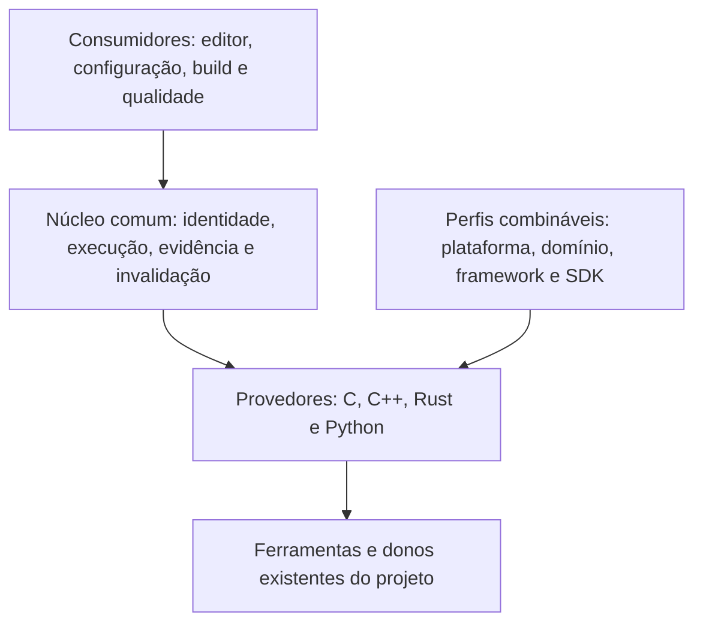

# Orquestração e verificação das linguagens

> **Classe: DECISÃO / ALVO, 2026-11-02.** Define a evolução da base pública
> 0.4: consolidar C e C++, introduzir o provedor Rust e aprofundar a integração
> Rust/C/C++, depois introduzir o provedor Python. O núcleo comum e os provedores
> adicionais descritos aqui são alvo; a implementação comprovada é a primeira
> fatia host do [verificador de correções LSP](verificador-de-correcoes-lsp.md).
> Fronteira da entrega no [62](../roadmaps/62-base-publica-0.4.md).

## 1. Finalidade e sequência

A base deve permitir desenvolver projetos pequenos e médios com uso contínuo
de editor, LSP, build, testes, depuração, Git e terminal. A Kinein Vectis deve
ser um caso de aceitação dessa jornada: core Rust, ponte C++, frontend QML e
comunicação IPC precisam permanecer coerentes ao editar e reconstruir o projeto.
Quantidade de arquivos ou linhas, isoladamente, não comprova essa capacidade.

A ordem de consolidação é vinculante:

1. C como etapa profunda dedicada, incluindo C23 e aceites próprios; depois C++
   e seu ecossistema de host, condicionado ao fechamento da etapa C.
2. Rust como terceira linguagem do verificador, integração profunda com C e C++,
   e jornada de desenvolvimento da própria IDE.
3. Python, reutilizando o núcleo comum demonstrado pelos provedores anteriores.
4. Perfis especializados de plataforma e domínio, conforme dependências e provas.

**Ordem completa de 2026-11-08** ([62 §3](../roadmaps/62-base-publica-0.4.md#3-ordem-e-critérios-de-fechamento)):
depois de Python vêm DAP e QEMU, os mínimos F5–F9, o algoritmo semântico de
ambiente, que lê a configuração essencial de cada ecossistema, e, por último,
a fase dedicada do algoritmo especializado (§12.1); seguem as camadas finais
de teste e a validação básica do Windows em VM. O foco é orquestrar os motores
maduros já integrados, sem parser, compilador ou servidor paralelos.

Os LSPs e recursos de Rust e Python já existentes continuam sendo mantidos
durante essa sequência. A ordem acima rege o aprofundamento e a introdução dos
provedores de verificação; não exige remover capacidades atuais.
Bare metal, Linux embarcado, ROS 2, computação científica e IoT compõem a
evolução especializada. A trilha do [52](../roadmaps/52-arquitetura-executavel-da-0.4.md)
permanece aberta, com seus compromissos e provas independentes.

**Fronteira complementar de 2026-11-03:** a
[infraestrutura fundamental](infraestrutura-fundamental-0.4.md) define mínimos
obrigatórios de ambiente, DAP, QEMU, Windows, SVD, VFS, plotagem, notebooks e
engenharia na 0.4. A ordem acima organiza dependências de linguagem; não adia
esses mínimos para a 0.5. Os provedores e a identidade comum desta especificação
devem atender os consumidores científicos e embarcados correspondentes.

## 2. Arquitetura comum e donos

O motor coordena evidências produzidas pelas ferramentas reais do projeto.
As decisões comuns ficam compartilhadas; cada linguagem define como preparar,
executar e interpretar sua verificação. Especializações acrescentam condições
de aplicação e regras versionadas.

| Responsabilidade | Dono existente a estender |
| --- | --- |
| Buffers, versões, ações e respostas dos servidores | `crates/kinein-core/src/lsp/` e `handlers/lsp/` |
| Conteúdo antes/depois, prévia e confirmação atômica | `crates/kinein-core/src/lsp/transaction.rs` |
| Contexto efetivo C/C++, CDB e identidade observada | `crates/kinein-core/src/index/context/` e `cdb/` |
| Primeira comparação com compilador | `crates/kinein-core/src/build/edit_verification/` |
| Build, Cargo e ambiente Python | `crates/kinein-core/src/build/`, `cargo.rs` e `python/` |
| Processos, limites e encerramento | `crates/kinein-core/src/process.rs`, Jobs e donos de execução |
| Contratos e apresentação | `crates/kinein-protocol/`, ponte C++ e consumidores QML atuais |

Essa divisão é conceitual, sem novos módulos ou API pública definidos por esta
especificação. Extrair mecanismos comuns ao adicionar um segundo consumidor
real, preservando os donos. Parsing, resolução de tipos e regras da linguagem
continuam nas ferramentas especializadas. O motor semântico profundo do
[56](../roadmaps/56-motor-semantico-profundo-cpp-rust.md) conserva seu escopo.

## 3. Identidade e contrato conceitual da verificação

Cada operação deve identificar o conjunto de entradas que efetivamente observou.

| Entrada | Identidade exigida |
| --- | --- |
| Documento e edição | Workspace, caminhos resolvidos, versão, conteúdo antes/depois, ranges e geração da consulta |
| Ferramentas | Executável efetivo, versão identificada, argumentos, diretório e ambiente relevante |
| Build | Sistema, configuração, alvo, toolchain, dependências, manifests e arquivos gerados pertinentes |
| Linguagem | Padrão ou edição, extensões, opções e unidade/pacote selecionado |
| Regras | Identificador, versão, origem, pré-condições e evidência de aplicabilidade |
| Execução | Escopo solicitado, orçamento, cancelamento e completude da saída |

Buffers modificados, headers, manifests, lockfiles, flags, bibliotecas ou alvo
alterados invalidam as evidências que dependem deles. Resposta de outro workspace,
consulta ou configuração não pode substituir a atual. O provedor deve declarar
as dependências observadas e as que não conseguiu capturar.

O resultado conserva origem, etapa executada, duração, diagnóstico, motivo de
incompletude e identidade das entradas. O contrato atual usa `newError`,
`noNewError` e `notVerified`; ele permanece o contrato da primeira fatia.
Uma evolução para várias etapas exige contrato IPC próprio antes do produtor.
Este documento não acrescenta campos ao protocolo nem altera sua versão.

O fluxo de cada operação deve capturar o snapshot, resolver contexto e escopo,
selecionar provedores/regras aplicáveis, executar em área controlada, comparar
evidências equivalentes e revalidar identidade antes de publicar e aplicar.
Cada passo conserva cancelamento e prazo. Mudança de entrada encerra ou invalida
o trabalho dependente; falha parcial preserva a informação da etapa afetada,
sem transformar o sucesso de outro provedor em verificação completa.

## 4. Evidências e alcance

| Etapa | Evidência que pode produzir | Prova separada necessária |
| --- | --- | --- |
| Estrutura/sintaxe | Edição bem formada e análise sintática da entrada observada | Resolução de tipos e dependências |
| Análise estática/compilação de verificação | Diagnósticos com o contexto e as ferramentas selecionadas | Geração de código, ligação e execução |
| Build e ligação | Artefatos e símbolos resolvidos na configuração exercitada | Comportamento em execução |
| Testes e depuração | Resultado dos casos executados no ambiente identificado | Propriedades e ambientes fora desses casos |
| Regra de domínio | Violação ou atendimento de uma condição versionada | Condições não cobertas pela regra |

Nenhuma etapa eleva automaticamente o resultado para uma garantia geral de
equivalência ou correção. Por exemplo, `cargo check` omite a etapa final de
geração de código e pode deixar de emitir erros dessa etapa, conforme a
[documentação do Cargo](https://doc.rust-lang.org/cargo/commands/cargo-check.html).
Resultados devem explicar o que foi executado, inclusive quando apenas parte
do projeto foi verificada. Ausência de ferramenta ou evidência fica explícita.

## 5. C como frente própria

Os requisitos, a sequência e a matriz C1–C8 pertencem à
[consolidação nativa de C](consolidacao-nativa-de-c.md). A etapa é obrigatória
na 0.4 e permanece aberta após a primeira jornada C11. C23 é a referência
moderna, preservando os padrões e dialetos exigidos pelos projetos existentes.
Criação/configuração, editor, qualidade, testes, depuração, contexto embarcado,
portabilidade e recuperação exigem aceites próprios antes de aprofundar C++.

O corpus C deve conter programas C puros e bibliotecas consumidas por outras
linguagens. O driver e o padrão efetivos devem ser preservados; sucesso ao
compilar um exemplo como C++ não aceita o caso C.

- **Linguagem:** padrões usados pelo projeto, extensões do compilador, tipos,
  conversões, declarações, linkage e diferenças entre configurações.
- **Pré-processamento:** macros, includes condicionais, headers públicos e
  privados, arquivos gerados, includes relativos e unidades que compartilham
  headers com flags diferentes.
- **Ecossistema de build:** CMake e Make nos donos existentes, CDB real,
  bibliotecas estáticas/dinâmicas, caminhos de busca e símbolos na ligação.
- **Memória e análise:** ponteiros, ownership convencionado pela API, duração
  dos objetos, alinhamento, aliasing e comportamento indefinido. Reusar
  analisadores e sanitizers quando aplicáveis, com execução e alcance declarados.
- **Plataforma:** ABI, arquitetura, sysroot, libc e distinção entre ambiente
  hospedado e freestanding. Este último afeta bibliotecas e inicialização;
  a prova de host não comprova um alvo sem sistema operacional.

A distinção hosted/freestanding e a seleção de dialetos estão descritas na
[documentação do GCC](https://gcc.gnu.org/onlinedocs/gcc/Standards.html).
Aceitar a frente por projetos C reais, incluindo biblioteca e executável em
múltiplas unidades, erro de header compartilhado, símbolo ausente, edição
válida e contexto divergente. Testes negativos devem demonstrar a guarda.

## 6. Consolidação C++

Preservar padrão, biblioteca padrão, ABI, macros, include paths, opções de
exceções/RTTI e configuração efetiva. O corpus deve cobrir templates, overloads,
headers compartilhados, dependências e falhas de ligação entre unidades.
Módulos, PCH, wrappers e response files só recebem suporte declarado com
interpretação, isolamento e provas próprios; não eliminar essas opções para
obter um resultado positivo.

A ampliação da comparação para headers e edições em vários arquivos deve
identificar as unidades afetadas, usar snapshots coerentes e relatar cobertura
parcial. Bibliotecas e dependências precisam ser tratadas no contexto do projeto,
incluindo a configuração selecionada e artefatos gerados.

## 7. Rust antes de Python

O provedor Rust deve resolver workspace/pacote, toolchain, edição, target,
profile, features, configuração `cfg`, manifests e lockfile efetivos.
Rust-analyzer, Cargo, compilador e ferramentas de teste devem observar o mesmo
contexto. Escolher um pacote ou conjunto de features diferente não aceita a
verificação solicitada.

Usar os diagnósticos estruturados existentes quando disponíveis, preservando
código, severidade, spans, expansões e relações entre diagnósticos. Conversões
entre bytes, Unicode e posições LSP precisam de testes próprios; o formato
[JSON do rustc](https://doc.rust-lang.org/rustc/json.html) não deve ser tratado
como texto já pronto para os ranges UTF-16 do editor.

Build scripts, macros procedurais e geradores podem participar da análise e
devem seguir a confiança e o isolamento do projeto. Preparar a verificação em
área controlada, preservar originais e impedir alteração implícita de manifests,
lockfiles ou dependências. Separar `check`, build, testes, Clippy e depuração
como evidências distintas, com orçamento e cancelamento próprios.

## 8. Integração profunda Rust/C/C++

O grafo do projeto deve representar a origem dos headers/bindings, bibliotecas
nativas, unidades produtoras e consumidores Rust. Alterar uma interface deve
invalidar e verificar os dois lados pertinentes.

| Fronteira | Casos obrigatórios de integração |
| --- | --- |
| Rust/C | Convenção de chamada, símbolos, tamanhos/layout, alinhamento, nulidade, buffers e ownership |
| Rust/C++ | Mecanismo de interoperabilidade declarado pelo projeto, headers/bindings gerados, runtime C++ e ligação |
| Execução | Callbacks, tempo de vida, threads, destruição, propagação de erros, panic e exceções |
| Build | Relação Cargo/CMake/Make, geradores, ordem/dependências e configurações compatíveis |

A compatibilidade precisa de fixtures positivas e negativas, build/ligação e
testes de execução nas fronteiras exercitadas. Rust não consegue conferir por
si só que toda declaração estrangeira corresponde à biblioteca real; esse
limite da FFI é descrito no [Rustonomicon](https://doc.rust-lang.org/nomicon/ffi.html).
O provedor deve diferenciar verificações estáticas de contratos que dependem
de teste. Nenhum mecanismo de bindings específico é imposto por este desenho.

Na própria IDE, Rust e C++ comunicam-se por IPC entre processos. Quando exercitada,
essa jornada comprova contrato, mensagens e sincronização das duas implementações; a prova FFI
precisa de um projeto próprio. Manter ambas na matriz, sem confundir seus aceites.
QML também participa da jornada de build, navegação e diagnóstico da IDE.

## 9. Python e projetos mistos

Depois da consolidação Rust/C/C++, o provedor Python deve preservar interpretador,
versão, ambiente virtual, dependências, caminhos de importação e configuração
dos analisadores do projeto. Reusar os donos de Python, basedpyright e Ruff.
Compilar bytecode é uma evidência limitada, conforme o escopo de
[`py_compile`](https://docs.python.org/3/library/py_compile.html); análise de tipos,
resolução de imports e testes têm aceites separados.

A descoberta não deve importar módulos do projeto para inferir sua estrutura.
Executar testes ou ferramentas que carreguem código deve respeitar confiança,
isolamento e gesto correspondente. CPython, MicroPython e CircuitPython têm
contextos distintos. Extensões Python em C/C++/Rust acrescentam casos de build,
ABI, ambiente e execução ao corpus de projetos mistos.

## 10. Especializações combináveis

Um perfil de domínio deve declarar linguagem, plataforma, framework/SDK,
versões, alvo, dependências, regras e ferramentas exigidas. Perfis não são
categorias mutuamente exclusivas: um projeto pode combinar C, bare metal e IoT,
ou Python, C++ e computação científica.

A seleção usa fatos observados do projeto; extensão do arquivo ou presença de
uma pasta não bastam para habilitar uma regra de SDK. Regras precisam de origem,
versão, pré-condição e corpus. Incompatibilidade, conflito ou contexto insuficiente
devem ser explicados. SDKs, ROS 2 e novas cargas científicas recebem provas reais
próprias, depois da base das linguagens; testes de host não demonstram suporte
nesses ambientes. Funcionalidades especializadas já oferecidas conservam regressões.

## 11. Orquestração e eficiência

Sincronizar conteúdo realmente alterado; vincular consultas e respostas a sua
geração; cancelar trabalho substituído; manter diagnóstico, navegação e correções
no contexto efetivo. O fechamento exige testar servidor principal e companheiros,
reinício/crash, ferramenta ausente, troca de configuração e workspace, edição
rápida, Unicode e retorno fora de ordem.

Exercitar `initialize`/prontidão, `didOpen`, `didChange`, `didSave` e `didClose`
com as capacidades negociadas de cada servidor. Sincronização incremental ou
completa, encoding de posições e conteúdo devem manter a mesma identidade.
Reinício ou troca de configuração retira diagnósticos antigos antes de aceitar
os novos. A fusão dos diagnósticos de principal/companheiros conserva origem,
severidade e retirada de resultados; uma falha de transporte não é uma lista
vazia bem-sucedida. Controlar concorrência e invalidação por documento/contexto,
preservando operações independentes.

Coalescer consultas equivalentes sem perder pedidos relevantes. Cache, quando
introduzido, deve usar a identidade completa das entradas e dependências;
resultado de outra configuração não é reutilizável. Limitar filas, processos,
saída, memória e temporários; manter a UI e o IPC responsivos sob carga.

Medir latência de edição/diagnóstico/navegação, consultas enviadas, cancelamentos,
CPU e memória em repouso e sob carga. Comparar execuções com a mesma fixture,
toolchain e configuração, incluindo cache frio/quente. A supressão atual de
`didChange` redundante é uma melhoria localizada; não constitui medição de ganho
global nem aceite de toda a orquestração.
Os limites de 1 MiB/5 s pertencem ao verificador inicial; provedores adicionais
precisam de orçamento justificado por medição, sem bloqueio síncrono do editor.

## 12. Fatias e aceite da base

| Ordem | Entrega técnica | Evidência de saída |
| --- | --- | --- |
| 1a | Consolidação nativa e profunda de C | Matriz C1–C8 da especificação C: C23, projetos/contexto, editor, análise, ciclo diário, embarcados e plataformas; jornada C11 inicial é parcial |
| 1b | C++ e comparação ampliada conforme o corpus, após o aceite C | Projeto C++ com dependências e várias unidades; correção válida e falhas introduzidas |
| 2a | Rust e núcleo compartilhado com consumidor real | Workspace Cargo, features/target, diagnósticos, verificação, build/testes e depuração |
| 2b | Integração Rust/C e Rust/C++ | Fixtures de interface positivas/negativas, invalidação bilateral, ligação e execução |
| 2c | Desenvolvimento da própria IDE | Jornada Rust/C++/QML, IPC, reconstrução, testes, recuperação e contexto externo conforme 62 §5 |
| 3 | Python e integração com componentes nativos | Ambiente correto, análise, imports, testes/depuração e extensão nativa exercitada |
| 4 | Especializações | Corpus e dependências reais por perfil; aceites dos roadmaps correspondentes |

Polimento de UI/HUD/UX e otimização acompanham a jornada implementada; integridade
e recuperação têm precedência. A matriz deve incluir projeto novo e existente,
dependência ausente, falha/cancelamento, troca de workspace e reabertura, sempre
com preservação de conteúdo e prévia das alterações.
Registrar por capacidade se está implementada, integrada e comprovada, com
fixture, versões e alcance. Cada fatia fecha regressões, mutações das guardas,
falsos resultados e tempo. Compilar a IDE ou passar um gate isolado não aceita
todo o ciclo de uso. Este plano não altera o estado de implementação por si só.

### 12.1 Dependências entre ferramentas e verificador

A sequência vigente prioriza consolidar a orquestração/integração das ferramentas
e o contexto de cada jornada. O verificador existente acompanha as fatias para
exercitar essas entradas e corrigir falhas de suas garantias. A fase dedicada
de evolução e fechamento do algoritmo ocorre depois, ainda na 0.4, sobre as
ferramentas e os consumidores consolidados; é a última etapa de implementação,
precedida por DAP/QEMU, F5–F9 e pelo algoritmo semântico de ambiente (62 §3). A vertical só fecha com evidência
funcional e robustez no escopo aceito.

O verificador host existente permanece integrado, com regressões das guardas
de conteúdo/contexto, cancelamento e aplicação transacional. Falhas confirmadas
nessas garantias têm correção imediata. A expansão para outra linguagem, SDK
ou ambiente exige primeiro um produtor de contexto confiável nesse recorte;
extrair infraestrutura comum ao integrar consumidores reais.

| Dependência da jornada | Pré-condição para ampliar a verificação |
| --- | --- |
| Ambiente e build | Ferramenta efetiva identificada, configuração/alvo e dependências conhecidos; configurar e compilar a fixture pelos donos existentes |
| LSP e contexto | Servidor e verificador observam o mesmo projeto/configuração; CDB atual, contexto Cargo ou ambiente Python conforme a linguagem |
| Documentos e arquivos | Conteúdo, versões, headers/gerados e caminhos coerentes; alterações invalidam a evidência e a aplicação dependente |
| Execução controlada | Confiança, isolamento aplicável, prazo, cancelamento e orçamento de recursos comprovados no ambiente exercitado |
| Evidência | Diagnósticos interpretáveis e comparação reproduzível, com casos válidos e falhas introduzidas que exercitem as guardas |

Uma dependência ausente ou divergente mantém o resultado não verificado e
direciona a correção ao dono correspondente. Não compensar contexto incorreto
com heurísticas de comparação, troca de compilador ou remoção de flags.
Resolver o contexto e repetir o caso antes de ampliar a cobertura declarada.

**Primeira fatia de implementação:** C de host, com biblioteca e executável,
múltiplas unidades e header compartilhado. Provar configurar/build/ligação e
contexto LSP, então exercitar correção válida, erro novo e troca de configuração
no verificador. Conferir a CDB efetivamente produzida, conteúdo preservado e
invalidação antes da aplicação. Falhas de ferramenta/contexto são resolvidas
na mesma fatia. Essa fixture inicia a
[etapa profunda de C](consolidacao-nativa-de-c.md); a consolidação C++ começa
após seus aceites obrigatórios. Rust e suas fronteiras C/C++ precedem Python
conforme a tabela de §12.

DAP, testes e QEMU acrescentam evidências de execução/depuração às jornadas;
não substituem os diagnósticos do compilador. SVD, notebooks e plotagem mantêm
seus aceites na [infraestrutura fundamental](infraestrutura-fundamental-0.4.md)
e não são pré-condições da comparação host de correções textuais. Quando um
consumidor científico ou embarcado precisar de verificação própria, seu ambiente
e suas ferramentas passam a integrar as entradas e o corpus correspondente.

Windows, SSH e containers exigem contexto, identidade e execução controlada
próprios ao ampliar o verificador a esses ambientes; a prova Linux local não
se transfere automaticamente. O endurecimento host pode avançar enquanto os
provedores desses ambientes são construídos. Seu suporte declarado depende
dos aceites da plataforma e do consumidor efetivamente exercitados.

O fechamento do algoritmo no escopo da 0.4 exige repetir o corpus sobre os
contextos consolidados: positivos/negativos, contexto obsoleto, troca de
workspace/configuração, Unicode, falhas, cancelamento, limites e recuperação.
Reexecutar mutações das guardas, medir falsos resultados, latência e recursos,
e provar a prévia/aplicação na UI. Vincular resultado, ferramenta e configuração;
análise, build, ligação, testes e depuração preservam evidências distintas.
O recorte host continua limitado ao contrato S0/S1 até a implementação e prova
de cada ampliação; consolidar ferramentas não o transforma no assistente S0–S4.

### 12.2 Jornada C inicial: build, contexto e correções

Fixture C de host: biblioteca estática com duas unidades, header público,
header gerado pelo CMake, executável e teste CTest. O projeto declara C11 e
recusa compilação como C++; includes e definições vêm do próprio CMake.
Executar em caminho com espaços/Unicode, usando o core e os produtores reais.

O corpus deve começar abrindo o projeto antes de existir CDB, ler uma unidade
no LSP e acionar `build.run` sem configure separado. O configure automático
precisa preparar o file-api, e a CDB gerada deve atualizar contexto e LSP.
Depois, alterar uma definição no CMake e repetir o build, incluindo a
regeneração automática do gerador. Conferir a configuração nova em
`index.context` e nas evidências do verificador.

Reusar o dono de contexto para identificar mudanças da CDB por conteúdo e
origem. Ao observar o fim de um build que as produziu, invalidar evidências,
recarregar o contexto e reabrir/reconfigurar os documentos pelo dono LSP
existente. Um build sem mudança na CDB deve preservar documentos e versões.
A atualização também vale quando o configure gera contexto válido e a
compilação/ligação seguinte falha. Não adicionar outro evento ou cliente IPC.

Aceitar correção válida e erro novo com compilador real; sugestões controladas
podem exercitar o consumidor, com origem declarada. Conferir arquivo intacto
na prévia, aplicação explícita, recusa após mudar header/configuração e novo
build/teste após aplicação. Exercitar erro de ligação, recuperação e reabertura.
Navegação/diagnósticos com clangd real e depuração DAP têm provas próprias.

**Estado da primeira fatia, 2026-11-03:** fixture, sincronização pelo build e
corpus implementados; regressões e mutações, clangd e GDB reais exercitados no
[registro §7.376](../roadmaps/40.7-registro-das-entregas.md#7376--jornada-c-de-host-e-sincronização-do-contexto-após-build-2026-11-03).
Isso aceita a jornada descrita em Linux, sem declarar todos os projetos C,
Windows, cross ou o assistente completo consolidados.
O fechamento da etapa C segue C1–C8; o corpus C11 continua como regressão,
enquanto C23 e os demais fluxos da linguagem recebem integração e provas próprias.
