# 57 — Mapa de versões até a 1.0

> **Classe: PLANO** (`DocsPublic/README.md`). Escrito em 2026-10-01, a pedido do
> autor: "estruturar todas as versões do projeto até a v1.0, de forma
> explícita". Este documento é um **índice com estado**, não um segundo plano.
> O escopo detalhado de cada versão tem **um dono** — o documento citado na
> coluna "Dono do detalhe" —, e aqui só mora o resumo, a ordem, o critério de
> pronto e o que ainda não foi decidido. Se este mapa e o dono divergirem, o
> dono vence e este mapa se corrige no mesmo gesto. **Onde cada versão começa
> no código** (arquivos, mecanismo a estender, primeira fatia) está no
> [`58`](58-onde-cada-versao-comeca-no-codigo.md).

## 0. Como ler: as quatro situações

Cada versão está em exatamente uma situação. A distinção é o ponto deste
documento: **ninguém (pessoa ou IA) pode tratar uma proposta como decisão.**

| Situação | Significa | Quem pode mudar |
| --- | --- | --- |
| **ENCERRADA** | lançada; o registro está no `CHANGELOG.md` e no [`40.7`](40.7-registro-das-entregas.md) | ninguém: é histórico |
| **EM CURSO** | decidida pelo autor e em implementação | o autor, com registro no dono |
| **PLANEJADA** | escopo e ordem decididos pelo autor, com documento dono | o autor, com registro no dono |
| **PROPOSTA** | agrupamento sugerido, **sem decisão do autor** | o autor decide; até lá não se implementa nada a partir dela |

## 1. A linha do tempo

```mermaid
flowchart LR
  v02["0.1–0.2<br/>MVP e teste fechado"]:::done --> v03["0.3.0–0.3.5<br/>série 0.3"]:::done
  v03 --> v036["0.3.6–0.3.9<br/>casca e base visual"]:::checkout
  v036 --> v04["0.4.0–0.4.9<br/>embarcados e entrega acumulada"]:::now
  v04 --> v05["0.5.x<br/>ambiente e capacidades"]:::planned
  v05 --> v06["0.6<br/>motor do editor"]:::planned
  v06 --> v07["0.7<br/>paridade diária"]:::planned
  v07 --> v08["0.8<br/>extensão declarativa"]:::planned
  v08 --> v09["0.9<br/>distribuição e comunidade"]:::planned
  v09 --> v10["1.0<br/>contratos congelados"]:::planned
  classDef done fill:#d9d9d9,stroke:#555
  classDef now fill:#ffe08a,stroke:#b38600,stroke-width:2px
  classDef planned fill:#bfe3ff,stroke:#2a6fa8
  classDef checkout fill:#e8e8e8,stroke:#666,stroke-dasharray:2 2
  classDef proposed fill:#ffffff,stroke:#888,stroke-dasharray:5 4
```



**Regra vigente de lançamento (autor, 2026-10-20):** a entrega da série 0.4
termina na **0.4.9** e inclui o trabalho não publicado da 0.3.6–0.3.9.
O AppImage é gerado e testado somente depois desse fechamento. O §1.1
resolve o agrupamento que ainda estava aberto no
[`53`](53-arquitetura-executavel-da-0.3.6.md) §11.

**Revisão de continuidade em 2026-10-07:** foco Qt 6.10; na mesma noite o
autor migrou para Arch Linux e o Qt local passou a 6.12.0 (59, topo). Em
2026-10-08 adiou MySQL/MariaDB nativo e a edição na grade (59 §2.3). A 0.3.9 encerra com
o pente fino como último passo (16 do 59 §2), após os passos menores do Banco
(7–15). Novo AppImage fica fora desse fechamento; o autor considera lançá-lo
após concluir a 0.4.0, ainda sem decisão de publicação (59 §8). **A 0.3.9
foi encerrada no checkout em 2026-10-16** (59 §7.1.8, 40.7 §7.304), sem
lançamento: as quatro etapas esperam o pacote único. No mesmo dia o autor
decidiu: o binário passa a dizer 0.3.9, e o AppImage só sai com a 0.4
finalizada (40 §5).
Uso cronometrado (40.7 §7.201) continua entre as provas do passo 16.
As intenções anteriores de pacote após a 0.4.0 e de fechamento na 0.4.5
foram substituídas pela decisão vigente do §1.1; não são marcos de pacote.

Cinza: encerrada. Cinza com traço fino: feita no checkout, não lançada. Amarelo: em curso. Azul: planejada. Tracejado: proposta
(nenhuma versão desde 2026-10-01; o que resta proposto é o critério da 1.0, §4).

### 1.1 Fronteira da entrega 0.4.9 — decisão de 2026-10-20

- A versão pública de referência continua sendo a **0.3.5**. As etapas
  históricas **0.3.6–0.3.9**, encerradas no checkout sem pacote próprio,
  passam a integrar as notas e o artefato da **série 0.4**, junto de todo o
  trabalho 0.4.0–0.4.9. Preservar os números antigos nos commits e registros;
  esta é uma correção da contabilização da entrega, sem reescrever histórico.
- A **0.4.5 continua sendo o marco funcional de Banco para embarcados**.
  A revisão geral de frontend, a consolidação e a estabilização prosseguem
  até a **0.4.9**; a ordem operacional pertence ao 52 §11.
- A conclusão da 0.4.9 exige jornadas verificadas, correções das falhas
  encontradas, auditoria visual e funcional, gates completos e documentação
  coerente. Então alinhar versão do binário, manifests, notas e pacote e
  **gerar/testar o AppImage localmente**. O binário do checkout ainda diz
  `0.3.9`; protocolo e versão de produto têm numerações independentes.
- **Prioridade esclarecida após o handoff (2026-10-20):** eficiência e
  fechamento completo de cada escopo, incluindo a UI/UX necessária ao uso;
  não acumular pendências para o final. A 0.4.9 entrega a base pronta e
  coerente. Em seguida, o autor confirmou uma **etapa especial de revisão
  de HUD/UX/UI após concluir a 0.4.9**, para procurar componentes, estados
  ou estilos esquecidos e incompatíveis com o padrão moderno da IDE.
  “Edição especial” é a denominação da etapa, com versão/artefato e
  cronograma ainda não fixados; ela não recebe pendências desta entrega.
  Critérios por escopo no 52 §11; cobertura da revisão no 52 §14.17.
- A **0.5 herda a base 0.4.9**. Suas notas devem listar somente mudanças
  introduzidas na 0.5, sem apresentar trabalho da 0.3.6–0.4.9 como novidade
  da 0.5. Aplicar a mesma regra nas séries posteriores: fechar, registrar e
  empacotar a série antes de anunciar o delta da próxima.
- A geração e o teste locais estão autorizados; **push, tag, release e
  publicação continuam com o autor**. Trabalho descrito no plano não é
  automaticamente entregue, e hardware indisponível continua NÃO PROVADO.
- MCP, abertura da colaboração e frente ROS 2 continuam **após o fechamento
  da 0.4**, agora 0.4.9. A transição da documentação para inglês acompanha
  esse fechamento. A extensão não antecipa essas frentes para 0.4.6–0.4.9.

## 2. Versão a versão

| Versão | Situação | Tema | O que entrega (resumo) | Dono do detalhe | Critério de pronto |
| --- | --- | --- | --- | --- | --- |
| 0.1–0.2 | ENCERRADA | MVP e teste fechado | o núcleo: core Rust, UI Qt/QML, editor, LSP, terminal, build | [`30`](30-caminho-para-o-mvp.md), [`34`](34-depois-do-mvp.md), `CHANGELOG.md` | — |
| 0.3.0–0.3.5 | ENCERRADA | série 0.3 | shell, Remote SSH (escritor único), terminal, editor, Grafana, AppImage | [`47`](47-estrutura-da-v0.3.md), [`48`](48-arquitetura-executavel-da-serie-0.3.md), [`51`](51-plano-fechamento-0.3.5.md) | AppImage 0.3.5 com smokes (40.7 §7.149) |
| 0.3.6 | FEITA NO CHECKOUT (2026-10-03) | limpeza e base | G0 (gates antes do código — feito), terminal mudo, passeio por superfícies, inventário F0, layout versionado | [`53`](53-arquitetura-executavel-da-0.3.6.md) §11, [`49`](49-frontend-0.3.6-e-sequencia-0.5.md) §4 | gate completo, passeio sem aviso no AppImage, telas nas três larguras (53 §11) |
| 0.3.7 | FEITA NO CHECKOUT (2026-10-03) | navegação | trilho por áreas, painel de baixo contextual | 53 §5.4–§5.5 | idem |
| 0.3.8 | FEITA NO CHECKOUT (2026-10-03) | centro e contexto | host de superfície central, header e status com contexto efetivo | 53 §5.6–§5.7 | idem |
| 0.3.9 | FEITA NO CHECKOUT (2026-10-16): encerrada, não lançada (59 §7.1.8, 40.7 §7.304). Passos 1–8, 9a e 13–16 feitos (40.7 §7.220–§7.303); 9b/9c, 10, 11 e 12 adiados pelo autor, sem versão (59 §2.3). AppImage adiado | teclado, fluidez e prova | foco, teclado, densidade, modo Foco, carga sob demanda e Banco voltado a embarcados (59 §2.3), QML para desenvolver a IDE nela (59 §2.4), confiança no projeto e a segurança da casca (59 §7.1.4) | [`59`](59-fechamento-da-0.3.9.md) (registro desde 2026-10-16); 53 §5.8–§5.9 | aceites dos passos 7–16 e medida antes/depois; sem novo pacote como requisito |
| porte e organização | porte PAUSADO na W6b4 (2026-10-14), a retomar numa VM; organização FEITA (2026-10-15, 61 §4; continua junto de cada fatia) | Windows nativo e documentação por contexto | a IDE compila e roda no Windows sem perder o Linux; a documentação separada por contexto, e a arquitetura se a medição pedir | [`60`](60-windows-e-edicao-especial.md) §3 (porte); [`61`](61-organizacao-da-documentacao.md) (organização) | porte: W6c (60 §3.3); organização: 61 §4 |
| 0.4.0–0.4.9 | EM CURSO; execução autônoma até a 0.4.9, com AppImage ao final (autor, 2026-10-20); incorpora a entrega não publicada 0.3.6–0.3.9 (§1.1) | embarcados e consolidação da IDE | contexto, cross, tamanho/cache, gravação/depuração/SVD, **PlatformIO tier 1**, emuladores, C puro, CPython/MicroPython/CircuitPython, Linux embarcado, integrações nativas opcionais; Banco na 0.4.5; auditoria e polimento geral de frontend antes do pacote | [`52`](52-arquitetura-executavel-da-0.4.md) §11, §14.14–14.17 | jornadas J1–J5 e de C/Python/Linux verificadas, auditoria/gates completos, documentação e AppImage 0.4.9 testado (§1.1; 52 §10) |
| edição especial | PLANEJADA (autor, 2026-10-08; retomada em 2026-10-09, Windows 11 Pro) | Windows + WSL2 | a IDE no Windows sem atrito com o WSL2, para embarcados e comunicação USB | [`60`](60-windows-e-edicao-especial.md) | a desenhar no Windows (60 §4) |
| 0.5.x | PLANEJADA; parte da base 0.4.9, com notas só do delta 0.5 (§1.1) | ambiente e capacidades | Environment Center, Library por capacidades/providers, resultados normalizados, monitoramento de processo; refino da gestão de integrações nativas | [`49`](49-frontend-0.3.6-e-sequencia-0.5.md) §6, [`50`](50-biblioteca-e-providers-0.5.md) | por fatia; corte de release pela evidência (49 §6) |
| 0.6 | PLANEJADA | motor do editor | a decisão M5.4 (o `TextEdit` do QtQuick bloqueia split, minimap, multi-cursor) e a migração | [`21`](21-roadmap-de-longo-prazo.md) §M5.4 | ADR da decisão + editor novo sem regressão de latência (régua do 45) |
| 0.7 | PLANEJADA | paridade diária | o restante de M5: navegação pesada, git avançado (conflitos, histórico), multi-cursor sobre o motor novo | 21 §M5.1–§M5.3 | o autor usa a IDE o dia inteiro sem sair para outra (régua do 34, TR1) |
| 0.8 | PLANEJADA | extensão declarativa | LS e adaptadores DAP configuráveis, task runner, tema/atalhos/layout **em dados** | 21 §M6.1–§M6.3, [`47`](47-estrutura-da-v0.3.md) §10.2 | um servidor/adaptador novo entra por configuração, sem código no core |
| 0.9 | PLANEJADA; a CI pública e a porta para colaboradores antecipadas (autor, 2026-10-17, §3 item 6) | distribuição e comunidade | CI pública, documentação pública, diagnóstico de falha sem telemetria, processo de release | 21 §M7 | "outra pessoa instala e contribui sem mim" (21 §M7) |
| 1.0 | PLANEJADA | contratos congelados | protocolo IPC e formatos persistidos versionados com migração; nada quebra sem versão major | este documento §4 | §4 — **ainda PROPOSTA** |

### 2.1 O que o código já entrega dos marcos M5–M7 (medido em 2026-10-01)

Os marcos do [`21`](21-roadmap-de-longo-prazo.md) não marcam estado; isto foi
medido nos métodos IPC roteados pelo core:

```text
M5.1 refatoracao por LSP     EXISTE   lsp.rename, lsp.codeActions, lsp.applyCodeAction,
                                      lsp.workspaceEdit.apply/cancel
M5.2 git avancado            PARCIAL  pull, push, stash, branchCreate, checkout, blame;
                                      sem fluxo de conflito
M5.3 navegacao pesada        PARCIAL  definition, references, workspaceSymbols,
                                      switchSourceHeader
M5.4 motor do editor         ABERTO   "a MAIOR decisao tecnica pendente" (21 §M5.4)
M6.1/M6.2 LS e DAP config.   ABERTO
M6.3 task runner             ABERTO   nenhum metodo task.*
M7.1 empacotamento           EXISTE   AppImage portavel com smokes (packaging/appimage)
M7.2 CI publica              AUSENTE  nao ha .github/ no repositorio
```

**Atualização de 2026-10-19:** a camada rápida da CI está preparada no
checkout e validada localmente; a execução no GitHub e as outras camadas
continuam pendentes. Cobertura e fronteiras no
[contribuindo/07 §2.1](../contribuindo/07-fluxo-e-responsabilidades-dos-gates.md#21-a-camada-rápida-da-ci-2026-10-19).

## 3. Pedidos do autor e para onde foram

Os três pedidos de 2026-10-01 já têm dono:

1. **PlatformIO como cidadão de tier 1** → **0.4** (decisão do autor,
   2026-10-01). O que existe e o que falta por jornada, medido no código, está
   no [`58`](58-onde-cada-versao-comeca-no-codigo.md) §4.4; o requisito está no
   [`52`](52-arquitetura-executavel-da-0.4.md) §5.10.
2. **Emuladores na IDE** → **0.4** (decisão do autor, 2026-10-01): QEMU (já no
   gate), Renode, QEMU da Espressif — como **alvo** onde o firmware roda,
   pelo `debugServer` do kit. **Não é a simulação física/matemática que saiu do
   produto** (40 §5); a matriz "jornada × emulador × NÃO PROVADO" é o 52 §10.1.
3. **Direção visual da 0.3.6–0.3.9** → 53 §13.1, com a linha de base medida
   no 58 §4.3; a task dedicada de UX/HUD a detalha.

Os de 2026-10-17 (40 §5), com o limite de fechamento atualizado para a
0.4.9 em 2026-10-20 (§1.1):

4. **A Kinein como servidor MCP** para agentes externos (o Claude Code por
   `claude mcp add`), **depois da 0.4.9**, o primeiro corte só de leitura,
   com o desenho antes do código. Revisa, só nisto, o "IA na IDE fora de
   escopo" de 2026-07-17: o agente segue no terminal, sem painel de IA.
5. **A documentação em inglês, junto do fechamento da 0.4.9** (a prioridade; o alemão
   talvez na 0.5, sem decisão). O site, em outra sessão, fica em inglês, com
   uma aba de colaboradores, dizendo só de passagem que o projeto vem do
   Brasil.
6. **Parte da 0.9 antecipada:** a CI pública entra agora, numa fatia curta
   antes da 0.4.1b; a porta para novos colaboradores (modelos, labels,
   issues de entrada em inglês) entra depois da 0.4.9: o autor segue sozinho
   até ela (esclarecimento de 2026-10-19).
   A recomendação de CI no repositório público e a ideia de cards no site
   derivados das issues foram documentadas em 2026-10-19 no
   [contribuindo/11](../contribuindo/11-ci-publica-e-tarefas-para-colaboradores.md);
   o site é outra sessão, sem requisito novo para o release.
7. **ROS 2 na IDE**, tão bom quanto o ambiente do VS Code ou melhor,
   orquestrando as ferramentas abertas; a versão sai de uma pesquisa medida.
   O pedido posterior de escopos e melhorias, recuperado em 2026-10-19,
   está no [integracoes/40 §1.2](../integracoes/40-ros2-ecossistema-e-integracao.md#12-decisão-recuperada-escopos-por-ferramentas-e-melhorias-próprias-2026-10-19);
   **Esclarecido pelo autor em 2026-10-19:** a frente ROS 2 e seu ensaio
   ficam para **depois do fechamento da 0.4, agora 0.4.9**; a versão exata
   continua sem número.
8. **Profundidade de refatoração e compreensão do compilador ao longo dos
   anos**, com a régua JetBrains: pedido recuperado em 2026-10-19,
   registrado no [56 §1.1](56-motor-semantico-profundo-cpp-rust.md#11-direção-de-longo-prazo-recuperada-em-2026-10-19).
   **Esclarecido em 2026-10-19:** estudar algoritmos próprios de análise e
   refatoração **complementares**, sem substituir os motores. Refina a
   restrição absoluta anterior quanto à pesquisa; hipóteses e critérios
   no [pesquisa/02](../pesquisa/02-analise-e-refatoracao-complementares.md).
   Não reserva versão nem aprova uma implementação na 0.4.

**O `/ide` da Kinein ficou sem decisão** (2026-10-17), pelo que a
documentação oficial do Claude Code mostra: o transporte (MCP por
WebSocket em `127.0.0.1`, porta efêmera), o token novo a cada início da IDE,
o arquivo `~/.claude/ide/<porta>.lock` e o único tool do modelo
(`getDiagnostics`) são públicos; os campos do arquivo e as operações
internas (abrir o diff, ler a seleção) não são, e podem mudar a cada versão
do CLI. Seria o único contrato da Kinein sem especificação; o MCP (item 4) é
especificação aberta. O diff no editor é o que só o `/ide` daria.

## 4. Proposta de critério para a 1.0

**PROPOSTA, sem decisão do autor.** A 1.0 é a promessa de que um contrato não
quebra sem aviso:

- o protocolo IPC tem versão (já tem, `0.147.0` em 2026-10-02) e a 1.0 congela a
  major: método removido ou mudado só numa 2.0;
- todo arquivo que o usuário guarda (`schemas/`) tem versão e migração provada;
- a 0.9 entregou CI pública rodando `scripts/verificar.sh --estrito` num
  ambiente declarado;
- nenhuma decisão aberta de §5 bloqueia o uso diário.

## 5. O que vale em TODAS as versões (não se reabre)

Não está copiado aqui — está no dono, e é lá que se lê:

- as camadas e os anti-padrões: [`ARCHITECTURE.md`](../arquitetura/ARCHITECTURE.md) §2, §8;
- as decisões do produto que não se reabrem: [`40`](40-estado-e-continuidade.md) §5
  (IA fora da IDE, simulação fora do produto, Python nativo, licenças proibidas…);
- 0.4 em diante: sem Lua antes nem depois da 1.0, alvo Linux nativo, o modelo
  semântico detecta deriva e não resolve versão: [`47`](47-estrutura-da-v0.3.md) §10.2.
  O alvo Linux nativo foi revisto pelo autor em 2026-10-08: Windows entra,
  com uma edição especial Windows + WSL2 depois da 0.4.0
  ([`60`](60-windows-e-edicao-especial.md)). Em 2026-10-09 o autor a
  suspendeu e a retomou no mesmo dia: o desenvolvimento vai para o Windows 11
  Pro, por um projeto de integração TA/TI. Na mesma noite, a ordem passou a
  ser: o porte, a organização da documentação e só então o fim da 0.3.9 (60
  §1). Em 2026-10-14 o autor voltou ao Linux (Ubuntu 26.04 LTS) e pôs o
  fechamento da 0.3.9 na frente; o porte pausou na W6b4 (40.7 §7.277). Em
  2026-10-15 pediu a organização da documentação junto com o fechamento
  ([`61`](61-organizacao-da-documentacao.md)).

## 6. Decisões deste mapa

| # | Decisão | Situação | Onde está |
| --- | --- | --- | --- |
| 1 | o agrupamento da 0.6 à 1.0 (§2) | **decidida (2026-10-01):** aceito como proposto; as cinco versões passam a PLANEJADA | este documento |
| 2 | o critério da 1.0 (§4) | **aberta** | este documento |
| 3 | PlatformIO tier 1 e emuladores | **decidida (2026-10-01):** os dois na 0.4 | 52 §5.10, §10.1; 58 §4.4 |
| 4 | versão mínima do gdb | **decidida (2026-10-01):** vale o ≥ 16; abaixo, degradação explicada (protocolo 0.145.0) | [`contribuindo/04`](../contribuindo/04-os-gates-que-dizem-nao.md) |
| 5 | qual qmllint vale | **decidida (2026-10-01):** vale o ≥ 6.5; no 6.4, NÃO PROVADO | `contribuindo/04` |
| 6 | fronteira e contabilização da entrega | **decidida (2026-10-20):** série atual até 0.4.9, incluindo trabalho não publicado 0.3.6–0.3.9; AppImage após fechar 0.4.9; 0.5 só anuncia seu próprio delta | §1.1; execução no 52 §11 |
