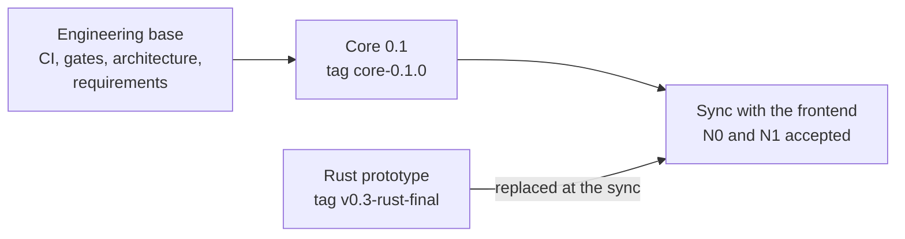
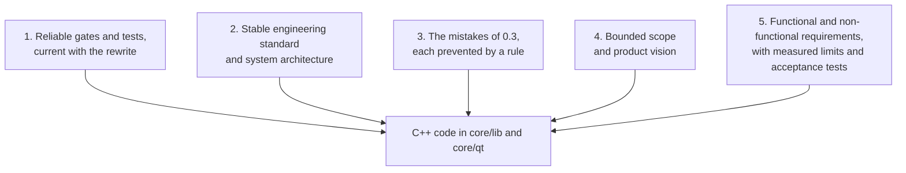
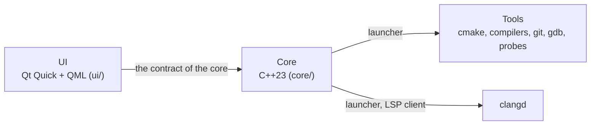

# Kinein Vectis

**Linux-first IDE for embedded, systems and IoT development.**

> **`main` rebuilds the core of the IDE in C++23.** It is an engineering front: the CI, the
> quality gates, the architecture and the requirements come before any feature code, and the core
> has no editor functionality yet. The public release is 0.3.5 (tag `v0.3.5`, on the Releases
> page of this repository), built on the Rust prototype.

## The rewrite

Kinein Vectis is a desktop IDE: a Qt Quick UI and a separate core process that reads the
workspace, runs the tools and keeps the state. The core of the 0.3 series is a Rust prototype. Its review
found defects that come from the design, not from isolated bugs: an untrusted workspace could run
its own code through five paths, the core's loop blocked with no deadline or cancellation, and
opening a 20,000-line file took up to 47 s
([lessons from 0.3](docs/lessons-from-0.3.md)).

The decision is recorded in
[ADR-0012](docs/adr/ADR-0012-cpp23-backend.md):

- The core is rewritten in C++23 under `core/`: a library with no Qt (`core/lib`) and a thin Qt
  adapter (`core/qt`). The Rust prototype is not in this tree: its last state is the tag
  `v0.3-rust-final`.
- The core owns the truth. The QML frontend stays, with no domain logic: it shows what the core
  asserts and sends the person's intent.
- The editor is a ready component, the Qt Quick `TextEdit`. The core owns the text of every
  document; the UI applies each keystroke at once and sends it to the core as a versioned delta.
- The scope is C and C++ until the core is solid; Rust and Python come back later.
- The behavior of the IDE and its acceptance come from mature IDEs: CLion first, with the source
  of IntelliJ IDEA, VS Code CMake Tools, Qt Creator, VS Code and Zed. The prototype is no
  reference.
- The UI connects to the new core when it passes the acceptance of levels N0 and N1, over its own
  contract; until then the UI runs on the prototype of the tag `v0.3-rust-final`. At the connection,
  the code of the UI with a known problem is deleted, not fixed.



The core is version 0.1 of Kinein Vectis. Its tags use their own prefix, `core-X.Y.Z`
([Semantic Versioning](https://semver.org/)), so they never sort among the `v0.2.0` and `v0.3.5`
tags of the prototype.

## Engineering before code

Code without planning is technical debt. The prototype grew one feature at a time, without a
bounded scope, a product vision or the consolidation of what existed before the next feature
started. The core reverses that order: code enters `core/lib` and `core/qt` only after the
maintainer closes five conditions. On 2026-11-23 all five are open; the decisions that block them
are listed in [docs/pending-decisions.md](docs/pending-decisions.md).



| Condition | Owning documents |
| --- | --- |
| 1. Gates and tests | [Gates and effectiveness](docs/engineering/gates-and-effectiveness.md), [test strategy](docs/engineering/test-strategy.md) |
| 2. Engineering standard and architecture | [C++23 rules](docs/engineering/cpp23-rules.md), [modules and layers](docs/architecture/modules-and-layers.md) |
| 3. Lessons from 0.3 | [Lessons from 0.3](docs/lessons-from-0.3.md) |
| 4. Scope and product vision | [Functional requirements](docs/requirements/functional-requirements.md), sections "Scope" and "Levels" |
| 5. Requirements and limits | [Functional](docs/requirements/functional-requirements.md) and [non-functional](docs/requirements/non-functional-requirements.md) requirements |

Quality comes before dates: there is no deadline. Where the scope matches a mature IDE, its
behavior is the reference, with the IDE, its version and how the behavior was observed. Where no
IDE is a reference, the expected behavior is proven by tests, including how each failure is
handled.

## Architecture



- The UI and the core are separate processes, joined by a contract that the maintainer designs
  by ADR.
- Every external process, `clangd` included, starts through the core's launcher, which decides
  what an untrusted workspace may run.
- A keystroke is drawn by the UI at once and reaches the core as a versioned delta; the core owns
  the text, the draft, the file and the LSP session.

The processes and their responsibilities are in
[boundaries and responsibilities](docs/architecture/boundaries-and-responsibilities.md); the full
map of the documentation is in [docs/README.md](docs/README.md).

## Repository layout

| Path | Content | State |
| --- | --- | --- |
| `core/` | The core: CMake project, build profiles, tests and gates | Active, the focus of the project |
| `docs/` | Documentation of the core: requirements, architecture, engineering, ADRs | Active |
| `.github/` | The `Core 0.1` workflow and the issue and pull request templates | Active |
| `ui/` | Qt Quick frontend and its C++ bridge | Kept; a change to its logic needs the maintainer's approval. At the sync, its code with a known problem is deleted |

## Building the core

The reference machine is the one the project is developed and measured on; its versions are the
source of truth. The floor is the oldest version the build accepts.

| Tool | Reference machine | Floor |
| --- | --- | --- |
| Operating system | Fedora 45, x86_64 | Linux |
| GCC | 16.2.1 | 14: configure rejects older versions |
| Clang, clang-tidy, libclang and its Python bindings | 23.1.5 | Clang 20: configure rejects older versions |
| CMake | 4.3.0 | 3.25, declared by the presets (version 6). Not verified: no CI job runs it |
| Ninja | 1.13.2 | None declared |
| Python | 3.15.2 | 3.10, for the gates of the `lint` preset |
| Qt | 6.12.1 | 6.12, only for the `dev-qt` preset |

Every preset is a workflow: configure, build and test. Build trees go to `build/core-<preset>/` at
the repository root.

```sh
cd core
cmake --workflow --preset dev          # GCC, -Werror, production semantics
cmake --workflow --preset asan-ubsan   # AddressSanitizer + UndefinedBehaviorSanitizer
cmake --workflow --preset tsan         # ThreadSanitizer
cmake --workflow --preset lint         # Clang + clang-tidy + gate measurements
KINEIN_QT_PREFIX=$HOME/Qt/6.12.1/gcc_64 cmake --workflow --preset dev-qt
```

| Preset | Purpose |
| --- | --- |
| `dev` | Development with GCC, `-Werror` and the semantics of what ships |
| `asan-ubsan`, `tsan` | Sanitizer builds; a sanitizer error fails the test |
| `debug-stl` | Standard library debug mode (`_GLIBCXX_DEBUG`, `-O0`) |
| `production` | The shipped build: same flags as `dev`, without `-Werror` |
| `lint` | Clang with clang-tidy on every unit, plus the measurement of the gates |
| `cxx26-probe` | Builds with C++26 to detect incompatibilities early |
| `dev-qt` | `dev` plus the Qt adapter, with Qt from `KINEIN_QT_PREFIX` |

Configure downloads GoogleTest 1.17.0 with a pinned SHA-256. Without network access, pass
`-DFETCHCONTENT_SOURCE_DIR_GOOGLETEST=<directory>`. The profiles, flags and sources are in
[build profiles and hardening](docs/engineering/build-profiles-and-hardening.md).

## CI and quality gates

The `Core 0.1` workflow ([`.github/workflows/core.yml`](.github/workflows/core.yml)) is the only
CI of the repository. It runs on every push to `main`, the single branch, and on every pull request
into it, with no path filter, in
11 jobs on `ubuntu-26.04`: the compiler floor (`dev` with GCC 14 and with Clang 20), GCC 15 in
every profile, and Clang 22 with clang-tidy 22 in `lint` and in both sanitizer profiles. Actions are
pinned by commit SHA, and the token is read-only.

The project's own gates run as tests of the `lint` preset. Each one is measured against a versioned
corpus of planted defects and correct forms on every build
([method](docs/engineering/gates-and-effectiveness.md)).

| Test | Rule | Measured on 2026-11-23 |
| --- | --- | --- |
| `gate.launcher` | Processes start only through the launcher | 40 of 40 defects rejected, 16 of 16 correct forms accepted |
| `gate.detach` | No detached thread (C++ Core Guidelines CP.26) | 10 of 10 defects rejected, 10 of 10 correct forms accepted |
| `gate.duplication` | No copied logic, clone types T1 to T3 | 15 of 15 defects rejected, 14 of 14 correct forms accepted |
| `build.contract` | The flags of the profile reach the compiler | Passes in every preset |
| `build.elf_hardening` | The hardening reaches the linked binary | Passes in every preset |

A change is done only when it meets the [definition of done](docs/engineering/definition-of-done.md),
which includes no warning in `dev` and `lint`, a clean clang-tidy, tests green in `dev`,
`asan-ubsan` and `tsan`, and the list of what was not verified. Approved and not yet in place: `actionlint` and `zizmor`, Dependabot for the actions,
a DCO check, a documentation gate, a CMake floor that a job tests (or a higher floor), a job in a Fedora 45 container that
reproduces the reference machine, and a gate on the roles of the files of each module.

## Contributing

How to contribute, the rules of a change and the license of a contribution are in
[CONTRIBUTING.md](CONTRIBUTING.md).

## License

Kinein Vectis is free software under the GNU Affero General Public License, version 3 only
(`AGPL-3.0-only`, [`LICENSE`](LICENSE)). The project's own documentation uses CC BY-SA 4.0
([`LICENSE-CC-BY-SA-4.0.txt`](LICENSE-CC-BY-SA-4.0.txt)), except where a file states otherwise and
for third-party material. The MIT and Apache-2.0 permissions granted earlier remain valid for the
material they cover ([`LICENSE-MIT.txt`](LICENSE-MIT.txt),
[`LICENSE-APACHE-2.0.txt`](LICENSE-APACHE-2.0.txt)). See also [`AUTHORS.md`](AUTHORS.md),
[`NOTICE`](NOTICE) and [`TRADEMARKS.md`](TRADEMARKS.md).

## Community

Feedback and discussion: [Kinein Vectis on Discord](https://discord.gg/cWRkUGUmQU).
