# Documentation of the core

Owner: the map of this tree, the question each file answers, and the rules every file follows.

This tree documents only the core (backend) of Kinein Vectis, in `core/`. The QML UI lives in
`ui/`, and no file here governs it. The 0.3 series is not in the repository (its last state is the
tag `v0.3-rust-final`) and is no reference for behavior, design or engineering: it enters only
through the mistakes of [lessons-from-0.3.md](lessons-from-0.3.md), by ID. The behavior comes from the reference IDEs
([ADR-0012](adr/ADR-0012-cpp23-backend.md)).

State: draft of 2026-11-22; the maintainer reviews it.

## The map

Each file answers one question and is the only owner of the facts of that question. The other
files link to it. The tree is a hierarchy: this index, then one directory per area, then one file
per question, then one `##` section per subject.

```mermaid
flowchart TD
    INDEX["docs/README.md<br/>map and rules"]
    INDEX --> LESSONS["lessons-from-0.3.md"]
    INDEX --> PENDING["pending-decisions.md"]
    INDEX --> GLOSSARY["glossary.md"]
    INDEX --> ADR["adr/"]
    INDEX --> REQ["requirements/"]
    INDEX --> ARCH["architecture/"]
    INDEX --> ENG["engineering/"]
    ADR --> ADR12["ADR-0012 C++23 backend and editing model"]
    REQ --> FR["functional-requirements.md"]
    REQ --> NFR["non-functional-requirements.md"]
    ARCH --> BOUND["boundaries-and-responsibilities.md"]
    ARCH --> MOD["modules-and-layers.md"]
    ARCH --> EXEC["execution-and-concurrency.md"]
    ARCH --> PROC["processes-and-trust.md"]
    ARCH --> PERS["persistence-and-durability.md"]
    ARCH --> PROTO["protocol-and-contract.md"]
    ARCH --> EDIT["editing-engine.md"]
    ARCH --> TEXT["text-encoding-and-positions.md"]
    ENG --> RULES["cpp23-rules.md"]
    ENG --> DEFECTS["known-cpp-defects-and-defenses.md"]
    ENG --> PROFILES["build-profiles-and-hardening.md"]
    ENG --> TIDY["static-analysis-clang-tidy.md"]
    ENG --> TESTS["test-strategy.md"]
    ENG --> GATES["gates-and-effectiveness.md"]
    ENG --> DONE["definition-of-done.md"]
```

| File | Question it answers |
| --- | --- |
| [lessons-from-0.3.md](lessons-from-0.3.md) | What did 0.3 get wrong, and what prevents each mistake from coming back? |
| [pending-decisions.md](pending-decisions.md) | What is still the maintainer's decision, with the recommendation? |
| [glossary.md](glossary.md) | What does each term of the domain mean, and which name does the code give it? |
| [adr/ADR-0012-cpp23-backend.md](adr/ADR-0012-cpp23-backend.md) | Why C++23, who owns the truth, which component edits, which IDEs are the reference, and when the core replaces the Rust core? |
| **Requirements** | |
| [requirements/functional-requirements.md](requirements/functional-requirements.md) | What the core does, in what order, and the acceptance test of each capability |
| [requirements/non-functional-requirements.md](requirements/non-functional-requirements.md) | Within which measured limits: time, memory, security, durability, quality |
| **Architecture** | |
| [architecture/boundaries-and-responsibilities.md](architecture/boundaries-and-responsibilities.md) | Which processes and components exist, who decides what, and who depends on whom |
| [architecture/modules-and-layers.md](architecture/modules-and-layers.md) | Which modules `core/lib` has, in which layer, who uses whom and what enforces it |
| [architecture/execution-and-concurrency.md](architecture/execution-and-concurrency.md) | Where work runs, who owns each piece of data, deadlines and cancellation |
| [architecture/processes-and-trust.md](architecture/processes-and-trust.md) | How a process is born and what an untrusted workspace may do |
| [architecture/persistence-and-durability.md](architecture/persistence-and-durability.md) | Where each file of the IDE lives and how much text a crash can lose |
| [architecture/protocol-and-contract.md](architecture/protocol-and-contract.md) | The contract between the UI and the core, and how it changes |
| [architecture/editing-engine.md](architecture/editing-engine.md) | Which component edits, who owns the text of a document, how an edit travels and how a large file degrades |
| [architecture/text-encoding-and-positions.md](architecture/text-encoding-and-positions.md) | How the bytes of a file become text, how lines end, which unit each component counts a position in, and who converts |
| **Engineering** | |
| [engineering/cpp23-rules.md](engineering/cpp23-rules.md) | The C++ methods of the project, the comment standard and what enforces each one |
| [engineering/known-cpp-defects-and-defenses.md](engineering/known-cpp-defects-and-defenses.md) | The classic defects of the language and the defense against each one |
| [engineering/build-profiles-and-hardening.md](engineering/build-profiles-and-hardening.md) | The build profiles, the flags, their sources and how to run them |
| [engineering/static-analysis-clang-tidy.md](engineering/static-analysis-clang-tidy.md) | What clang-tidy checks, what is disabled and why |
| [engineering/test-strategy.md](engineering/test-strategy.md) | The test layers, the acceptance against the reference IDEs and the performance measurements |
| [engineering/gates-and-effectiveness.md](engineering/gates-and-effectiveness.md) | The order the gates run in, the CI, and how a new gate proves that it works |
| [engineering/definition-of-done.md](engineering/definition-of-done.md) | When a change or a milestone may be called done |

Reading order for a newcomer: this file, `lessons-from-0.3.md`,
`architecture/boundaries-and-responsibilities.md`, `architecture/modules-and-layers.md`,
`engineering/cpp23-rules.md` and `engineering/definition-of-done.md`. The others are read when
their subject comes up.

## Rules of this tree

1. **One fact, one owner.** When a fact already has an owner here, the other files link to its
   section.
2. **A rule a tool enforces lives in the tool.** The document says which tool enforces it and
   why; it does not repeat the list of flags or checks. CMake, `.clang-tidy` and the tests are
   the truth.
3. **Every technical claim says where it came from:** measured (with date and method), read (with
   file and line), primary source (with a link) or **hypothesis**. What nobody checked is marked
   NOT VERIFIED.
4. **A new file only at the maintainer's request.** A new subject first enters as a section of
   the closest owner.
5. **ADRs** live in `adr/`. The numbering continues the ADRs of 0.3 (the last one is ADR-0011, at
   the tag `v0.3.5`), so that no number points to two decisions.
6. **At most 200 lines per file**, and each subject in a `##` section with an explicit name that
   stands on its own. Past that, the file splits by responsibility (rule 4).
7. **The first lines name the owner.** The reader decides from them whether the file is needed,
   and then reads only the section needed.
8. **State, not history.** A file says what holds and where it came from. How it got there
   belongs in the commit message. What leaves the project leaves the documents entirely, with no
   note that it was removed and no justification. The exception is the record of the gate
   measurements, which is the proof of each gate.
9. **0.3 enters only through the lessons.** `lessons-from-0.3.md` cites the origin of each mistake
   by identifier (`INF-26`, `ENG-51`) or by line (`62:1371`), never a whole roadmap.
10. **No god document.** A file answers the one question the map gives it. A subject that needs
    a second question goes to the owner of that question, or to a new file the maintainer
    approves; it never grows the file into a second owner.
11. **English, technical and objective.** Each file is product documentation for a contributor:
    no report addressed to a person, no narration of how the text was produced. The maintainer
    is "the maintainer", never a name or a user name.
12. **Diagrams where there is structure.** Structure, flow, dependency, state and sequence get a
    Mermaid diagram, which GitHub renders with no extra tool; the text explains what the diagram
    cannot.

Rules 6 to 12 are conventions until the documentation gate is in place: it is approved, not yet
written ([the CI](engineering/gates-and-effectiveness.md#the-ci)).

## How to cite 0.3

`62:1371` means `DocsPublic/roadmaps/62-base-publica-0.4.md`, line 1371, at commit `a9f01d51`
(the tag `v0.3.5`). The same form holds for document 19
(`DocsPublic/arquitetura/19-compromissos-de-arquitetura.md`) and for roadmaps 63 to 66. Code files
of 0.3 are cited by their path from the repository root, at the same commit.
