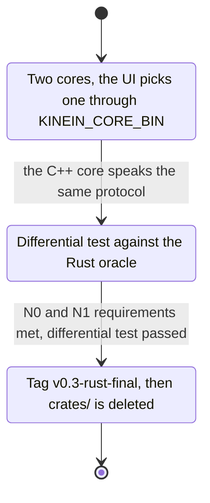

# ADR-0012: the backend in C++23, with Neovim as the editing engine

> **State:** draft of 2026-11-22, under review by the maintainer.
> **Decision by the maintainer:** 2026-11-22 (C++23 backend); 2026-11-15 (Neovim, DP-10 of 64).
> The numbering continues the one of `DocsPublic/decisoes-adr/`.

## Context

Up to 0.3.9, Kinein Vectis was built for its author's own use, and the architecture followed the
features. 0.4 has to serve other people. The review of 2026-11-14 (64) and the evaluation of the
editing engine (65) measured defects that come from the design, not from an isolated spot:

- an untrusted project ran its own code through five paths (INF-23);
- the core's loop blocked, and nothing had a deadline or cancellation (ENG-50);
- processes were created in about 122 places (ENG-51);
- the whole text travelled on every keystroke, and opening 20 thousand lines took up to 47 s
  (ENG-55, INF-25);
- the draft had no maximum write delay (INF-26);
- the text gates detected 36 of 120 defects (66).

The full list, with the evidence, is in the [lessons](../lessons-from-0.3.md).

## Decision

1. **The core is rewritten in C++23**, in `core/`, with a library that has no Qt (`core/lib`) and
   a thin adapter (`core/qt`). The Rust core gets no further evolution.
2. **The editing engine is an embedded Neovim** (`nvim --embed`, msgpack-RPC, `ext_linegrid`),
   under the conditions of 65 §21 ([editing engine](../architecture/neovim-editing-engine.md)).
3. **The QML frontend stays.** The views and the theme are reused; the controllers go through the
   boundary test ([boundaries](../architecture/boundaries-and-responsibilities.md)).
4. **The scope is only C and C++** until the core is solid. Rust and Python come back later.
5. **The migration strangles the old core**, in the same repository:
   - the C++ core speaks the same protocol, and the UI picks the core through `KINEIN_CORE_BIN`;
   - the Rust core is the oracle of the differential test;
   - a working IDE always exists, for dogfooding.
6. **The Rust core is deleted only** when the C++ core meets the non-functional requirements of
   N0 and N1 and passes the differential test, apart from the list of intentional divergences.
   Before the deletion, the tag `v0.3-rust-final` is created.

## Why

**TO BE CONFIRMED BY THE MAINTAINER.** The reasons below come from the plan of 2026-11-22; no
earlier document records them:

- whoever writes the logic of the core wants to master the mechanism, and the algorithms library
  (C/C++ environment, embedded, semantics) is the differentiator of the product;
- the product is an IDE for C and C++, developed in itself: the core's code goes through the same
  clangd, the same CMake and the same sanitizers that the IDE offers to its users;
- the UI is Qt and C++: one language fewer in the product.

## What this decision replaces

- **The conclusion of 64 §1** (64:71-77), which discarded a broad rebuild and chose strategy B:
  replacing four seams inside the Rust core.
- **Phases B1 to B11 of 64 §8**, as a code plan. The solutions they described (a launcher with
  trust, execution classes, deadline and cancellation, a contract with a single source, three
  persistence classes) become requirements of the C++ core.
- **The proposal of 66** (the gates before B1), which awaited a decision: the text gates of 0.3
  do not enter the C++ core.
- **The sentence of 62:2079-2080**, about closing debt "by proven behavior, not by the
  completion of a rewrite". The switch of cores happens only by proven behavior: the criterion of
  item 6 is a measurement, not a completion.

**Items that close with the removal of the Rust core**, with no fix of their own: INF-24, INF-29,
INF-30, INF-31 and ENG-57. **Items that become requirements of the C++ core:** INF-23, ENG-50 to
ENG-56 and INF-22. **UI items** (INF-25 to INF-28) close with the removal of the current editor in
phase E of 65, not with the backend.

## Alternatives considered

| Alternative | Why not |
| --- | --- |
| Strategy B of 64, in Rust | It was the plan decided on 2026-11-14 (DP-01 to DP-09). The decision of 2026-11-22 revises it, for the reasons of the section "Why" (to be confirmed) |
| C++26 | Not published (the DIS ballot of 2026-10-23 failed); GCC 16 marks its support as experimental; the official Clang 23 has no reflection, and clangd would not understand the code. C++26 features enter one at a time, by ADR |
| Rewriting the UI too | The QML UI works and is the IDE of dogfooding; the measured defects are in the core, in the bridge and in the editor |

## Consequences

- During the migration there are two cores, and every new behavior of the C++ core is checked
  against the oracle or against the list of divergences.
- The contract needs a source that does not depend on Rust before Rust leaves
  ([ADR-0013](ADR-0013-single-source-of-the-contract.md), pending the maintainer's approval).
- The defects of 0.3 stay in the product in use until the switch. INF-26 was fixed in the current
  QML on 2026-11-22 (the maintainer's decision); INF-23 remains, and until the C++ launcher exists
  only trusted projects are opened.
- The rule "only the launcher creates processes" loses the compiler enforcement that Rust gave
  (`disallowed_methods = "forbid"`). Its mechanism in C++ is the `bugprone-unsafe-functions`
  option of clang-tidy, measured by `gate.launcher`
  ([gates](../engineering/gates-and-effectiveness.md)).

## What was not verified

- How the UI reacts to `MethodNotFound` on the requests it sends on its own.
- The effort of the rewrite: no estimate was measured.
- Windows and MSVC.
