# ADR-0012: the backend in C++23 and the editing model

> **State:** accepted by the maintainer on 2026-11-25.
> **Decision by the maintainer:** 2026-11-22 (C++23 backend); 2026-11-23 (the core owns the
> truth, the frontend has no domain logic, the editor is a ready component); 2026-11-25 (the
> reference IDEs and the sync with the frontend).
> The numbering continues the ADRs of 0.3 (tag `v0.3.5`).

## Context

Up to 0.3.9, Kinein Vectis was built for its author's own use, and the architecture followed the
features. The next version has to serve other people. The review of 0.3 measured defects that
come from the design, not from an isolated spot:

- an untrusted workspace ran its own code through five paths (L05);
- the core's loop blocked, and nothing had a deadline or cancellation (L08);
- processes were created in about 122 places (L06);
- the whole text travelled on every keystroke, and opening 20 thousand lines took up to 47 s
  (L01, L02);
- the draft had no maximum write delay (L04);
- the text gates detected 36 of 120 defects (L15).

The full list, with the evidence, is in the [lessons](../lessons-from-0.3.md).

## Decision

1. **The core is rewritten in C++23**, in `core/`, with a library that has no Qt (`core/lib`) and
   a thin adapter (`core/qt`). The Rust core gets no further evolution.
2. **The core owns the truth, and the frontend has no domain logic.** The QML frontend stays: it
   shows what the core asserts and sends the person's intent. The logic of the UI that belongs to
   the core leaves the UI and is rebuilt in the core with the design of 0.1; the code of the UI
   with a known problem is deleted, not fixed
   ([boundaries](../architecture/boundaries-and-responsibilities.md)).
3. **The editor is a ready component, the Qt Quick `TextEdit`**, and the core owns the text of
   every document ([editing engine](../architecture/editing-engine.md)):
   - the UI applies a keystroke to its copy at once and sends the delta with its base version;
   - the core is the truth for the disk, the draft, the LSP session and every edit, and its own
     text changes reach the UI as proposals with a base version;
   - a divergence is resolved from the core's text;
   - a file beyond a size limit degrades in a declared way, by the method of the JetBrains IDEs:
     editing without code insight, or not opened, with a notice of the limit and the size;
   - the core is the LSP client of the document, and tree-sitter runs in the core.
4. **The scope is only C and C++** until the core is solid. Rust and Python come back later.
5. **The behavior of the IDE and its acceptance come from the reference IDEs**, each cited with
   its version and its source (the code or the official documentation); a known defect of a
   reference is not copied, and the requirement states the divergence. 0.3 is no reference: it
   enters only through the mistakes of the [lessons](../lessons-from-0.3.md).
   - CLion: the fundamental behavior of an IDE for C and C++;
   - IntelliJ IDEA, whose source is open (`JetBrains/intellij-community`): the technical reading
     of that behavior; JetBrains is the reference for safe behavior;
   - VS Code CMake Tools and Qt Creator, alongside CLion: CMake, toolchains and kits;
   - VS Code and Zed: the rest of the behavior of an editor.
6. **The core replaces the Rust core at the sync with the frontend.** The Rust core and the
   documents of 0.3 are not in the repository: their last state is the tag `v0.3-rust-final`, on
   which the UI runs for dogfooding until the sync (the maintainer's decision of 2026-11-26). The
   sync happens when the core passes the acceptance of the N0 and N1 requirements, functional
   and non-functional; the UI then talks to the core over its own contract (P24 in the
   [pending decisions](../pending-decisions.md)).

```mermaid
stateDiagram-v2
    [*] --> Building
    Building: The UI runs on the prototype of v0.3-rust-final; the core passes its own tests
    Building --> Synced: N0 and N1 accepted against the reference IDEs
    Synced: The UI talks to the core over its own contract (P24)
    Synced --> [*]
```

## Why

**Items 1 and 4.** The reasons come from the plan of 2026-11-22:

- whoever writes the logic of the core wants to master the mechanism, and the algorithms library
  (C/C++ tool setup, embedded, semantics) is the differentiator of the product;
- the product is an IDE for C and C++, developed in itself: the core's code goes through the same
  clangd, the same CMake and the same sanitizers that the IDE offers to its users;
- the UI is Qt and C++: one language fewer in the product.

**Items 2 and 3.** One owner for each fact: a rule written once, in the core, serves the UI, a
command-line client and the tests. `TextEdit` is Qt's own component: input, IME, accessibility
and the clipboard come with it, in the process and the toolkit of the UI, with no process to
contain.

**Items 5 and 6.** A prototype whose review found defects by design is no reference when mature
IDEs exist for the fundamental behavior of an IDE. The engineering of the UI is rebuilt from
scratch: a known problem is deleted, not patched in place.

## Alternatives considered

| Alternative | Why not |
| --- | --- |
| Fixing four seams inside the Rust core | It was the plan decided on 2026-11-14. The decision of 2026-11-22 revises it, for the reasons of the section "Why" |
| C++26 | Not published (the DIS ballot of 2026-10-23 failed); GCC 16 marks its support as experimental; the official Clang 23 has no reflection, and clangd would not understand the code. C++26 features enter one at a time, by ADR |
| Rewriting the views too | The views and the theme work and are the IDE of dogfooding; what is wrong in the UI is the domain logic and the code with a known problem, which leave it (item 2) |
| QScintilla or KTextEditor | `QWidget` components, outside the Qt Quick scene. The Qt Quick port of Scintilla lives in a fork with no commit since 2023-03 |
| KSyntaxHighlighting | Highlighting by regular expressions; tree-sitter gives an incremental syntax tree, which also feeds the analysis of the core |

## Consequences

- Until the sync, the core is proven by its own tests against the reference IDEs; no test
  compares it with the Rust core.
- The contract between the UI and the core is designed from scratch, by its own ADR (P24), and
  the client of the UI bridge is rebuilt on it at the sync.
- The defects of 0.3 stay in the product in use until the sync. L04 was fixed in the QML of
  the prototype on 2026-11-22 (the maintainer's decision); L05 remains, and until the launcher exists
  only trusted projects are opened.
- The rule "only the launcher creates processes" has no compiler mechanism in C++. Its mechanism
  is the `bugprone-unsafe-functions`
  option of clang-tidy, measured by `gate.launcher`
  ([gates](../engineering/gates-and-effectiveness.md)).
- The core carries tree-sitter with the C and C++ grammars (MIT) and an LSP client, whose library
  is P21.
- The UI keeps a copy of each open document; the property test of the
  [editing engine](../architecture/editing-engine.md#acceptance) proves that it stays equal to the
  core's.

## What was not verified

- The effort of the rewrite: no estimate was measured.
- Windows and MSVC.
- `TextEdit` with the files of 20,000 and 40,000 lines, without the IPC of 0.3.
