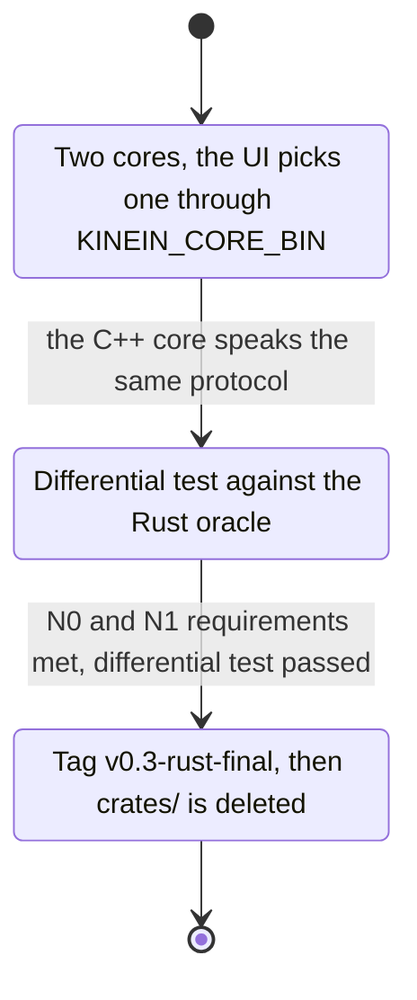

# ADR-0012: the backend in C++23 and the editing model

> **State:** accepted by the maintainer on 2026-11-25.
> **Decision by the maintainer:** 2026-11-22 (C++23 backend); 2026-11-23 (the core owns the
> truth, the frontend has no domain logic, the editor is a ready component).
> The numbering continues the one of `DocsPublic/decisoes-adr/`.

## Context

Up to 0.3.9, Kinein Vectis was built for its author's own use, and the architecture followed the
features. 0.4 has to serve other people. The review of 2026-11-14 (64) and the evaluation of the
editing engine (65) measured defects that come from the design, not from an isolated spot:

- an untrusted project ran its own code through five paths (INF-23);
- the core's loop blocked, and nothing had a deadline or cancellation (ENG-50);
- processes were created in about 122 places (ENG-51);
- the whole text travelled on every keystroke, and opening 20 thousand lines took up to 47 s
  (ENG-55, INF-25);
- the draft had no maximum write delay (INF-26);
- the text gates detected 36 of 120 defects (66).

The full list, with the evidence, is in the [lessons](../lessons-from-0.3.md).

## Decision

1. **The core is rewritten in C++23**, in `core/`, with a library that has no Qt (`core/lib`) and
   a thin adapter (`core/qt`). The Rust core gets no further evolution.
2. **The core owns the truth, and the frontend has no domain logic.** The QML frontend stays: it
   shows what the core asserts and sends the person's intent. The 0.3 logic in the UI that
   belongs to the core leaves the UI and is rebuilt in the core with the design of 0.1, keeping
   the behavior the person sees
   ([boundaries](../architecture/boundaries-and-responsibilities.md)).
3. **The editor is a ready component, the Qt Quick `TextEdit`**, and the core owns the text of
   every document ([editing engine](../architecture/editing-engine.md)):
   - the UI applies a keystroke to its copy at once and sends the delta with its base version;
   - the core is the truth for the disk, the draft, the LSP session and every edit, and its own
     text changes reach the UI as proposals with a base version;
   - a divergence is resolved from the core's text;
   - a file beyond a size limit degrades in a declared way, by the method of the JetBrains IDEs:
     editing without code insight, or not opened, with a notice of the limit and the size;
   - the core is the LSP client of the document, and tree-sitter runs in the core.
4. **The scope is only C and C++** until the core is solid. Rust and Python come back later.
5. **The migration strangles the old core**, in the same repository:
   - the C++ core speaks the same protocol, and the UI picks the core through `KINEIN_CORE_BIN`;
   - editing is the exception: the 0.3 methods `lsp.*`, `syntaxTree.*` and `draft.*` carry the
     whole document (L01), and the editing protocol that replaces them exists only in the C++
     core, by its own ADR (P22);
   - the Rust core is the oracle of the differential test;
   - a working IDE always exists, for dogfooding.
6. **The Rust core is deleted only** when the C++ core meets the non-functional requirements of
   N0 and N1 and passes the differential test, apart from the list of intentional divergences.
   Before the deletion, the tag `v0.3-rust-final` is created.

## Why

**Items 1, 4, 5 and 6: TO BE CONFIRMED BY THE MAINTAINER.** The reasons below come from the plan
of 2026-11-22; no earlier document records them:

- whoever writes the logic of the core wants to master the mechanism, and the algorithms library
  (C/C++ environment, embedded, semantics) is the differentiator of the product;
- the product is an IDE for C and C++, developed in itself: the core's code goes through the same
  clangd, the same CMake and the same sanitizers that the IDE offers to its users;
- the UI is Qt and C++: one language fewer in the product.

**Items 2 and 3.** One owner for each fact: a rule written once, in the core, serves the UI, a
command-line client and the tests. `TextEdit` is Qt's own component: input, IME, accessibility
and the clipboard come with it, in the process and the toolkit of the UI, with no process to
contain.

## What this decision replaces

- **The conclusion of 64 §1** (64:71-77), which discarded a broad rebuild and chose strategy B:
  replacing four seams inside the Rust core.
- **Phases B1 to B11 of 64 §8**, as a code plan. The solutions they described (a launcher with
  trust, execution classes, deadline and cancellation, a contract with a single source, three
  persistence classes) become requirements of the C++ core.
- **The proposal of 66** (the gates before B1), which awaited a decision: the text gates of 0.3
  do not enter the C++ core.
- **The sentence of 62:2079-2080**, about closing debt "by proven behavior, not by the
  completion of a rewrite". The switch of cores happens only by proven behavior: the criterion of
  item 6 is a measurement, not a completion.

**Items that close with the removal of the Rust core**, with no fix of their own: INF-24, INF-29,
INF-30, INF-31 and ENG-57. **Items that become requirements of the C++ core:** INF-23, ENG-50 to
ENG-56 and INF-22. **UI items** (INF-25 to INF-28) close with the rebuilt editor, each with its
test.

## Alternatives considered

| Alternative | Why not |
| --- | --- |
| Strategy B of 64, in Rust | It was the plan decided on 2026-11-14 (DP-01 to DP-09). The decision of 2026-11-22 revises it, for the reasons of the section "Why" (to be confirmed) |
| C++26 | Not published (the DIS ballot of 2026-10-23 failed); GCC 16 marks its support as experimental; the official Clang 23 has no reflection, and clangd would not understand the code. C++26 features enter one at a time, by ADR |
| Rewriting the views too | The views and the theme work and are the IDE of dogfooding; what is wrong in the UI is the domain logic, which leaves it (item 2) |
| QScintilla or KTextEditor | `QWidget` components, outside the Qt Quick scene. The Qt Quick port of Scintilla lives in a fork with no commit since 2023-03 |
| KSyntaxHighlighting | Highlighting by regular expressions; tree-sitter is mandatory (21 §M5.4) and also feeds the analysis of the core |

## Consequences

- During the migration there are two cores, and every new behavior of the C++ core is checked
  against the oracle or against the list of divergences.
- The contract needs a source that does not depend on Rust before Rust leaves
  ([ADR-0013](ADR-0013-single-source-of-the-contract.md), pending the maintainer's approval).
- The defects of 0.3 stay in the product in use until the switch. INF-26 was fixed in the current
  QML on 2026-11-22 (the maintainer's decision); INF-23 remains, and until the C++ launcher exists
  only trusted projects are opened.
- The rule "only the launcher creates processes" loses the compiler enforcement that Rust gave
  (`disallowed_methods = "forbid"`). Its mechanism in C++ is the `bugprone-unsafe-functions`
  option of clang-tidy, measured by `gate.launcher`
  ([gates](../engineering/gates-and-effectiveness.md)).
- The core carries tree-sitter with the C and C++ grammars (MIT) and an LSP client, whose library
  is P21.
- The UI keeps a copy of each open document; the property test of the
  [editing engine](../architecture/editing-engine.md#acceptance) proves that it stays equal to the
  core's.

## What was not verified

- How the UI reacts to `MethodNotFound` on the requests it sends on its own.
- The effort of the rewrite: no estimate was measured.
- Windows and MSVC.
- `TextEdit` with the files of 20,000 and 40,000 lines, without the IPC of 0.3.
