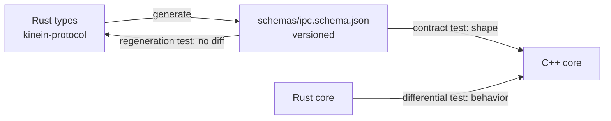

# ADR-0013: the single source of the contract between the UI and the cores

> **State:** draft of 2026-11-22, awaiting the maintainer's approval. Nothing this ADR describes
> is implemented: `schemas/ipc.schema.json` does not change before the approval.
> **Decision by the maintainer:** 2026-11-22 (P02: generate it from `kinein-protocol`).

## Context

- **The truth of the contract today is the Rust types of `kinein-protocol`**, at version 0.223.0
  (`crates/kinein-protocol/src/lib.rs:121`). `schemas/ipc.schema.json` stopped at 0.62.0 and
  describes only the envelope (`schemas/ipc.schema.json:4`; ENG-54, L12).
- **During the strangling there are two cores** talking to the same UI (ADR-0012). Without a
  source both follow, the C++ core would copy the contract by hand, and the copy would diverge as
  the schema diverged.
- **64 §5.7** (64:556-577) planned to generate the schema from the Rust types with `schemars` and
  to check the generated file against the versioned one. `kinein-protocol` does not use `schemars`
  (read on 2026-11-22: no occurrence in the crate).

## Decision

1. **The types of `kinein-protocol` generate `schemas/ipc.schema.json`.** Each method declares
   its name, the type of its parameters and the type of its result once; the schema comes from
   them.
2. **The generated schema is versioned.** A test on the Rust side generates it again and fails if
   the result differs from the versioned file. The schema never stalls again.
3. **Both cores are checked against the schema.** The contract test of the C++ core validates each
   request and each response of the implemented methods against the schema (RNF-CON-01). The
   differential test (ADR-0012) checks the behavior; the schema checks the shape.
4. **When the Rust core leaves**, the versioned schema becomes the source and is maintained by
   hand, always through an ADR. The generation leaves with Rust.
5. **The protocol version** stays a single one, the one of `kinein-protocol` while it exists.

## Alternatives considered

| Alternative | Why not |
| --- | --- |
| Writing a new schema by hand, only for the N0 subset | A manual copy of a contract that still changes in Rust; it repeats the cause of ENG-54 |
| Deciding at the first milestone, with the differential test as the only reference | The differential test compares behavior, not shape; an optional field both omit goes unnoticed |
| Generating a C++ header from the Rust types | 64 §5.7 planned it for the UI bridge. For the new core, the design of the protocol types belongs to the maintainer (`protocol`, [modules](../architecture/modules-and-layers.md)); generation may enter later, through its own ADR |

## Consequences

- **First step:** `schemars` becomes a dependency of `kinein-protocol`. It is new code in
  `crates/`, with nothing deleted or moved. This conflicts with the rule of 2026-11-23 that
  `crates/` gets no changes; the maintainer resolves the conflict when deciding on this ADR.
- **The generated schema replaces the current one entirely.** Every consumer of schema 0.62.0
  must be checked first. NOT VERIFIED: who reads the schema today besides the gates.
- **The C++ core needs a JSON Schema validator in its tests**, which is a dependency to approve
  (together with P16).

## What was not verified

- Whether `schemars` represents every type of `kinein-protocol` without manual annotation (enums
  with data, fields renamed by `serde`).
- The size and the generation time of the schema of about 250 methods.
