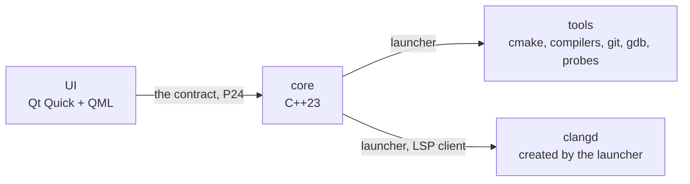
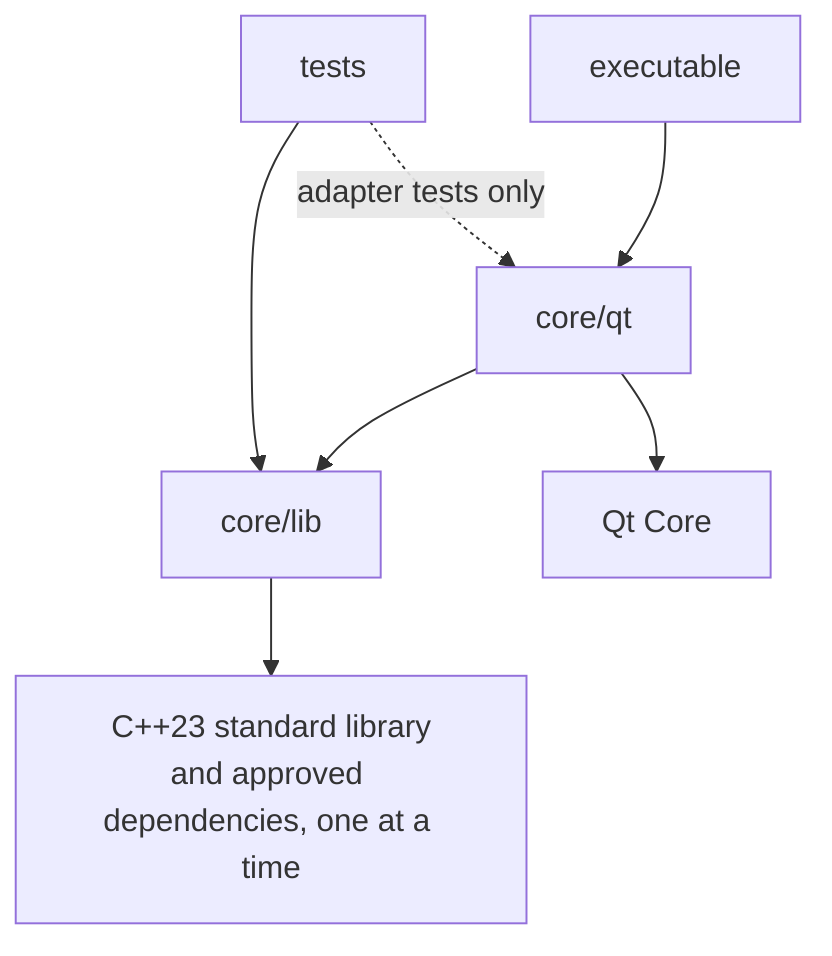

# Boundaries and responsibilities

Owner: the processes, the components, what each one decides and the direction of the
dependencies. The internal design of each component belongs to its own owner (execution,
processes, persistence, protocol, editing engine).

## Processes

- **The UI and the core** are separate processes, joined by the contract of
  [protocol and contract](protocol-and-contract.md).
- **The editor** is the Qt Quick `TextEdit`, in the UI process. The core owns the text of every
  document: the UI applies a keystroke to its copy and sends it to the core as a versioned delta,
  so the core stays off the path from the key to the frame ([editing engine](editing-engine.md)).
- **Every external tool** is born through the launcher
  ([processes and trust](processes-and-trust.md)).

## What each component decides

| Component | Decides | Never decides |
| --- | --- | --- |
| QML | presentation and intent | facts, rules, effective paths, trust |
| UI bridge (C++) | transport, correlation, the UI-side deadline, the life of a response | domain rules |
| `core/qt` (adapter) | event loop, transport of the wire, translation between the wire and the library | domain rules |
| `core/lib`, domain | domain rules and state, algorithms | how a process is born, where an own file lives |
| `core/lib`, launcher | origin, trust, environment, deadline, output cap, process group | domain rules |
| `core/lib`, persistence | path, class and schema of each own file, durability | domain content |
| Editor (`TextEdit`) | cursor, selection, scroll; it applies the person's keystrokes to its copy | the version, the text of record, the file, highlighting, diagnostics |

**The frontend has no domain logic.** It shows what the core asserts and sends the person's
intent. The logic of the UI that belongs to the core leaves the UI and is rebuilt in the core with
the design of 0.1; the code of the UI with a known problem is deleted, not fixed. The behavior the
person sees comes from the reference IDEs ([ADR-0012](../adr/ADR-0012-cpp23-backend.md)).

**The test for each function** of a QML controller and of the bridge: *if a command-line client
would need the same logic, it belongs to the core.* The inventory of the 89 `*Controller.qml`
under this test is Phase B, pending ([decisions](../pending-decisions.md), P11).

## Direction of the dependencies

| Rule | Enforced by |
| --- | --- |
| `core/lib` neither includes nor links Qt | The `dev` preset does not even look for Qt: an `#include <QObject>` in `core/lib` does not compile (`core/CMakeLists.txt`) |
| moc never sees the code of `core/lib` | AUTOMOC is enabled only on the targets of `core/qt`; there is no global `CMAKE_AUTOMOC` |
| `core/lib` is testable without an event loop | The tests of `core/lib` do not link `core/qt` |
| Nothing in `core/` depends on `crates/` or `ui/` | The CMake project of `core/` does not reference those directories |

The modules inside `core/lib`, the layers and the gate that rejects cycles are in
[modules-and-layers.md](modules-and-layers.md). The CMake graph does not reject cycles on its
own: it accepts a cycle between `STATIC` libraries (measured on 2026-11-22).

## The sync with the frontend

Until the C++ core passes the acceptance of N0 and N1, the UI runs on the Rust core in `crates/`,
which gets no change. The criterion and what leaves at the sync are in
[ADR-0012](../adr/ADR-0012-cpp23-backend.md).
