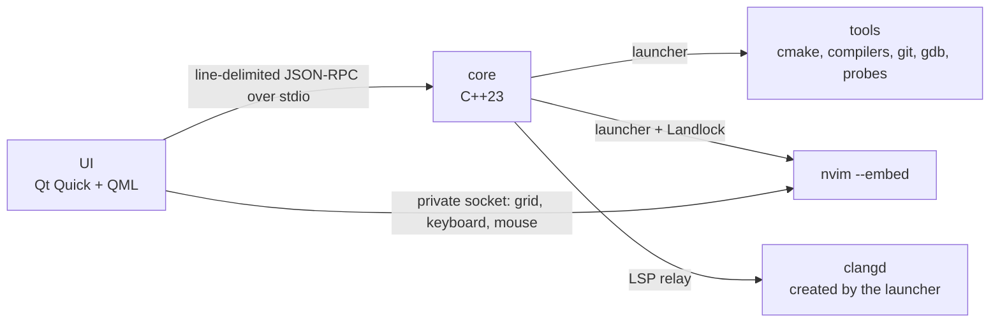
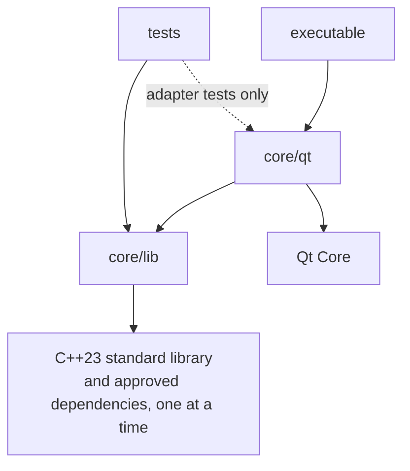

# Boundaries and responsibilities

Owner: the processes, the components, what each one decides and the direction of the
dependencies. The internal design of each component belongs to its own owner (execution,
processes, persistence, protocol, editing engine).

## Processes

- **The UI and the core** are separate processes, as in 0.3 (A01 of the
  [lessons](../lessons-from-0.3.md)). The UI picks the core binary through `KINEIN_CORE_BIN`
  (`ui/src/core_client_process.cpp:240`): that is how the C++ core takes the place of the Rust
  core without a change to the UI.
- **`nvim`** is born through the core's launcher and dies when the core closes its channel
  (65 §6.1). A keystroke goes from the UI straight to `nvim`; the core stays off the typing path.
- **Every external tool** is born through the launcher
  ([processes and trust](processes-and-trust.md)).

## What each component decides

A rule inherited from 64 §5.2 (64:384-393), adapted to the C++ core.

| Component | Decides | Never decides |
| --- | --- | --- |
| QML | presentation and intent | facts, rules, effective paths, trust |
| UI bridge (C++) | transport, correlation, the UI-side deadline, the life of a response | domain rules |
| `core/qt` (adapter) | event loop, transport of the wire, translation between the wire and the library | domain rules |
| `core/lib`, domain | domain rules and state, algorithms | how a process is born, where an own file lives |
| `core/lib`, launcher | origin, trust, environment, deadline, output cap, process group | domain rules |
| `core/lib`, persistence | path, class and schema of each own file, durability | domain content |
| Neovim | text, `changedtick`, cursor, the document's LSP protocol | processes, trust, server configuration |

**The test for each function** of a QML controller and of the bridge: *if a command-line client
would need the same logic, it belongs to the core.* The inventory of the 89 `*Controller.qml`
under this test is Phase B, pending ([decisions](../pending-decisions.md), P11).

## Direction of the dependencies

| Rule | Enforced by |
| --- | --- |
| `core/lib` neither includes nor links Qt | The `dev` preset does not even look for Qt: an `#include <QObject>` in `core/lib` does not compile (`core/CMakeLists.txt`) |
| moc never sees the code of `core/lib` | AUTOMOC is enabled only on the targets of `core/qt`; there is no global `CMAKE_AUTOMOC` |
| `core/lib` is testable without an event loop | The tests of `core/lib` do not link `core/qt` |
| Nothing in `core/` depends on `crates/` or `ui/` | The CMake project of `core/` does not reference those directories |

The modules inside `core/lib`, the layers and the gate that rejects cycles are in
[modules-and-layers.md](modules-and-layers.md). The CMake graph does not reject cycles on its
own: it accepts a cycle between `STATIC` libraries (measured on 2026-11-22).

## Strangling

The Rust core stays in `crates/` as the product in use and as the oracle of the differential test
until the C++ core passes the switch criteria of ADR-0012. Nothing in `crates/` is deleted or
moved before that.
