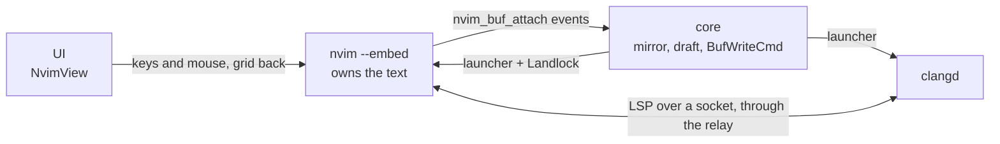

# Editing engine: Neovim

Owner: the division of responsibilities between Neovim, the core and the UI, the conditions of
the switch of editors and the requirements inherited from the proof. The full evaluation is in
65; this file keeps only what the C++ core must meet.

## Who owns what

From 65 §5 (65:185-200).

| Responsibility | Owner | The others |
| --- | --- | --- |
| Text and version of the document | Neovim (`changedtick`) | The core and the UI receive versioned events and never edit on their own |
| A text change made by Kinein | A Lua function that checks the expected `changedtick` and refuses a stale one | none |
| Writing the file | The core, through `BufWriteCmd`, with a guarded write | Neovim notifies |
| Recovery after a crash | The core, from the draft of the mirror, with no swap file | none |
| The LSP server process | The core, through the launcher | Neovim connects through a socket and creates no process |
| The document's LSP protocol | Neovim | The core does not synchronize the same document; the relay sends no `didOpen` |
| Server configuration | The core (kit, preset, trust) | Neovim receives it ready |
| Server diagnostics | The server publishes; Neovim shows | The core reads them through the relay for the problems panel |

## Decisions of the maintainer of 2026-11-15 (65:890-903)

1. No modal editing by default; Vim modes are the person's option.
2. The core writes the file, through `BufWriteCmd`.
3. Recovery comes from the draft of the mirror, with no swap file.
4. Without Landlock, an untrusted project opens without the new editor.
5. `nvim` ships pinned inside the AppImage.
6. and 7. Multiple cursors and the fix checker (a specialized algorithm of the core that queries
   the LSP server through the relay, 65:285-288) stay open: the proof measured neither.

## Conditions to remove the current editor (65:870-883)

The current editor stays next to the new one until the integrated product passes all four: R1 and
R12 by the method of the proof, R10 with the whole document, real IME with fcitx5 or ibus, and the
Windows tests with the Job Object. If one fails, the decision goes back to the maintainer with the
measurement.

## What exists

The branch `origin/prova/eng-60` (`8e35e471`) holds the proof of the 15 items (65 §20). The UI
side is C++: msgpack, the RPC client and `NvimView` (65:709). The supervisor, which plays the role
of the core, is Rust (Landlock, relay, mirror, about 1,700 lines). What is missing is the
supervisor inside the C++ core, in the integrated product.

**The order.** `nvim` is born through the launcher with Landlock, so the integration comes after
the launcher and the deadlines (65:885-888). The isolated proof does not depend on the language of
the backend; the integration depends on the launcher.

## Requirements of the integration (65:777-805)

Eight defects the proof found and fixed, each with a mandatory test in the integration:

1. After each compound action, the modeless layer returns to insertion.
2. Typing or pasting over the selection does not change the clipboard.
3. With an active snippet, `Tab` jumps to the next field.
4. The workaround of `selection=exclusive` with `vim.snippet`.
5. The launcher waits for the previous LSP session to end before accepting the next one.
6. The socket lives on a short path, and a path above 108 bytes fails with a message.
7. Input handles text by code point, not by UTF-16 unit.
8. The accessibility factory is installed before the QML engine, and R10 is read through AT-SPI.

The limit of Landlock (65:814-821): it blocks `execve`, not the loading of a library. The hostile
test covers the passive vectors (`runtimepath`, `package.path`, `package.cpath`, modeline and
`exrc`).
