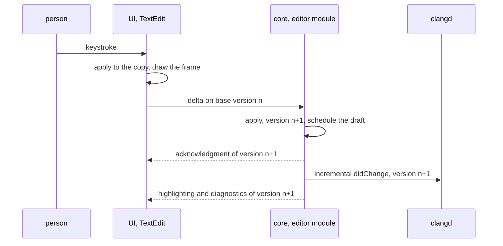
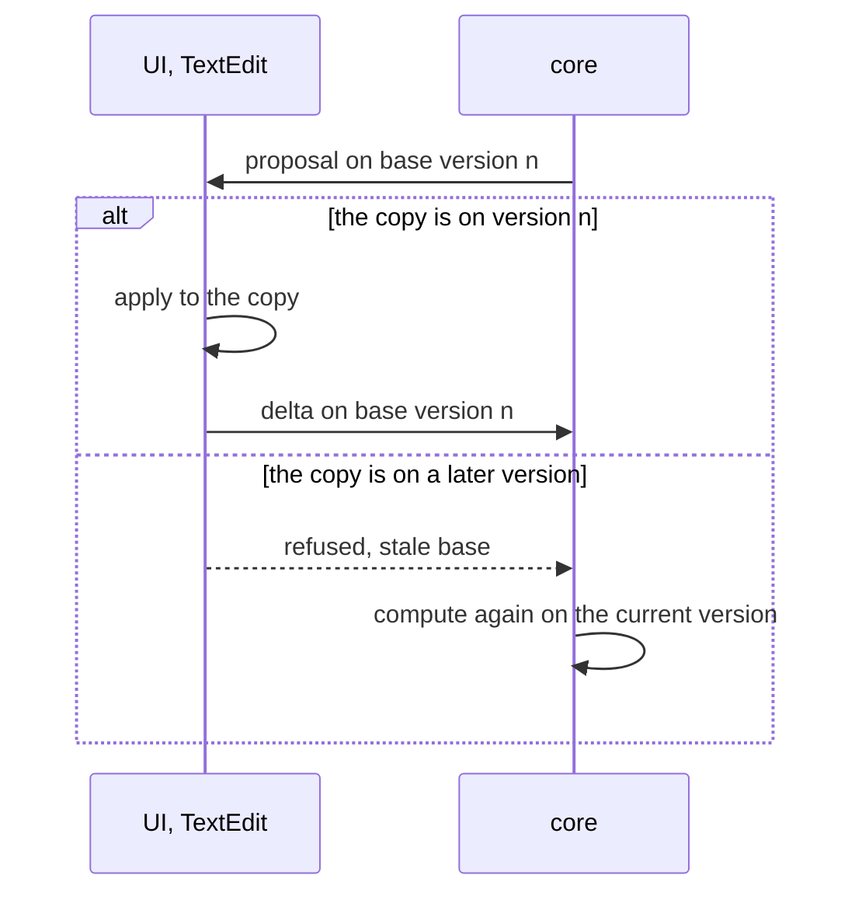

# Editing engine

Owner: the editing component, who owns the text of a document, how an edit travels between the
UI and the core, what the component does not bring and how the editor is accepted.

## The component

The Qt Quick `TextEdit`, with its `QQuickTextDocument`, inside a `Flickable`
([ADR-0012](../adr/ADR-0012-cpp23-backend.md)). It is Qt's own component: keyboard and mouse
input, selection, the clipboard, undo, input methods and accessibility come with it. A solid ready
component is used wherever one exists; what no component brings is built, with the reason written
in this file.

| Need | Comes from |
| --- | --- |
| Input, selection, clipboard, undo, IME, accessibility | `TextEdit` |
| Highlighting | tree-sitter in the core; the UI applies the ranges the core sends through a `QSyntaxHighlighter` on the `QQuickTextDocument` |
| Completion, diagnostics, navigation, rename, code actions | clangd, through the LSP client of the core (P21) |
| Line numbers, diagnostic marks, folding, multiple cursors, split view | Not in `TextEdit`. Each one enters only with a requirement, as QML over the component, fed by the core |

Inside a `Flickable`, `TextEdit` creates scene graph nodes only for the blocks in the viewport
([Text editing improvements in Qt Quick](https://www.qt.io/blog/text-editing-improvements-in-qt-quick)).
The layout, however, covers the whole document: that is the risk the first measurement checks.

## Who owns what

| Responsibility | Owner | The others |
| --- | --- | --- |
| Text and version of the document | The core | The UI holds the copy it shows and never decides a version |
| A keystroke | The UI applies it to its copy at once and sends the delta with its base version | The core applies the deltas in order; a typed delta is never refused |
| A text change of the core (format, rename, fix) | The core proposes it with its base version | The UI applies it only on that base, and the change reaches the core as an ordinary delta; on another base it refuses, and the core computes again |
| A divergence between the copy and the document | The core: its text and version replace the copy | none |
| Writing the file | The core, with the guarded write of [persistence](persistence-and-durability.md) | The UI sends the intent |
| Draft and recovery | The core, from its document, with a maximum delay (RNF-DUR-01) | none |
| Highlighting, diagnostics, completion | The core, for a named version | The UI discards a result for an older version |
| The LSP session and the document sync | The core: one client per document, incremental `didChange` from the deltas | none |
| Cursor, selection, scroll | The UI (presentation) | The core receives the position when a request needs it |

The core's document changes only through the stream of deltas, so it has a single writer.

## An edit

## A text change of the core

- No message after the opening carries the whole document (RNF-EDI-01). The exception is the
  resynchronization after a divergence, which is recorded as a defect.
- The shape of a delta, the detection of a divergence and the replay of the deltas the draft does
  not have after a crash of the core belong to the editing protocol, by ADR (P22).

## Acceptance

1. **The component alone**, before the integration: `TextEdit` with no IPC, offscreen at
   1280x800, with the files of 85, 2,463, 19,970 and 40,000 lines, by the method of 65 §20.3 (key
   to frame, opening to the first frame, CPU while typing, RSS).
2. **The reference** is the proof column of the table of 65 §20.3:

   | Lines | Key to frame, p95 (ms) | Opening (ms) | RSS (MiB) |
   | --- | --- | --- | --- |
   | 85 | 8.71 | 29.4 | 73.9 |
   | 2,463 | 9.00 | 30.4 | 75.0 |
   | 19,970 | 9.94 | 32.0 | 83.4 |

   The limits against it are RNF-ED-01 (P23). The 40,000-line file has no reference; it answers
   to RNF-PERF-01. A missed limit goes back to the maintainer with the measurement.
3. **The integrated product**, by the same method.
4. **IME** with fcitx5 or ibus: the preedit at the cursor and the right committed text.
5. **Accessibility** through AT-SPI: the whole document, the cursor and the selection.
6. **A property test:** after random deltas and proposals, the copy of the UI and the document of
   the core are equal, and a proposal on a stale base is refused.
7. **Crash:** RNF-DUR-01, with `kill -9` on the UI and on the core.

## NOT VERIFIED

- `TextEdit` with 19,970 and 40,000 lines without the IPC of 0.3: never measured. The 0.3 opening
  of 47 s (INF-25) has no isolated cause.
- A report on Qt 6.6 measured 5 s to redraw 21,000 lines, growing linearly
  ([Qt Forum](https://forum.qt.io/post/819626)). It was not reproduced with Qt 6.12.
- Folding and multiple cursors on `QQuickTextDocument`.
