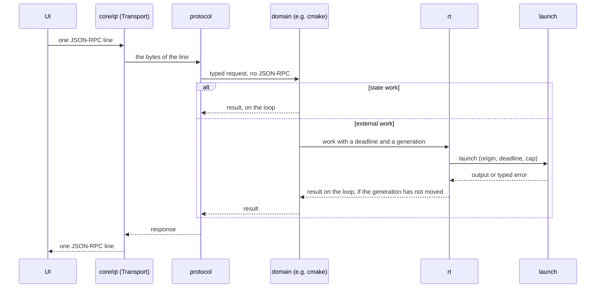

# Execution and concurrency

Owner: where the core's work runs, who owns each piece of data, deadlines, cancellation, the
discarding of stale results and the path of a request between the modules. It is also the
register of the threads.

The **design** of the execution model belongs to the maintainer. This page holds the invariants
the design must meet and, after the approval, the design itself.

## Invariants

| # | Invariant | Origin | Enforced by |
| --- | --- | --- | --- |
| E1 | The core's loop never blocks: processes, the workspace's disk, the network and waiting on a server run outside it | L08; RNF-EXE-01 | An I/O guard on the loop that fails in the tests and in the debug build |
| E2 | Every external call has a deadline and cancellation | L08, L09; RNF-EXE-02 | The type of a work request requires a deadline; test with a hung tool |
| E3 | Each piece of data has a single owner; threads exchange messages and share no mutable state | The C++ rules of the plan | TSan in the `tsan` profile; review of the design |
| E4 | Cancellable work uses `std::jthread` with `std::stop_token` | The C++ rules of the plan | Review; a bare `std::thread` stays out (no known automatic check) |
| E5 | An exception crosses neither a thread nor the Qt event loop | The C++ rules of the plan | `bugprone-exception-escape` in clang-tidy; a thread body and an adapter slot are `noexcept` |
| E6 | The result of a stale generation (of the workspace, or the version of a document) is never applied | L10 (INF-22); 64:416-421 | Ordering test with forced interleaving |
| E7 | A cancellation answers `RequestCancelled`; an expired deadline answers `DeadlineExceeded`; neither becomes "stale" | L19 (INF-30); 64:433-434 | Deadline test |
| E8 | Cancelling a piece of work kills its process group, first with SIGTERM and then with SIGKILL | A05; 64:435-436 | Launcher test: no process is left |
| E9 | Different resources run in parallel; the same resource (repository, build directory, document) runs in series | 64:425-427 | Test with two pieces of work on the same resource |
| E10 | Nothing in the tests synchronizes on a fixed time | R-TEST-03 of 63; L16 | Fake tool with a lock the test controls |

64 §5.3 proposed three route classes (state on the loop, work outside it, visible job) and a
three-phase helper: prepare on the loop, work outside it, apply on the loop if the generation has
not moved (64:395-451). It is a 0.3 reference, not a decision for the C++ core.

## Threads and owners

No thread exists yet. Each thread enters this table in the same commit that creates it.

| Thread | Owns | Receives | Sends | Stops how |
| --- | --- | --- | --- | --- |
| none | | | | |

## The path of a request

The modules are those of [modules and layers](modules-and-layers.md).

What happens inside `R` and `P` (threads, queues, framing) is the maintainer's design; the diagram
shows only who talks to whom.
