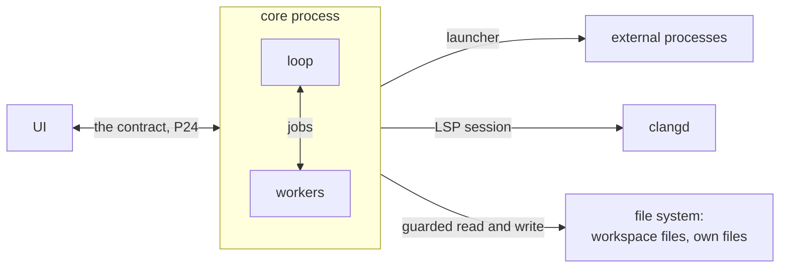

# Failures by boundary

Owner: how each boundary of the core fails, how the core detects each failure, the cause it names,
its answer, what the person sees and the test of each failure. The states and the transitions
belong to the machine of each owner; a failure an owner already answers is listed here with a link
to it.

## The boundaries

## Rules of every failure

- **A named cause.** A failure answers with the cause that names it, the `E` of
  `std::expected` ([C++23 rules](../engineering/cpp23-rules.md)). The names below are the
  vocabulary; the type of each one is fixed with the code of the module that owns it.
- **Typed text survives every failure:** none of them discards the draft of RNF-DUR-01.
- **Never in part.** An input that fails its check at the boundary is not applied, not even in
  part.
- **Each failure states what the person sees, and has its own test**, with a fake of the peer or
  a fixture that injects the failure.

## UI and core

Answered by an owner: the crash and the hang of the core ([the core
process](protocol-and-contract.md#the-core-process)); a request past its deadline or cancelled
(E7 of [execution](execution-and-concurrency.md#invariants)).

| Failure and detection | Cause | Answer | The person sees | Test |
| --- | --- | --- | --- | --- |
| **The UI ends** (a crash, a `kill`): the channel reaches its end | — | The core writes the pending drafts and exits; it never runs without its UI | The drafts, at the next start (RNF-DUR-01) | `kill -9` on the UI: the core exits and every accepted delta is in a draft; a mutant that keeps the core running fails it |
| **A malformed message, or a protocol version the peer does not implement:** the check against the single source of the contract | `MalformedMessage` | Not applied, not even in part; the reaction of the session is decided by the ADR of the contract (P24) | Decided with P24 | A fuzz target of the contract |

- **Source:** the extension host of VS Code 1.148.0 ends when its parent process ends; it checks
  `process.kill(parentPid, 0)` every 1000 ms (`extensionHostProcess.ts`). The core reacts to the
  end of the channel instead, which needs no polling.

## External processes

Answered by an owner ([the life of an external
process](processes-and-trust.md#the-life-of-an-external-process)): a workspace without trust
(`WorkspaceUntrusted`); an exec that fails, with the system error (L18); a deadline or a
cancellation (`DeadlineExceeded`, `RequestCancelled`), with SIGTERM and then SIGKILL to the process
group (E8). A non-zero exit or a signal is the result of the tool, not a failure of the boundary:
the job reports the exit status. The output cap and malformed output follow the maintainer's
decision of 2026-11-26: the answer past the cap depends on whether the core parses the output or
the person reads it.

| Failure and detection | Cause | Answer | The person sees | Test |
| --- | --- | --- | --- | --- |
| **Output past the cap, of a tool whose output the core parses** (`cmake -E capabilities`, a `--version`) | `OutputCapExceeded` | As at a deadline: SIGTERM and then SIGKILL to the process group; nothing of the output is applied | The tool, the cap and the cause, through the job | A fake tool that writes past the cap ends with `OutputCapExceeded`; a mutant with no cap fails it |
| **Output past the cap, of a process the person reads** (a build, a program, a test run) | None: the process goes on, and only its deadline or a cancellation stops it | The last bytes up to the cap are kept and the oldest lines dropped, as the console of IntelliJ IDEA does (`idea.cycle.buffer.size`, 1024 KiB, in `bin/idea.properties`) | The output, with a notice that its start was dropped | A fake tool that writes twice the cap and exits by itself; the kept output is its end |
| **Malformed output** (a reply of the CMake File API, the diagnostics of a compiler): the parser of the tool | `MalformedOutput` | Not applied, not even in part; the job ends, and the previous result of the tool stays, marked out of date | The previous result, with the mark and the cause | A fuzz target for each parser; a malformed reply after a good one keeps the good one, marked out of date |

## The LSP session

Answered by an owner ([the LSP session](processes-and-trust.md#the-lsp-session)): the crash of
clangd, with no restart on its own; a request past its deadline or cancelled (E7).

| Failure and detection | Cause | Answer | The person sees | Test |
| --- | --- | --- | --- | --- |
| **A malformed message from clangd:** the decoder of the client | `MalformedMessage` | Not applied, not even in part; the reaction of the session comes with the library of the client (P21) | Decided with P21 | A fuzz target of the decoder |

## The file system

Answered by an owner:

- a change on the disk and a deletion
  ([the life of a document](editing-engine.md#the-life-of-a-document));
- an own file that is a link or is not regular, refused; a workspace file that is a link, saved
  to its target; a newer schema, preserved
  ([writing rules](persistence-and-durability.md#writing-rules));
- invalid UTF-8, a NUL, mixed line endings
  ([file content](text-encoding-and-positions.md#file-content));
- a file past the opening limit (RNF-ED-02).

| Failure and detection | Cause | Answer | The person sees | Test |
| --- | --- | --- | --- | --- |
| **Writing a file fails:** no space, no permission, a read-only file system, an I/O error | `DiskFull`, `PermissionDenied`, `ReadOnlyFileSystem`, `IoError` | The guarded write leaves the old file whole and removes its temporary file; the document goes from Saving to Modified, with its text and its draft | Each file with its cause. Revert (reload from the disk) is offered and is never the default action; the person's next save retries | A fake file system that fails with each cause; mutants that drop the text or make revert the default fail it |
| **Writing a draft fails** | The cause from the system, as above | The core retries at each accepted delta | A notice that stays while the draft fails: the typed text is not protected, with the cause. It clears at the first write that succeeds | RNF-DUR-04 |
| **Watching the files fails:** the watch or the instance limit of inotify, or the watcher stops | `WatchUnavailable` | The check before each write still guards the file. The core also checks the open documents at every gain of focus of the window, an intent of the UI, so a change the watcher missed is found there | A notice with the cause | A fake watcher that fails; a change on the disk found at the next gain of focus |
| **Another core has the workspace open:** the lock of its state directory is held | `WorkspaceInUse` | The core holds `flock` on a file of the state directory of the workspace while it is open, through a close-on-exec descriptor, and refuses a second opening | That the workspace is open in another instance; taking the person to it belongs to the UI, at the sync | RNF-DUR-05 |
| **An own file cannot be read:** a draft or the person's state, truncated or corrupt | `CorruptOwnFile` | It is moved aside in its directory, never deleted, and the core continues with the defaults. A corrupt draft never replaces a file: the file opens from the disk. A corrupt cache is created again, since it is derived | A notice with the file and where it was moved | Fixtures of a truncated and of a corrupt file; mutants that delete it or apply the draft fail it |

- **Writing a file**, as IntelliJ IDEA 2026.3 (branch `263`,
  `FileDocumentManagerImpl.handleErrorsOnSave`): a dialog lists each file with its error, its
  revert action reloads from the disk, and the dialog has no default action. VS Code 1.148.0
  offers "Overwrite as Sudo" and, for a read-only file, "Overwrite", which makes it writable
  (`textFileSaveErrorHandler.ts`); IntelliJ IDEA offers neither, and the core does not either.
- **Writing a draft:** VS Code 1.148.0 only writes a failed backup to its log
  (`workingCopyBackupTracker.ts`, `logService.error`), so the protection disappears in silence; that
  defect is not copied. IntelliJ IDEA has no drafts. With no reference, RNF-DUR-04 proves it.
- **Watching:** IntelliJ IDEA reports the limits of inotify (`inotify.watch.limit` and
  `inotify.instance.limit`, `IdeCoreBundle.properties`), and VS Code reports "Unable to watch for
  file changes" (`enospcError`, `workspaceWatcher.ts`). The check at the gain of focus is
  `autoSyncFiles` of IntelliJ IDEA, on by default (`GeneralSettings`).
- **One core per workspace:** IntelliJ IDEA runs one instance per pair of configuration and cache
  directories, and a second launch hands its arguments to the running one (`DirectoryLock`). A
  `flock` lock belongs to the open file description, so the kernel releases it when the last
  descriptor closes, a crash included, and a child that inherited the descriptor would keep it
  ([flock(2)](https://man7.org/linux/man-pages/man2/flock.2.html)): hence close-on-exec.
- **The workspace settings** in `.kinein/` are not moved: the rule "warn and preserve" of
  [persistence](persistence-and-durability.md#writing-rules) holds, and nothing is written in a
  workspace without trust.

## Inside the core

Answered by an owner: a stale result (E6) and an exception that would cross a thread or the loop
(E5), both in [execution](execution-and-concurrency.md#invariants).

| Failure and detection | Cause | Answer | The person sees | Test |
| --- | --- | --- | --- | --- |
| **An unexpected exception, or memory exhausted:** the `noexcept` entry point that catches it (E5) | — | It writes the cause to the log and ends the process; [the core process](protocol-and-contract.md#the-core-process) starts it again, and the drafts bring the text back (RNF-DUR-01) | The notice of a restart | A fault injected in a job ends the core with its cause in the log; a mutant that catches it and continues fails the test |

- **Why the process ends:** the default of Linux is heuristic overcommit, where only a seriously
  wild allocation fails (mode 0 of
  [Overcommit Accounting](https://docs.kernel.org/mm/overcommit-accounting.html)); the others
  may succeed and later meet the OOM killer, whose SIGKILL the core survives anyway (the `kill -9`
  test of RNF-DUR-01). After a broken invariant the state of the core is
  unknown, and going on could write a corrupt state to the disk.

## NOT VERIFIED

- No failure is implemented or tested yet.
- `flock` on a state directory on NFS.
- IntelliJ IDEA and VS Code were read in their source on 2026-11-26, not observed running.
- CLion 2026.3 with a tool past the cap and with a malformed reply of the CMake File API: the
  answers above are checked against it in a test with CLion running.
