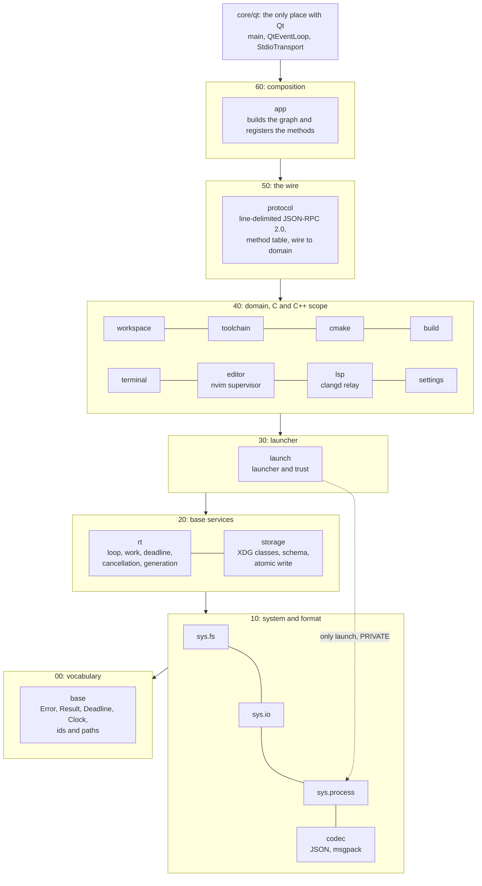
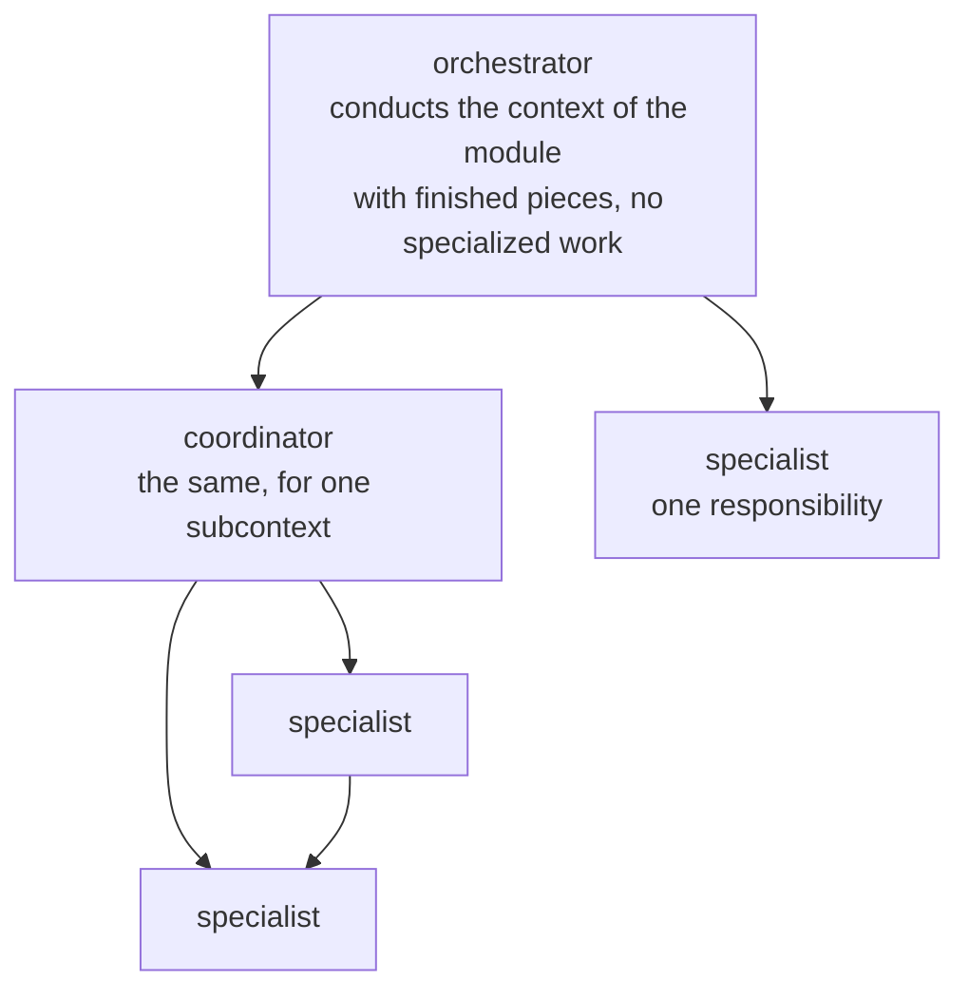

# Modules and layers of the core

Owner: which modules `core/lib` has, what each one does, who may use whom, how the files inside a
module are ranked, and the mechanism that enforces it. The processes and who decides what are in
[boundaries-and-responsibilities.md](boundaries-and-responsibilities.md).

State: **proposal of 2026-11-22, awaiting the maintainer's approval (P15)**. No module exists yet.
The internal design of `rt` (execution) and of `protocol` belongs to the maintainer; this page
fixes only their boundary. The file roles were approved by the maintainer on 2026-11-23.

## The problem, before the solution

0.3 measured the same cause in several places: nothing prevented a module from using another,
and the dependency was whatever compiled.

- **Processes created in about 122 places** (ENG-51).
- **Infrastructure in the domain:** the `Content-Length` framing and `EventSender` lived in `lsp`
  and served 9 modules; `rpc.rs` held error functions of 6 domains (ENG-12).
- **A `Core` with 32 fields**, and `impl Core` spread over 73 files (ENG-14, ENG-15).
- **Routing by chain:** one `match` and 40 `or_else`, in a file 35 of the last 300 commits edited
  (ENG-10).

Convention held none of these. The C++ core puts the direction of the dependencies in the build,
where a mistake fails the configure step.

## The mechanism

1. **A module is a CMake target** (a `STATIC` library) with its own directory of public headers.
   A file can only `#include` the header of a target its module links. That is why "who uses
   whom" is exactly the link graph.
2. **The CMake graph alone is not enough.** CMake accepts a cycle between `STATIC` libraries.
   Measured on 2026-11-22 with CMake 4.3: A links B, B links A, and both configure and build
   pass. That is why each module declares a **rank** (an integer). Configure rejects a dependency
   on an equal or higher rank: with every edge going down, a cycle is impossible, and so is going
   up a layer.
3. **Restricted module.** `sys.process`, which creates processes, may be linked only by `launch`,
   and only as `PRIVATE`, so that it does not leak further through the graph.
4. **Inside a module**, clang-tidy prevents calling a system function outside its place. The
   first list, process creation, is active
   ([gates](../engineering/gates-and-effectiveness.md#measurement-record)).

Items 1 and 2 are a single function, `kinein_add_module(NAME RANK DEPENDS VISIBLE_TO)`, written
after the approval, with mutants (cycle, going up, same layer, restricted module linked by
another, restricted module linked as `PUBLIC`) that must fail.

## The layers

The rank is one number per module. The blocks of ten are only for reading: the rule is "depends
only on a lower rank".



The lines without arrows inside a block only group; the arrows are the allowed direction. A
module may skip layers downward (the domain uses `base` directly), never go up.

## The modules

| Module | Rank | Responsibility | Uses | Origin |
| --- | --- | --- | --- | --- |
| `base` | 00 | Vocabulary with no I/O: `Error` with the named cause, `Result<T>` (`std::expected`), `Deadline`, the `Clock` port, strong ids (`RequestId`, `Generation`, `JobId`), `CanonicalPath` | standard library | L19, E7, E10 |
| `sys.fs` | 10 | RAII descriptors, reading, atomic writing (temporary file, `fsync`, rename, `fsync` of the directory), never following links | `base` | RNF-DUR-02, R-DADOS-02 |
| `sys.io` | 11 | Pipe, PTY, local socket, waiting on a descriptor | `base` | none |
| `sys.process` | 12 | `posix_spawn`, `pidfd`, process group, Landlock. **The only place with the process-creation functions** | `base`, `sys.io` | L05, L18 |
| `codec` | 13 | JSON and msgpack, with the library to be decided (P16) | `base` | none |
| `rt` | 20 | Loop (port), work classes, deadline, cancellation, generation. **Designed by the maintainer** | `base` | E1 to E10, RNF-EXE-01 and 02 |
| `storage` | 21 | The three XDG classes, the catalog of own files, the schema version, the migration of `.kinein` | `base`, `sys.fs`, `codec` | L04, L13, RNF-DADOS-05 |
| `launch` | 30 | Launcher and trust: origin, environment, deadline, output cap, cancellation, record; the trust store through `storage` | `base`, `rt`, `storage`, `sys.io`, `sys.process` (only `launch`) | L05, L06, L08, RNF-SEG-01 and 02 |
| `workspace` | 40 | Open and close, workspace generation, tree, `fs.*` confined to the root | `base`, `rt`, `storage`, `sys.fs` | RF-WS, RF-FS |
| `settings` | 41 | Settings of the person and of the project | `storage`, `codec` | RF-SET-01 |
| `toolchain` | 42 | Detection of compilers and tools: detected, selected, effective | `launch`, `storage` | A06, RF-TC-01 |
| `terminal` | 43 | Terminal on a PTY through the launcher | `launch`, `sys.io` | RF-TERM-01 |
| `cmake` | 44 | Presets, File API, configure | `launch`, `toolchain`, `workspace`, `codec` | RF-CMK |
| `build` | 45 | Build, run and the problems panel | `cmake`, `launch` | RF-BLD-01 |
| `editor` | 46 | `nvim` supervisor: msgpack-RPC, buffer mirror, `BufWriteCmd`, draft with a maximum delay | `launch`, `codec`, `storage`, `workspace`, `rt` | RF-ED, RNF-DUR-01, RNF-SEG-03 |
| `lsp` | 47 | clangd relay: process through the launcher, socket to `nvim`, diagnostics to the panel | `launch`, `codec`, `toolchain`, `cmake` | RF-LSP-01 |
| `protocol` | 50 | Line-delimited JSON-RPC 2.0, method table, translation between the wire and the domain, wire errors. **Designed by the maintainer** | `codec`, `base`, the domain modules | L12, RNF-CON-01 |
| `app` | 60 | Composition root: creates the modules, injects the ports, registers the methods | all | ENG-14, ENG-15 |

The N1 modules (git, debugging, project creation, environment setup, formatting) enter later,
under the same rules. E1 to E10 are the invariants of [execution](execution-and-concurrency.md).

**"The domain does not know the wire"** means: no domain module sees the JSON-RPC messages, the
method names or the wire errors, because `protocol` sits above it. JSON as a file format (the
CMake File API, `compile_commands.json`) reaches the domain through `codec`.

## Ports and adapters

`core/lib` declares the interfaces it needs (ports); the implementations live outside. That is how
`core/lib` runs in tests without Qt and with deterministic time (E10): the fake clock moves only
when the test says so, and a deadline test does not use `sleep`.

| Port (in `core/lib`, no Qt) | Product adapter (`core/qt`) | Test double (`core/tests`) |
| --- | --- | --- |
| `rt`: the loop | `QtEventLoop` (`QSocketNotifier` and `QTimer`) | `ManualLoop` |
| `base`: `Clock` | `SteadyClock` | `FakeClock` |
| `protocol`: `Transport` | `StdioTransport` (stdin and stdout) | `MemoryTransport` |

**The form of the port is the maintainer's choice.** Recommendation: a virtual interface. It
costs one indirection per I/O event, which is negligible there. A template removes the cost, but
every user of the port becomes a template and the build time grows.

Qt in the core only provides the loop and the I/O notification, both portable to Windows. A loop
of its own in `sys.io` (epoll, IOCP) can replace `core/qt` without touching the domain.

## Inside a module: file roles

A module divides further, file by file, into three roles. The rule is the one between modules:
a file uses only files below it, so the dependencies go down and there is no cycle. This is the
*uses hierarchy* (Parnas, "Designing Software for Ease of Extension and Contraction", IEEE TSE
SE-5(2), 1979) and *levelization* (Lakos, *Large-Scale C++ Software Design*, 1996, chapters 4
"Physical Hierarchy" and 5 "Levelization"), applied to the files of one module.



- **A file never calls the file that commands it**; results go up as return values.
- **A coordinator is born when the direct command of the orchestrator grows, never before**, as a
  port is born at the second occurrence. The number of direct subordinates that calls for one is
  measured once there is code; no number is fixed before that.
- **An orchestrator that commands every specialist of its context alone is a god file:** the
  bloated controller of GRASP (Larman, *Applying UML and Patterns*, 3rd edition, 2004, chapter 17,
  "Controller"; NOT VERIFIED against the book text, only against the publisher's contents).
- **No line cap**, per file or per function: a specialist is as long as its responsibility. Per
  function, only clang-tidy: cognitive complexity up to 25 (the clang-tidy 23 default, measured
  on 2026-11-23) and nesting up to 4; approved, not yet enabled.
- **A large file is organized.** Above 200 lines of code, the header has a `Layout:` field (each
  section, what it does, whom it talks to), the body a divider per section, and the owning
  document its Mermaid diagram. An orchestrator or coordinator names in its header the files it
  commands, and the owning document has their diagram.
- **Before a file is written**, its role and the file that commands it are decided.

## The directories

```text
core/lib/<module>/include/kinein/<module>/   the public API: the only thing others include
core/lib/<module>/src/                        the implementation
core/tests/unit/<module>/                     the module's unit tests
```

The target is `kinein_<module>`, with the alias `kinein::<module>`, and the namespace is
`kinein::<module>`; for `sys.process`, `core/lib/sys/process/` and `kinein::sys::process`.

## What enforces each rule

| Rule | Mechanism | State |
| --- | --- | --- |
| A module includes only what it links | One header directory per module, no common directory | By construction, once the first module exists |
| Dependencies only on a lower rank: no cycle, no going up | `kinein_add_module` checks at configure | Gate written after the approval, with measured effectiveness |
| `sys.process` only for `launch`, as `PRIVATE` | `VISIBLE_TO` of the same `kinein_add_module` | Same |
| Process-creation functions only in `sys.process` | clang-tidy, `bugprone-unsafe-functions.CustomFunctions` | **Active**: 40 of 40 defects and 16 of 16 correct forms |
| No Qt in `core/lib` | The `dev` preset does not look for Qt | Active |
| The domain does not know the wire | `protocol` above the domain: the domain cannot include `kinein/protocol/` | By construction |
| Threads only inside `rt` | No mechanism: clang-tidy does not match constructors (measured). Review and TSan | Review |
| File roles: header fields against the real includes, downward direction, `Layout:` and diagram | Role gate in the CI, with a corpus and measured effectiveness | Approved; written after the translation of the documentation |
| One responsibility per file | No tool decides it, like T4 (P20) | Review |

## Against over-engineering

Eighteen modules look like many for a core that does not exist yet. Each one is in the table
because a lesson of 0.3 asked for that boundary, but **a module is born only with its first
code**. No empty target enters the build. If two modules always change together, that is a sign
they are one, and they merge. The same holds for files: a coordinator or a port without a second
user is not created.
