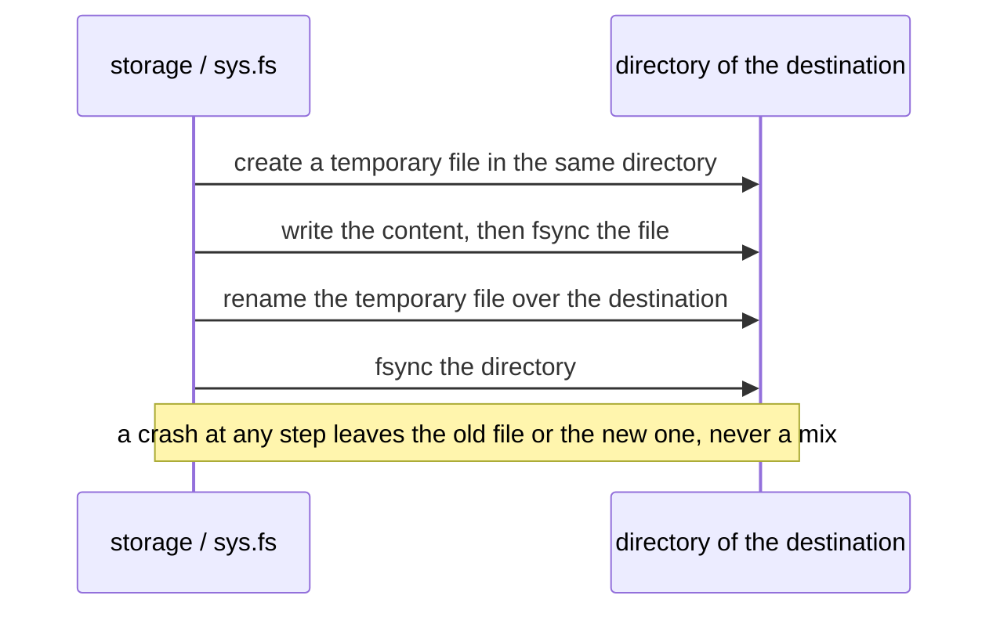

# Persistence and durability

Owner: where each file the IDE owns lives, how it is written and how much text a crash can lose.
It closes lessons L04 and L13 ([lessons](../lessons-from-0.3.md)).

## Three classes, plus the build tree

From 64 §5.9 (64:603-672), decision DP-08 of the maintainer (64:943). The directory names are
English in the C++ core; 64 wrote `projetos/`, a name no code uses.

| Class | Where | What |
| --- | --- | --- |
| Workspace settings, shareable | `<root>/.kinein/` | what a colleague should receive through git |
| The person's state in the workspace | `$XDG_STATE_HOME/kinein-vectis/workspaces/<id>/` | session, drafts, local choices |
| Workspace cache | `$XDG_CACHE_HOME/kinein-vectis/workspaces/<id>/` | derived and re-creatable |
| Build tree | `<root>/.kinein/build/` | build output, with its own `.gitignore` |

- `<id>` derives from the canonical path of the root, and the state follows a workspace renamed on
  the same volume through the identity of the directory (64:620-635).
- Opening a folder without trust writes nothing in it.
- Each own file has an owner, a class and a schema version in a single catalog.

## Writing rules

| Rule | Origin |
| --- | --- |
| Atomic write: temporary file in the same directory, `fsync`, rename, `fsync` of the directory | RNF-DUR-02 |
| Write with the expected content: if the disk changed since the read, the write is refused with the conflict | `fs.write` of 0.3 (65:83-84) |
| Never follow a link, never open what is not a regular file | R-DADOS-02 of 63 |
| Never overwrite a file that is not understood (a newer schema version): warn and preserve | R-DADOS-03 of 63 |
| Migration of the 0.3 `.kinein`: copy, read back, and only then remove | 64:660-672 |

## Durability of typed text

- **The 0.3 problem:** a debounce with no maximum delay in a QML `Timer`. Whoever types without a
  1.5 s pause has nothing written, and the loss has no ceiling (INF-26).
- **The rule:** the durability policy belongs to the core. Every delta the core accepts
  schedules the write of the draft with a **maximum delay**; a pause in the typing may bring the
  write forward, never push it past the delay.
- **The limit:** RNF-DUR-01, 2 s, the maintainer's decision of 2026-11-22
  ([non-functional requirements](../requirements/non-functional-requirements.md)).
- **The path:** the draft comes from the core's document, which owns the text
  ([editing engine](editing-engine.md)). The file is written by the core, with the guarded
  write above.
- **Acceptance:** `kill -9` on the UI and on the core after long typing with no pause, with
  the loss measured, and a mutant with no maximum delay that must fail.
