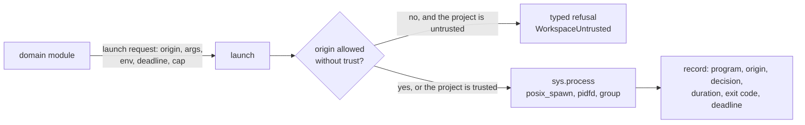

# Processes and trust

Owner: how an external process is born and what an untrusted project may do. It closes lessons
L05, L06 and L18 ([lessons](../lessons-from-0.3.md)).

## The launcher

The launcher is the only path that creates a process in the core: `fork`, `exec*`,
`posix_spawn*`, `system`, `popen`, PTY and `QProcess`. Its design belongs to the maintainer. The
launch request carries, by type, what 0.3 left to each call site (64:460-470):

| Field | Why |
| --- | --- |
| Origin of the program: from the IDE (detected), from the project, or a tool configured by the project | Trust is decided by the origin (L05) |
| Arguments, directory and environment (allow list) | An entire inherited environment leaks secrets and configuration |
| Deadline, mandatory | L08 |
| Output cap, mandatory | Unbounded output fills the memory |
| Cancellation | E2 and E8 of [execution](execution-and-concurrency.md) |

The rules:

- **An argument that names a program** (`--query-driver` of clangd, for example) goes through the
  same origin rule. It was vector E5 of INF-23 (64:122).
- **git is a tool configured by the project:** `.git/config` defines `fsmonitor`, filters and
  hooks (64:476-477).
- **The compiler pinned in the kit** belongs to the project while its path comes from a file of
  the project tree (64:480-482).
- **An `exec` failure** returns as a typed error, with the system error, with no abort or core
  dump (L18).
- **Every launch** records the program, the origin, the decision, the duration, the exit code and
  whether the deadline expired (RNF-SEG-02).
- **The tests** also go through the launcher, with the fake tools API.

**What enforces "only the launcher creates processes".** In Rust it was the compiler
(`disallowed_methods = "forbid"`, 64:248-265). C++ has no direct equivalent. Since 2026-11-22 it
is `bugprone-unsafe-functions.CustomFunctions` in `core/.clang-tidy`, which flags every
process-creation function (POSIX, glibc, `QProcess` and Windows) anywhere in the core. It matches
a direct call, a qualified call, a call through `std::`, a pointer, a macro, a `using` and a class
method; it does not match a constructor. Effectiveness: 40 of 40 defects and 16 of 16 correct
forms, through the `gate.launcher` test
([gates](../engineering/gates-and-effectiveness.md#measurement-record)). Once `sys.process`
exists, its directory gets its own `.clang-tidy` that allows only it, and `VISIBLE_TO` lets only
`launch` link it ([modules](modules-and-layers.md)).

## The restricted mode

From 64 §5.5 (64:508-528), restricted to C and C++, with Neovim (65 §21).

| Capability | Without trust | With trust |
| --- | --- | --- |
| Read, navigate, edit, search | yes | yes |
| The new editor (`nvim`) | starts with Landlock; without Landlock, the project opens without the new editor | starts with Landlock |
| clangd | starts with `--query-driver` only for a compiler the IDE detected | starts with the whole kit |
| Git | off, with a notice | yes |
| CMake configure, build, run, test, debug, flash | asks for trust on the gesture | yes |
| `--version` of a project tool | no | yes |

- **Nothing runs before trust**, including the CMake configure step and the `--query-driver` of
  clangd.
- **The rule lives in the core**, in the launcher. QML shows the state and asks for the gesture.
  In 0.3, QML held back the automatic configure (64:306-309); in the C++ core, the core refuses.
- **Trust** stays in the person's global state, by the canonical root of the project, with the
  trusted folders of DP-02 (64:525-528).
- **Acceptance:** the hostile project of 64 §2.1 plus the Neovim vectors, with zero marks
  (RNF-SEG-01) and a mutant that removes the guard and must fail.
