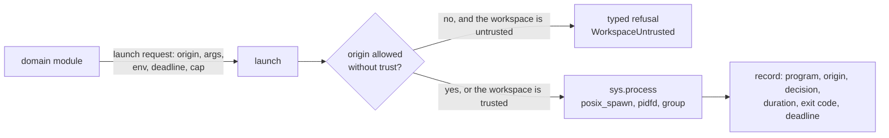
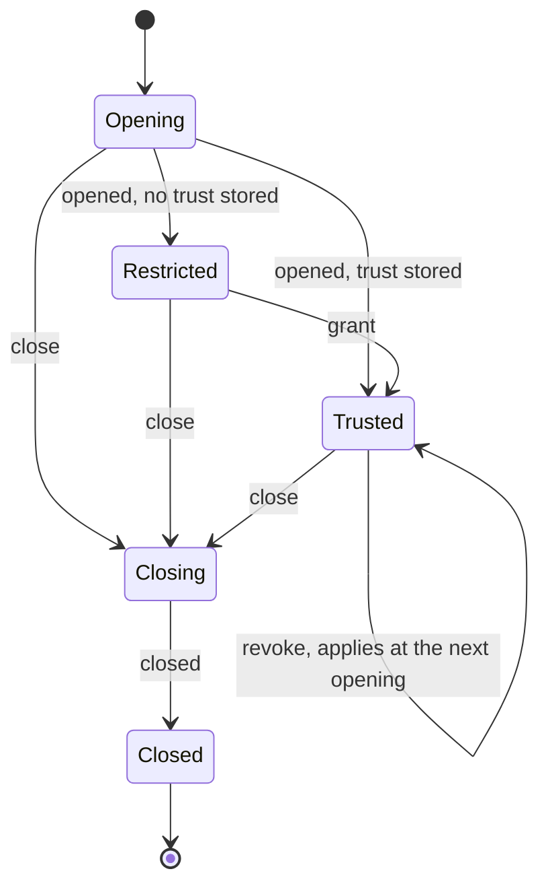
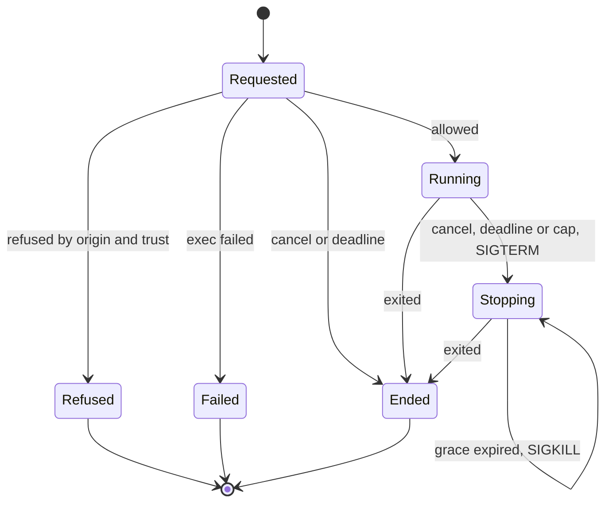
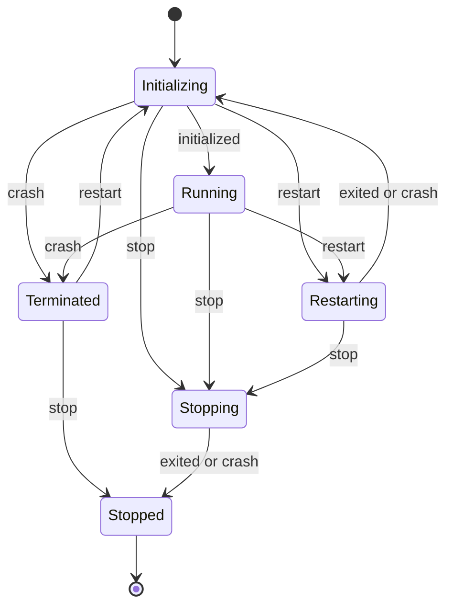

# Processes and trust

Owner: how an external process is born and what an untrusted workspace may do. It closes lessons
L05, L06 and L18 ([lessons](../lessons-from-0.3.md)).

## The launcher

The launcher is the only path that creates a process in the core: `fork`, `exec*`,
`posix_spawn*`, `system`, `popen`, PTY and `QProcess`. Its design belongs to the maintainer. The
launch request carries, by type, what 0.3 left to each call site (L06):

| Field | Why |
| --- | --- |
| Origin of the program: from the IDE (detected), from the workspace, or a tool configured by the workspace | Trust is decided by the origin (L05) |
| Arguments, directory and environment (allow list) | An entire inherited environment leaks secrets and configuration |
| Deadline, mandatory | L08 |
| Output cap, mandatory, and whether the core parses the output or the person reads it | Unbounded output fills the memory; past the cap, the first is stopped and the second keeps its end ([failures](failures-by-boundary.md#external-processes)) |
| Cancellation | E2 and E8 of [execution](execution-and-concurrency.md) |

The rules:

- **An argument that names a program** (`--query-driver` of clangd, for example) goes through the
  same origin rule. It was one of the paths of L05.
- **git is a tool configured by the workspace:** `.git/config` defines `fsmonitor`, filters and
  hooks (`core.fsmonitor` and `core.hooksPath` of `git-config`).
- **A compiler that a file of the workspace names** (a CMake preset or a toolchain file) belongs
  to the workspace.
- **The program is an absolute path** (CWE-426). Detection resolves each program and skips an
  empty or relative entry of `PATH` and a directory inside the workspace; the launcher calls
  `posix_spawn`, never `posix_spawnp`. An empty entry means the current directory
  ([environ(7)](https://man7.org/linux/man-pages/man7/environ.7.html)), here the workspace.
- **An operand from the workspace is never an option** (CWE-88): a path goes absolute; a branch
  or a revision goes after `--end-of-options` ([gitcli](https://git-scm.com/docs/gitcli)); a tool
  with no such marker never receives one.
- **An `exec` failure** returns as a typed error, with the system error, with no abort or core
  dump (L18).
- **Every launch** records the program, the origin, the decision, the duration, the exit code and
  whether the deadline expired (RNF-SEG-02).
- **The tests** also go through the launcher, with the fake tools API.

**What enforces "only the launcher creates processes".** C++ has no compiler mechanism for it.
Since 2026-11-22 it is `bugprone-unsafe-functions.CustomFunctions` in `core/.clang-tidy`, which flags every
process-creation function (POSIX, glibc, `QProcess` and Windows) anywhere in the core. It matches
a direct call, a qualified call, a call through `std::`, a pointer, a macro, a `using` and a class
method; it does not match a constructor. Effectiveness: 40 of 40 defects and 16 of 16 correct
forms, through the `gate.launcher` test
([gates](../engineering/gates-and-effectiveness.md#measurement-record)). Once `sys.process`
exists, its directory gets its own `.clang-tidy` that allows only it, and `VISIBLE_TO` lets only
`launch` link it ([modules](modules-and-layers.md)).

## The restricted mode

As the restricted mode of VS Code and the safe mode of CLion 2026.3 ([project security](https://www.jetbrains.com/help/clion/project-security.html)): browsing and editing work, and nothing the workspace defines runs.

| Capability | Without trust | With trust |
| --- | --- | --- |
| Read, navigate, edit, search | yes | yes |
| clangd | starts with `--query-driver` only for a compiler the IDE detected | starts with the compilers of the active CMake profile |
| Git | off, with a notice | yes |
| CMake configure, build, run, test, debug, flash | asks for trust on the gesture | yes |
| `--version` of a tool of the workspace | no | yes |
| Terminal | asks for trust on the gesture | yes |

- **Nothing runs before trust**, including the CMake configure step and the `--query-driver` of
  clangd.
- **The terminal** asks for trust, as in VS Code: a shell can run code of the workspace when it
  starts ([Workspace Trust](https://code.visualstudio.com/docs/editing/workspaces/workspace-trust)).
  Its environment is the person's, not the allow list.
- **The rule lives in the core**, in the launcher. QML shows the state and asks for the gesture.
  The core refuses, not the UI (L14).
- **Trust** stays in the person's global state, by the canonical root of the workspace, with the
  trusted folders (the trusted locations of CLion 2026.3).
- **Acceptance:** the hostile project, a fixture with a mark on every path of L05, with zero marks
  (RNF-SEG-01) and a mutant that removes the guard and must fail.

## The workspace and its trust

One core process holds one workspace, and the core runs this machine. Trust goes only from
restricted to trusted while the workspace is open, as in IntelliJ IDEA 2026.3
(`TrustedProjectsListener`: "the vice versa is not possible"). A cell with "—" keeps the state and records the event.

| State | opened | grant | revoke | close | closed |
| --- | --- | --- | --- | --- | --- |
| Opening | Trusted when the person's state trusts the root or a trusted folder holds it; otherwise Restricted | — | — | Closing | — |
| Restricted | — | Trusted | — | Closing | — |
| Trusted | — | — | Trusted; the removal is stored for the next opening | Closing | — |
| Closing | — | — | The removal is stored for the next opening | — | Closed |
| Closed | — | — | — | — | — |

- **grant** restarts the LSP session and makes the gestures of the table above available.
- **close** saves every document with unsaved edits, cancels the jobs of the workspace and stops
  the LSP session; **closed** comes when all of them have ended, and the core process shuts down.
- **What the person sees:** the trust state at every change and, after a revoke, that it applies
  at the next opening.
- **Acceptance:** a table test drives every cell; a mutant that lets revoke leave Trusted, or
  grant skip the restart of the session, fails it.

## The life of an external process

The launcher runs this machine for every process it creates. The stop follows the Stop of CLion
2026.3, SIGTERM and then SIGKILL ([Run tool window](https://www.jetbrains.com/help/clion/run-tool-window.html)); the launcher sends both to the process
group, the second after a grace time that is a parameter (E8). A cell with "—" keeps the state and records the event.

| State | allowed | refused | exec failed | exited | cancel | deadline | cap | grace expired |
| --- | --- | --- | --- | --- | --- | --- | --- | --- |
| Requested | Running | Refused, `WorkspaceUntrusted` | Failed, with the system error (L18) | — | Ended, `RequestCancelled` | Ended, `DeadlineExceeded` | — | — |
| Running | — | — | — | Ended, with the exit status | Stopping, `RequestCancelled` | Stopping, `DeadlineExceeded` | Stopping, `OutputCapExceeded` | — |
| Stopping | — | — | — | Ended, with the cause of the stop | — | — | — | Stopping, SIGKILL to the group |
| Refused, Failed, Ended | — | — | — | — | — | — | — | — |

- **cap** is only for output the core parses; output the person reads keeps its end instead.
- **The record** of every launch is written at its final state (RNF-SEG-02).
- **What the person sees:** the cause of the end, through the job that asked for the process.
- **Acceptance:** a table test with the fake tools drives every cell; a fake tool that ignores
  SIGTERM ends by SIGKILL after the grace time; a mutant that skips the group or the SIGKILL
  fails it.

## The LSP session

The core runs one LSP session per workspace root (RF-LSP-01). The states follow the LSP client of
IntelliJ IDEA 2026.3 (`LspServerState`): it does not restart a session that ended unexpectedly
(`LspClientManagerImpl.handleServerStop`), and the person restarts it by hand
(`RestartLspServerAction`). A crash is an end of clangd that no shutdown asked for. A cell with "—" keeps the state and records the event.

| State | initialized | crash | restart | stop | exited |
| --- | --- | --- | --- | --- | --- |
| Initializing | Running | Terminated | Restarting | Stopping | — |
| Running | — | Terminated | Restarting | Stopping | — |
| Restarting | — | Initializing | — | Stopping | Initializing |
| Terminated | — | — | Initializing | Stopped | — |
| Stopping | — | Stopped | — | — | Stopped |
| Stopped | — | — | — | — | — |

- **restart** comes from the person, from a trust grant or from a change of the active CMake
  profile: clangd 23.1.5 reads `--query-driver` and the compilation database only at its start
  (`clangd --help`; `ClangdLSPServer.cpp:552`).
- **Restarting and Stopping** send `shutdown` and `exit` (LSP 3.17); a clangd that does not end is
  stopped by its own machine, above. **Initializing** opens every open document again at its
  current version.
- **What the person sees:** the state of the session of each root and, at Terminated, the restart
  action.
- **Acceptance:** a table test with a fake server drives every cell; a mutant that restarts a
  Terminated session on its own fails it.
