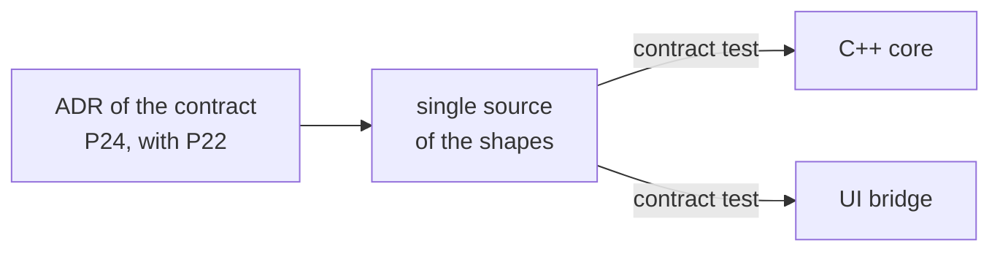

# Protocol and contract

Owner: the contract between the UI and the C++ core, what holds of it before its ADR, and how it
changes.

## The contract

The contract between the UI and the C++ core is its own. The maintainer designs it by ADR before
the `protocol` module (P24 in the [pending decisions](../pending-decisions.md)), and the editing
protocol (P22) is part of it. The protocol of the Rust core is no reference for it.

What holds whatever the ADR decides:

- **A single source** for the shape of every message, with both sides checked against it
  (RNF-CON-01; L12 of the [lessons](../lessons-from-0.3.md)).
- **Every request** has an id, a deadline and cancellation
  ([execution](execution-and-concurrency.md); RNF-EXE-02).
- **Only intent, deltas and facts cross it:** the UI sends the person's intent and the edit
  deltas, and the core sends facts ([boundaries](boundaries-and-responsibilities.md)).
- **The protocol version** is the version of the contract; the core reports the version it
  implements.

## Changing the contract

1. **Only through an ADR** in [`docs/adr/`](../adr/), approved by the maintainer.
2. **The contract comes before the code:** the contract test changes in the same commit as the
   contract.
3. **Both sides change together:** a method or a field changed on one side only fails the
   contract test (RNF-CON-01).
