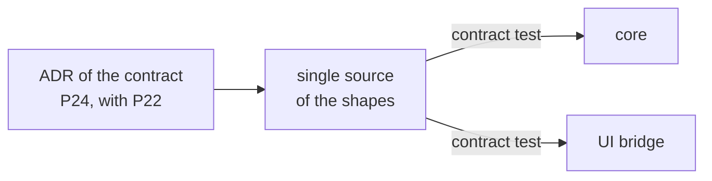
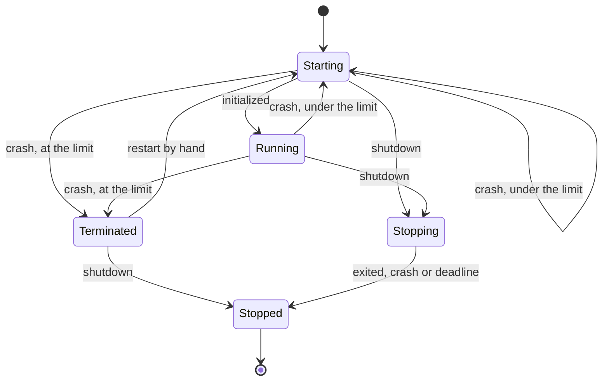

# Protocol and contract

Owner: the contract between the UI and the core, what holds of it before its ADR, and how it
changes.

## The contract

The contract between the UI and the core is its own. The maintainer designs it by ADR before
the `protocol` module (P24 in the [pending decisions](../pending-decisions.md)), and the editing
protocol (P22) is part of it. The protocol of the Rust core is no reference for it.

What holds whatever the ADR decides:

- **A single source** for the shape of every message, with both sides checked against it
  (RNF-CON-01; L12 of the [lessons](../lessons-from-0.3.md)).
- **Every request** has an id, a deadline and cancellation
  ([execution](execution-and-concurrency.md); RNF-EXE-02).
- **Only intent, deltas and facts cross it:** the UI sends the person's intent and the edit
  deltas, and the core sends facts ([boundaries](boundaries-and-responsibilities.md)).
- **The protocol version** is the version of the contract; the core reports the version it
  implements.
- **The channel** is the stdin and the stdout of the core, the child process the UI starts
  (`StdioTransport`, [modules](modules-and-layers.md)). The core accepts no connection
  (RNF-SEG-03); a command-line client is decided with P24.

## Changing the contract

1. **Only through an ADR** in [`docs/adr/`](../adr/), approved by the maintainer.
2. **The contract comes before the code:** the contract test changes in the same commit as the
   contract.
3. **Both sides change together:** a method or a field changed on one side only fails the
   contract test (RNF-CON-01).

## The core process

The UI bridge starts the core and runs this machine, as the window of VS Code 1.148.0 runs the one
of its extension host (`ExtensionHostCrashTracker`). A crash is an end of the process that no
shutdown asked for, or a start that fails. A cell with "—" keeps the state and records the event.

| State | initialized | crash | deadline | shutdown | exited | restart |
| --- | --- | --- | --- | --- | --- | --- |
| Starting | Running | Starting, or Terminated at the limit | As a crash, after killing the process group | Stopping | — | — |
| Running | — | Starting, or Terminated at the limit | — | Stopping | — | — |
| Stopping | — | Stopped | Stopped, after killing the process group | — | Stopped | — |
| Terminated | — | — | — | Stopped | — | Starting |
| Stopped | — | — | — | — | — | — |

- **The limit:** the core restarts on its own while the crashes of the last 5 minutes, this one
  included, are fewer than 3 (`_CRASH_LIMIT = 3`, `_TIME_LIMIT` of 5 minutes). At the third, the
  state is Terminated, and only the person's restart starts the core again.
- **Deadlines:** the start and the shutdown each have one, a parameter of the bridge.
- **After a restart** the bridge opens the workspace again, the core restores the drafts
  (RNF-DUR-01), and the UI replays the deltas the core did not acknowledge (P22).
- **What the person sees:** a notice at each restart on its own; at Terminated, that the core
  ended unexpectedly 3 times within 5 minutes, with the restart action.
- **Acceptance:** a table test with a fake core and a clock the test controls drives every cell,
  and the limit at the second and third crash within 5 minutes and at a third crash after them; a
  mutant that changes one cell or the limit fails it.
