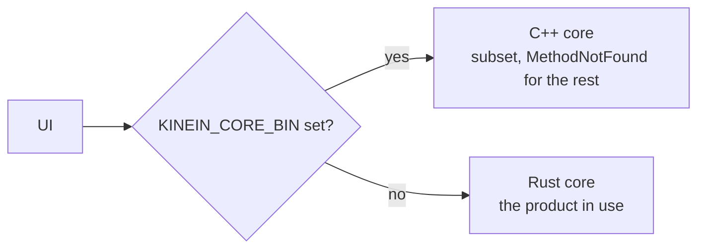

# Protocol and contract

Owner: the wire between the UI and the core, what the C++ core implements of it, how the UI
switches cores and how the contract changes.

## The wire

- **JSON-RPC 2.0**, one message per line, on the core's stdin and stdout (64:95-96;
  `ui/src/core_client_process.cpp:74` and `:220`).
- **Protocol version:** the one of the Rust core, 0.223.0 (`crates/kinein-protocol/src/lib.rs:121`). The
  C++ core reports the version it implements; a version change follows the rule of the last
  section.
- **The source of the contract is the Rust types of `kinein-protocol`.** `schemas/ipc.schema.json`
  stopped at 0.62.0 and describes only the envelope (`schemas/ipc.schema.json:4`; ENG-54). It is
  no reference for the C++ core (L12).

## What the C++ core implements

- **A subset**, by the levels of the
  [functional requirements](../requirements/functional-requirements.md). Each implemented method
  has the same request, response and error shape as in the Rust core, checked by the differential
  test.
- **A method outside the subset** answers with the `MethodNotFound` error, which is what the Rust
  core returns for an unknown method (`crates/kinein-protocol/src/rpc.rs:132` and `:195`).
- **The requests the UI sends on its own** when opening a workspace (`cmakeStatus`,
  `cmakePresetsList`, `cargoMetadata`, `runConfigList`, `gitStatus`; 64:110-114) need a defined
  answer in N0, even if it is `MethodNotFound`. How the UI reacts to that error is NOT VERIFIED;
  the first milestone checks it.

## Switching cores

```sh
KINEIN_CORE_BIN=/path/to/the/cpp/core ./kinein-vectis
```

The UI reads this variable (`ui/src/core_client_process.cpp:240`). Without it, the UI starts the
Rust core.



## Changing the contract

1. **Only through an ADR** in [`docs/adr/`](../adr/), approved by the maintainer. This includes
   `schemas/ipc.schema.json` and methods that 64 planned and 0.223.0 lacks, such as `core.cancel`
   (64:431-432).
2. **The contract comes before the code** (R-IPC-01 of 63): the contract test changes in the same
   commit.
3. **A single source** (RNF-CON-01): the schema generated from the types of `kinein-protocol`,
   with both cores checked against it, the maintainer's decision of 2026-11-22. The details are in
   [ADR-0013](../adr/ADR-0013-single-source-of-the-contract.md), a draft: nothing changes in the
   schema before the approval.
