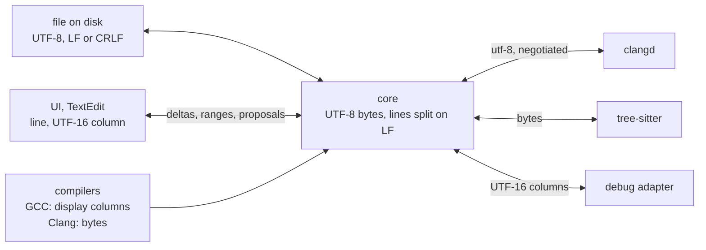
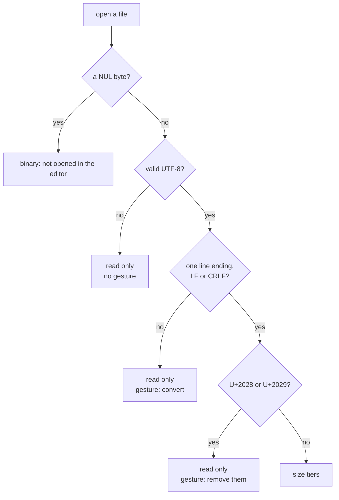

# Text encoding and positions

Owner: how the bytes of a file become the text of a document, how its lines end, which unit each
component counts a position in, and where the core converts between units.

The maintainer's decision of 2026-11-24. The core counts in UTF-8 bytes. Every other unit exists
only at a boundary, and the core is the only converter: the UI converts nothing.

## The unit of each component

| Component | Line | Column | Source |
| --- | --- | --- | --- |
| `TextEdit` (`QTextDocument`) | Block, from 0. On insertion, `\n`, `\r\n`, `\r` and U+2029 each become a block break; U+2028 stays inside the block | UTF-16 code units | qtbase v6.12.1, `src/gui/text/qtextcursor.cpp`, lines 1436 to 1452 |
| LSP 3.17 | From 0; `\n`, `\r\n` and `\r` end a line | Negotiated: `utf-8`, `utf-16` (the default, which every server supports) or `utf-32` | [LSP 3.17](https://microsoft.github.io/language-server-protocol/specifications/lsp/3.17/specification/), "Position" and "Text Documents" |
| clangd 23.1.5 | Split on `\n` only | `utf-8` when the client offers it; `utf-16` with no offer | Measured on 2026-11-24 with `initialize`; `clang-tools-extra/clangd/SourceCode.cpp`, lines 180 to 200, llvmorg-23.1.5 |
| tree-sitter 0.27.2 | The number of `\n` before the position, from 0 | Bytes from the start of the line | `docs/src/using-parsers/2-basic-parsing.md`, lines 74 to 77, v0.27.2 |
| Clang 23.1.5 | From 1 | Bytes | Measured on 2026-11-24 |
| GCC 16.2.1 | From 1 | Display columns: a tab reaches the next multiple of `-ftabstop` (default 8), a wide character counts 2 | Measured on 2026-11-24; GCC manual, `-fdiagnostics-column-unit` and `-ftabstop` |
| GCC 16.2.1, SARIF output | From 1 | The same display columns, with no `columnKind`, which [SARIF 2.1.0](https://docs.oasis-open.org/sarif/sarif/v2.1.0/errata01/os/sarif-v2.1.0-errata01-os-complete.html) §3.14.27 requires | Measured on 2026-11-24 |
| Debug Adapter Protocol | From 1 or 0, by `linesStartAt1` | UTF-16 code units, from 1 or 0 by `columnsStartAt1` | [DAP specification](https://microsoft.github.io/debug-adapter-protocol/specification) |

The measurement: one C file, an undeclared identifier after each prefix, the 1-based column of the
identifier.

| Prefix | Byte | UTF-16 | GCC | GCC, SARIF | Clang |
| --- | --- | --- | --- | --- | --- |
| `/*中*/ int a = ` | 17 | 15 | 16 | 16 | 17 |
| `/*😀*/ int b = ` | 18 | 16 | 16 | 16 | 18 |
| a tab, then `int c = ` | 10 | 10 | 17 | 17 | 10 |
| `/*é*/ int d = ` | 16 | 15 | 15 | 15 | 16 |

## Inside the core

- The text of a document is UTF-8. A position is a `ByteOffset`, or a `LineIndex` with a byte
  column. Each version has an index of the byte offsets where lines start.
- Disk, tree-sitter, clangd and Clang count bytes, so the path of a keystroke converts nothing.
  clangd keeps its text the same way (`SourceCode.cpp`, above), and Zed keeps UTF-8 in its rope
  with the UTF-16 length beside it (zed v1.29.3, `crates/rope/src/rope.rs`, `TextSummary`).
- A conversion runs per line: the line from the index, then a walk along that line, as clangd
  does. Its cost is the search in the index plus the length of the line.
- The units are types of `base`: `ByteOffset`, `LineIndex`, `Utf16Column`, `DisplayColumn`. A
  position never crosses a module as a bare integer ([C++23 rules](../engineering/cpp23-rules.md#types-and-interfaces)).

## Between the UI and the core

- Every position on the wire with the UI is a line and a column in UTF-16 code units, from 0:
  the LSP `Position` in `utf-16`. A block number and the offset in the block are what
  `QTextDocument` gives, so the UI converts nothing.
- A delta carries the base version, the start (line, UTF-16 column), the number of UTF-16 code
  units removed and the inserted text. The removal is a count, not an end position:
  `contentsChange` fires after the change, and from then on only the base version in the core
  holds the removed text. Qt Creator computes the removed range the same way, on a shadow copy of each
  document (v21.0.0, `src/plugins/languageclient/client.cpp`, `Client::documentContentsChanged`).
- A removal that runs past the end is cut at the end and recorded (RNF-OBS-01): Qt Creator does
  the same for QTBUG-80662, where `contentsChange` reports a wrong count and `characterCount()`
  includes the hidden final paragraph separator. Any other delta that does not fit its base (a
  line past the end, a column past the line or inside a surrogate pair) is a divergence, resolved
  from the core's text ([editing engine](editing-engine.md#who-owns-what)).
- Everything the core sends to the UI (highlighting, diagnostics, proposals) is in the same unit,
  converted by the core. Highlighting goes line by line, the unit of `QSyntaxHighlighter`.
- The bridge reads the inserted text from the raw document (`QTextDocument::toRawText()`, or the
  raw text of a cursor selection) and maps U+2029 to `\n`. It never reads through
  `TextEdit.text`, `getText()` or `selectedText`: all three go through `toPlainText()`, which turns
  U+00A0 into a space and U+2028 and U+2029 into `\n` (qtbase v6.12.1, `qtextdocument.cpp`, lines
  1229 to 1258; qtdeclarative v6.12.1, `qquicktextedit.cpp`, lines 166, 1518 and 3357).
- Shift+Enter and Shift+Return are `QKeySequence::InsertLineSeparator` on every platform (qtbase
  v6.12.1, `qplatformtheme.cpp`, lines 351 and 352), and `TextEdit` inserts U+2028 for it
  (qtdeclarative v6.12.1, `qquicktextcontrol.cpp`, lines 882 and 883). The UI binds both to an
  ordinary line break.

## Between the core and the tools

| Tool | Rule |
| --- | --- |
| LSP server | The client offers `["utf-8", "utf-16"]`. clangd 23.1.5 takes `utf-8`, with no conversion; a server that answers nothing runs on `utf-16`, converted per line |
| tree-sitter | UTF-8 input; each edit in bytes and points (`TSInputEdit`) |
| Clang | Byte columns, used as they are |
| GCC | Display columns, converted with the `-ftabstop` of the compile command (8 without one). When a non-ASCII character comes before the column, the diagnostic keeps only its line: converting it would need GCC's width table, and a guessed column is worse than none. The SARIF output is not a source of columns |
| Debug adapter | UTF-16 columns, converted per line, with `linesStartAt1` and `columnsStartAt1` stated by the client |

## Line endings

- The core's document holds `\n` only. It records the line ending of the file, LF or CRLF, and the
  write puts it back. A new file is written with LF.
- A file with mixed line endings, or with a lone `\r`, opens read only. The notice counts each
  kind, and the gesture "convert to LF" or "convert to CRLF" converts the document, which becomes
  editable and is written by the ordinary save.
- VS Code, IntelliJ and Zed convert such a file in silence, and the save rewrites lines the person
  did not edit (vscode 1.147.0, `pieceTreeTextBufferBuilder.ts`, `_getEOL`; intellij-community
  `14b343ec`, `LoadTextUtil.java`, `convertLineSeparatorsToSlashN` and `majorLineSeparator`; zed
  v1.29.3, `crates/text/src/text.rs`, `LineEnding`). In Kinein only the gesture changes them. A
  lone `\r` also splits lines differently: LSP ends a line there, clangd 23.1.5 does not.

## File content

The content decides first; the size tier comes after
([editing engine](editing-engine.md#size-limits)).

- **Read only:** the text is shown, with no highlighting and no LSP, and no edit reaches the file.
  The notice states the reason.
- **UTF-8**, with or without a BOM. The BOM is kept and written back, as VS Code does with
  `utf8bom` (vscode 1.147.0, `src/vs/workbench/services/textfile/common/encoding.ts`).
- **Not valid UTF-8** (a Latin-1 comment in a vendor SDK, a UTF-16 file): read only. The core never
  writes U+FFFD in place of a byte it could not decode. Reopening in another encoding needs its
  own requirement.
- **A NUL byte anywhere** marks the file binary. VS Code looks only at the first 512 bytes
  (`encoding.ts`, above); the core validates every byte anyway.
- **U+2028 and U+2029:** `TextEdit` breaks a block at U+2029 where the core and LSP do not break a
  line, and draws U+2028 as a break inside the line. The gesture removes them, as VS Code offers
  by default (vscode 1.147.0, `editorOptions.ts`, `unusualLineTerminators`, `prompt`). U+0085 is an
  ordinary character for `TextEdit`, LSP and the core, and needs no rule.

## Invariants

1. Block `i` of the UI's copy is line `i` of the core's document. The rules on line endings and
   on U+2028 and U+2029 keep it.
2. Opening and saving a file with no edit writes the same bytes (RNF-DUR-03).
3. A position crosses a boundary only with its unit in its type.
4. The UI converts no unit.

## Acceptance

1. **Round trip:** files with LF, CRLF, a BOM, U+00A0, a character outside the Basic Multilingual
   Plane, a combining mark, tabs and no final line break are opened and saved with no edit, and
   the bytes are equal (RNF-DUR-03).
2. **Property test:** random edits in UTF-16 units, with surrogate pairs and line breaks, applied
   to `TextEdit` and to the core; the raw texts are equal at every version. A mutant converter
   that counts code points fails it.
3. **Conversion:** the four prefixes of the measurement above are a corpus: GCC display columns
   and Clang bytes convert to the same position. A mutant with a tab stop of 4 fails it.
4. **Content:** one file per case (NUL, invalid UTF-8, mixed endings, a lone `\r`, U+2028,
   U+2029, a BOM) reaches its state with its notice, and the gesture makes it editable (RF-ED-05).
5. **LSP:** clangd answers `utf-8`; a test server that answers nothing gives the same positions in
   `utf-16`.

## NOT VERIFIED

- `TextEdit` while running: the values of `contentsChange`, Shift+Enter, the deletion of half a
  surrogate pair and the IME preedit were read in the source, not measured. They enter the
  measurement of the editor.
- QTBUG-80662 is known from the comment in Qt Creator; the report itself was not read.
- A header with a lone `\r` that clangd reads from disk: its lines differ from the core's. Not
  measured.
- GCC's width table for non-ASCII characters; hence the rule that keeps only the line.
