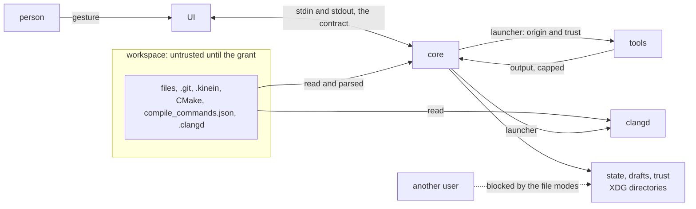

# Threat model

Owner: what the core protects, from whom and across which boundary; the defense of each threat,
by STRIDE, with the owner of its rule; and the risks the core accepts. The rule of each defense
lives in its owner, linked in the last column.

## What is protected

| Asset | The threat to it |
| --- | --- |
| The person's machine and account | Code of the workspace that runs without the person's decision |
| The person's files and typed text | A write the person did not ask for; a loss (RNF-DUR-01) |
| Secrets: the environment, keys, credentials | Leaving through a process, a record or the network |
| Privacy | A connection the person did not ask for (RNF-PRIV-01) |
| The core's own state: trust, drafts, settings | Read or changed by another user; changed by the workspace |
| What the person reads before trusting | Code that appears to say something it does not |

## Adversaries

| Adversary | Reaches the core through |
| --- | --- |
| A hostile workspace, such as a cloned repository | Its files, `.git/`, `.kinein/`, the CMake files and presets, the compilation database, `.clangd` |
| The hostile content of a file | The parsers of the core and of clangd, and the views of the UI |
| A tool or clangd that misbehaves | Its output and its messages |
| Another user of the machine | The directories of the core |

What is out of scope, and why, is in [the accepted risks](#accepted-risks).

## Trust boundaries

## The workspace and the core

| Threat | STRIDE | Defense | Owner |
| --- | --- | --- | --- |
| A file of the workspace runs code at the opening or at a request of the UI: the CMake configure step, `--query-driver`, the `fsmonitor` and hooks of git | E | Nothing the workspace defines runs before trust; the launcher decides by origin | RNF-SEG-01, [restricted mode](processes-and-trust.md#the-restricted-mode) |
| A program planted in the workspace runs through an empty or relative entry of `PATH` | S, E | The launcher runs only an absolute path | [launcher](processes-and-trust.md#the-launcher) |
| A file or branch name is read as an option (`--upload-pack=...`) | E | An operand from the workspace is never an option | [launcher](processes-and-trust.md#the-launcher) |
| `.kinein/` grants trust, turns on the network, moves the drafts or turns a defense off | T, E | A setting of the person's scope in `.kinein/` is ignored, with a notice | [persistence](persistence-and-durability.md#three-classes-plus-the-build-tree), RF-SET-01 |
| A shell opened in the root runs code of the workspace when it starts | E | In the restricted mode, the terminal asks for trust | [restricted mode](processes-and-trust.md#the-restricted-mode), RF-TERM-01 |
| The person reads code that appears to say something else (Trojan Source) and grants trust | S | Bidirectional controls and invisible characters are marked; in the restricted mode, so is every character outside ASCII | [text encoding](text-encoding-and-positions.md#invisible-and-bidirectional-characters), RF-ED-05 |
| A file the core owns in the workspace (`.kinein/`) is a link to a file outside it | T | An own file is never written through a link | [writing rules](persistence-and-durability.md#writing-rules) |
| A preset, a compilation database or a source file is malformed, deeply nested or huge | D | A fuzz target per parser; the JSON depth criterion of P16; the size tiers (RNF-ED-02) | [failures](failures-by-boundary.md), P16 |
| A loop of links, or a link out of the root, makes a scan endless | D | Every request has a deadline and cancellation (RF-CORE-02) | [execution](execution-and-concurrency.md#invariants) |

- **Trust is never read from the workspace.** Only the person's gesture grants it, through the
  UI, and the core stores it in the person's state.
- **The terminal:** the Safe Mode of CLion 2026.3 does not list the terminal among its limits
  ([project security](https://www.jetbrains.com/help/clion/project-security.html)); the core
  follows the Restricted Mode of VS Code, which blocks it
  ([restricted mode](processes-and-trust.md#the-restricted-mode)).

## The core and its processes

| Threat | STRIDE | Defense | Owner |
| --- | --- | --- | --- |
| The core connects to the network | I | Zero telemetry, and no connection without the person's gesture | RNF-PRIV-01 |
| A secret of the environment reaches a tool or a record | I | The environment comes from an allow list; no secret is recorded | [launcher](processes-and-trust.md#the-launcher), RNF-OBS-01 |
| A tool writes without end, or never ends | D | The output cap; the deadline, SIGTERM and then SIGKILL to the process group | [life of a process](processes-and-trust.md#the-life-of-an-external-process), P25 |
| Which process ran, from where and why is unknown | R | Every launch is recorded with the program, the origin and the trust decision | RNF-SEG-02 |
| clangd runs a compiler that the compilation database names | E | Without trust, `--query-driver` names only a compiler the IDE detected | [restricted mode](processes-and-trust.md#the-restricted-mode) |
| The compilation database loads a plugin into clangd (`-fplugin`) | E | clangd does not load plugins | clangd, below |
| A `.clangd` of the workspace points clangd to a remote index | I | clangd refuses a remote index from the configuration of a project | clangd, below |
| clangd sends a malformed message | T, D | Never applied, not even in part; a fuzz target of the decoder | [failures](failures-by-boundary.md#the-lsp-session) |

- **The allow list of the environment** keeps the configuration of the IDE (`CC`, `CFLAGS`,
  `LD_LIBRARY_PATH`) out of a build and the secrets out of the records. It does not hide a secret
  from the code of a trusted workspace, which reads the person's files with the same rights.
- **clangd 23.1.5**, read in its source at the tag `llvmorg-23.1.5`:
  - it clears the plugins of every compiler invocation (`Compiler.cpp`, `Plugins.clear()`);
  - it reads `.clangd` with no trust (`ClangdMain.cpp`, `fromAncestorRelativeYAMLFiles`) and
    refuses a remote index there: "Remote index may not be specified by untrusted configuration"
    (`ConfigCompile.cpp`);
  - the build of Fedora 45 has no remote index at all (`clangd --version`: `Features: linux`,
    measured on 2026-11-26).

## The UI and the core

| Threat | STRIDE | Defense | Owner |
| --- | --- | --- | --- |
| Another process speaks to the core | S | The only channel is the stdin and the stdout of the child process the UI starts; the core accepts no connection | RNF-SEG-03, [contract](protocol-and-contract.md#the-contract) |
| A message is malformed | T, D | Never applied, not even in part; a fuzz target of the contract | [failures](failures-by-boundary.md#ui-and-core) |
| Text from outside makes the UI connect: a remote image in a comment, shown by a hover | I | Plain text, or markdown the core reduced to no image and no HTML; no network access in the QML engine | [the sync](boundaries-and-responsibilities.md#the-sync-with-the-frontend) |
| The UI decides trust | E | The core refuses, not the UI (L14) | [restricted mode](processes-and-trust.md#the-restricted-mode) |

## The file system and other users

| Threat | STRIDE | Defense | Owner |
| --- | --- | --- | --- |
| Another user reads the drafts, or changes the trust or a draft | I, T | Own directories are created with mode 0700, own files with 0600 | [writing rules](persistence-and-durability.md#writing-rules) |
| Two cores write the state of one workspace | T | A lock on the state directory | RNF-DUR-05 |
| A corrupt draft replaces a file | T | It is moved aside and never applied | [failures](failures-by-boundary.md#the-file-system) |

## The shipped binary and its sources

| Threat | STRIDE | Defense | Owner |
| --- | --- | --- | --- |
| A memory defect of the core, reached by hostile input | E | The hardening of the binary; the sanitizers; a fuzz target per input | [known defects](../engineering/known-cpp-defects-and-defenses.md#the-shipped-binary), [failures](failures-by-boundary.md) |
| A dependency or an action changes upstream | T | A dependency with a pinned hash, an action pinned by SHA, a read-only token; a new dependency only with the maintainer's approval | [the CI](../engineering/gates-and-effectiveness.md#the-ci), [C++23 rules](../engineering/cpp23-rules.md) |

## Accepted risks

- **The code of a trusted workspace** runs with the person's rights, with no sandbox, as in
  CLion 2026.3 and VS Code. The grant of trust is the boundary.
- **clangd parses hostile source** with the person's rights, and tree-sitter does so inside the
  core process. A memory defect in either still runs with those rights. Upstream, tree-sitter runs
  its tests under ASan and UBSan (`sanitize.yml`), and tree-sitter-cpp fuzzes its scanner
  (`fuzz.yml`). The core fuzzes its own use of tree-sitter.
- **A workspace file that is a link** is saved to its target, which may lie outside the
  workspace, as in IntelliJ IDEA ([writing rules](persistence-and-durability.md#writing-rules)).
  The content is the person's.
- **Another process of the same user, root and physical access** already hold the person's
  rights.
- **No release is signed**, because no release exists yet.

## NOT VERIFIED

- CLion 2026.3: how it shows a bidirectional character, and how it passes an operand to git.
- `QQmlNetworkAccessManagerFactory` refusing every request: the class exists in Qt 6; the effect
  is measured at the sync.
- Whether CLion and VS Code CMake Tools pass the whole environment to a build.
- The escape sequences a terminal accepts (the clipboard, the title): assessed with the
  component of RF-TERM-01.
- The mode of the home directory in other distributions; Fedora 45 sets `HOME_MODE 0700`
  (`/etc/login.defs`, measured on 2026-11-26).
- The IDEs were read in their source and documentation on 2026-11-26, not observed running.
