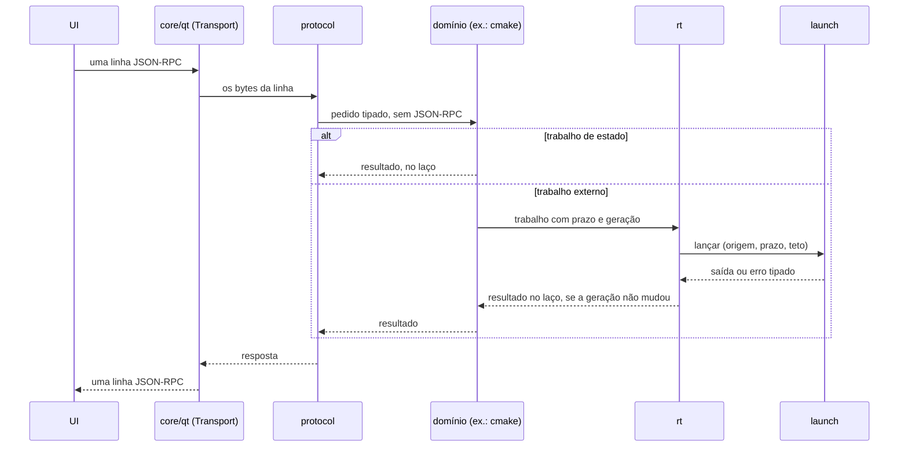

# Execução e concorrência

Dono: onde o trabalho do core roda, quem é dono de cada dado, prazo,
cancelamento, descarte de resultado velho e o caminho de um pedido entre os
módulos. Também é o registro das threads (o "threads.md" do plano).

O **desenho** do modelo de execução é do Viktor. Esta página guarda as
invariantes que o desenho tem de cumprir e, depois de aprovado, o desenho.

## Invariantes

| # | Invariante | Origem | Quem impõe |
| --- | --- | --- | --- |
| E1 | O laço do core nunca bloqueia: processo, disco do projeto, rede e espera de servidor rodam fora dele | L08; RNF-EXE-01 | Guarda de E/S no laço, que reprova nos testes e no build de depuração |
| E2 | Toda chamada externa tem prazo e cancelamento | L08, L09; RNF-EXE-02 | O tipo do pedido de trabalho exige prazo; teste com ferramenta travada |
| E3 | Cada dado tem um dono só; threads trocam mensagens, não compartilham estado mutável | Regras de C++ do plano | TSan no perfil `tsan`; revisão do desenho |
| E4 | Trabalho cancelável usa `std::jthread` com `std::stop_token` | Regras de C++ do plano | Revisão; `std::thread` solto fica fora (sem checagem automática conhecida) |
| E5 | Exceção não atravessa thread nem o laço de eventos do Qt | Regras de C++ do plano | `bugprone-exception-escape` no clang-tidy; corpo de thread e slot do adaptador são `noexcept` |
| E6 | Resultado de uma geração velha (workspace ou documento) não se aplica | L10 (INF-22); 64:416-421 | Teste de ordem com intercalação forçada |
| E7 | Cancelado responde `RequestCancelled`; prazo vencido responde `DeadlineExceeded`; nenhum dos dois vira "obsoleto" | L19 (INF-30); 64:433-434 | Teste de prazo |
| E8 | Cancelar um trabalho mata o grupo de processos dele, primeiro com SIGTERM e depois com SIGKILL | A05; 64:435-436 | Teste do lançador: nenhum processo sobra |
| E9 | Recursos diferentes andam em paralelo; o mesmo recurso (repositório, pasta de build, documento) anda em série | 64:425-427 | Teste com dois trabalhos no mesmo recurso |
| E10 | Nada sincroniza por tempo fixo nos testes | R-TEST-03 do 63; L16 | Ferramenta falsa com trava controlada pelo teste |

O 64 §5.3 propôs três classes de rota (estado no laço, trabalho fora dele,
job visível) e um ajudante em três fases: preparar no laço, trabalhar fora,
aplicar no laço se a geração não mudou (64:395-451). É referência da 0.3,
não decisão para o core novo.

## Threads e donos

Nenhuma thread existe ainda. Cada thread entra nesta tabela no mesmo commit
que a cria.

| Thread | Dona de | Recebe | Envia | Para como |
| --- | --- | --- | --- | --- |
| — | — | — | — | — |

## O caminho de um pedido

Os módulos são os de [módulos e camadas](modulos-e-camadas.md).

O que acontece dentro de `R` e de `P` (threads, filas, enquadramento) é o
desenho do Viktor; o diagrama só mostra quem fala com quem.
