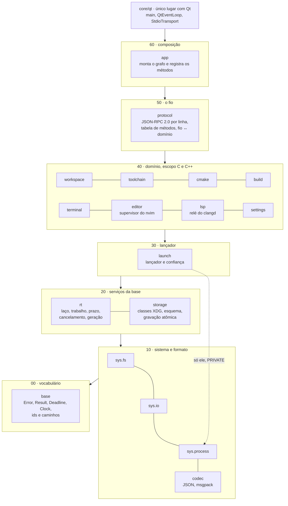
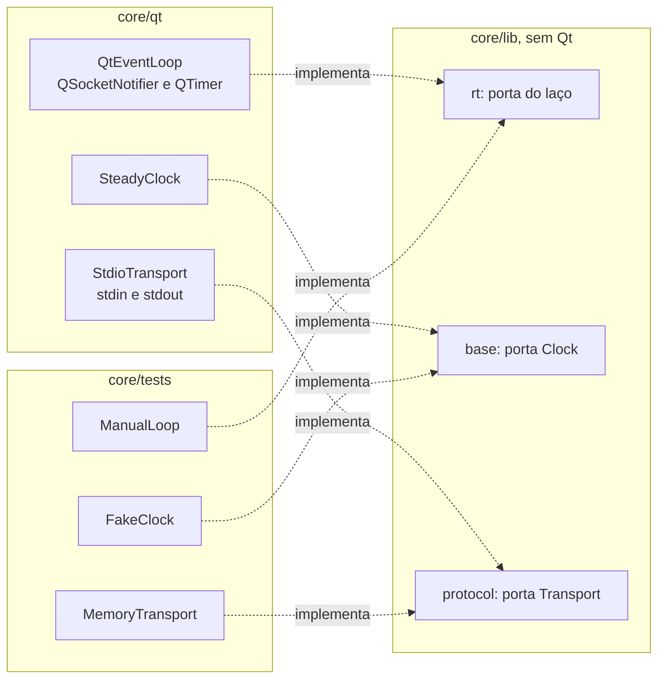

# Módulos e camadas do core

Dono: quais módulos `core/lib` tem, o que cada um faz, quem pode usar quem e o
mecanismo que impõe isso. Os processos e quem decide o quê estão em
[fronteiras-e-responsabilidades.md](fronteiras-e-responsabilidades.md).

Estado: **proposta de 2026-11-22, aguardando a aprovação do Viktor (P15)**.
Nenhum módulo existe ainda. O desenho interno de `rt` (execução) e de
`protocol` é do Viktor; esta página fixa só a fronteira deles.

## O problema, antes da solução

A 0.3 mediu a mesma causa em vários lugares: nada impedia um módulo de usar
outro, e a dependência era o que compilava.

- **Processo criado em cerca de 122 lugares** (ENG-51).
- **Infraestrutura morando no domínio.** O enquadramento `Content-Length` e o
  `EventSender` moravam no `lsp` e eram usados por 9 módulos; o `rpc.rs` tinha
  funções de erro de 6 domínios (ENG-12).
- **Um `Core` com 32 campos**, e `impl Core` espalhado por 73 arquivos
  (ENG-14, ENG-15).
- **Roteamento por cadeia**: um `match` e 40 `or_else` num arquivo que 35 dos
  últimos 300 commits editaram (ENG-10).

Convenção não segurou nenhum desses. O core em C++ põe a direção das
dependências no build, onde um erro reprova o configure.

## O mecanismo

1. **Um módulo é um alvo do CMake** (biblioteca `STATIC`), com a sua própria
   pasta de cabeçalhos públicos. Um arquivo só consegue fazer `#include` do
   cabeçalho de um alvo que o módulo dele liga. Por isso "quem usa quem" é
   exatamente o grafo de link.
2. **O grafo do CMake sozinho não basta.** O CMake aceita ciclo entre
   bibliotecas `STATIC`. Medido em 2026-11-22 com o CMake 4.3: A liga B, B liga
   A, e o configure e o build passam. Por isso cada módulo declara um **posto**
   (um inteiro). O configure recusa a dependência para um posto igual ou maior:
   com toda aresta descendo, ciclo é impossível, e subir de camada também.
3. **Módulo restrito.** `sys.process`, que cria processo, só pode ser ligado
   por `launch`, e ligado como `PRIVATE`, para não vazar adiante pelo grafo.
4. **Dentro do módulo**, o clang-tidy impede chamar a função de sistema fora
   do lugar dela. A primeira lista, a de criar processo, já está ativa
   ([gates](../engenharia/gates-e-medida-de-eficacia.md#registro)).

Os dois primeiros itens são uma função só, `kinein_add_module(NAME RANK
DEPENDS VISIBLE_TO)`, a escrever depois da aprovação, com mutantes (ciclo,
subida, mesma camada, restrito ligado por outro, restrito ligado como
`PUBLIC`) que precisam reprovar.

## As camadas

O posto é um número por módulo. Os blocos de dezena são só para ler: a regra
é "só depende de posto menor".



As linhas sem seta dentro de um bloco só agrupam; as setas são a direção
permitida. Um módulo pode pular camadas para baixo (o domínio usa `base`
direto), nunca subir.

## Os módulos

| Módulo | Posto | Responsabilidade | Usa | Origem |
| --- | --- | --- | --- | --- |
| `base` | 00 | Vocabulário sem E/S: `Error` com a causa nomeada, `Result<T>` (`std::expected`), `Deadline`, a porta `Clock`, ids fortes (`RequestId`, `Generation`, `JobId`), `CanonicalPath` | biblioteca padrão | L19, E7, E10 |
| `sys.fs` | 10 | Descritor com RAII, leitura, gravação atômica (temporário, `fsync`, troca de nome, `fsync` da pasta), sem seguir link | `base` | RNF-DUR-02, R-DADOS-02 |
| `sys.io` | 11 | Pipe, PTY, socket local, espera em descritor | `base` | — |
| `sys.process` | 12 | `posix_spawn`, `pidfd`, grupo de processos, Landlock. **Único lugar com as funções de criar processo** | `base`, `sys.io` | L05, L18 |
| `codec` | 13 | JSON e msgpack, com a biblioteca a decidir (P16) | `base` | — |
| `rt` | 20 | Laço (porta), classes de trabalho, prazo, cancelamento, geração. **Desenho do Viktor** | `base` | E1 a E10, RNF-EXE-01 e 02 |
| `storage` | 21 | As três classes do XDG, o catálogo dos arquivos próprios, a versão de esquema, a migração do `.kinein` | `base`, `sys.fs`, `codec` | L04, L13, RNF-DADOS-05 |
| `launch` | 30 | Lançador e confiança: origem, ambiente, prazo, teto de saída, cancelamento, registro; o armazém de confiança via `storage` | `base`, `rt`, `storage`, `sys.io`, `sys.process` (só ele) | L05, L06, L08, RNF-SEG-01 e 02 |
| `workspace` | 40 | Abrir e fechar, geração do workspace, árvore, `fs.*` confinado à raiz | `base`, `rt`, `storage`, `sys.fs` | RF-WS, RF-FS |
| `settings` | 41 | Configuração da pessoa e do projeto | `storage`, `codec` | RF-SET-01 |
| `toolchain` | 42 | Detecção de compiladores e ferramentas: detectado, selecionado, efetivo | `launch`, `storage` | A02, RF-TC-01 |
| `terminal` | 43 | Terminal em PTY pelo lançador | `launch`, `sys.io` | RF-TERM-01 |
| `cmake` | 44 | Presets, File API, configure | `launch`, `toolchain`, `workspace`, `codec` | RF-CMK |
| `build` | 45 | Compilar, executar e o painel de problemas | `cmake`, `launch` | RF-BLD-01 |
| `editor` | 46 | Supervisor do `nvim`: msgpack-RPC, espelho do buffer, `BufWriteCmd`, rascunho com prazo máximo | `launch`, `codec`, `storage`, `workspace`, `rt` | RF-ED, RNF-DUR-01, RNF-SEG-03 |
| `lsp` | 47 | Relé do clangd: processo pelo lançador, socket para o `nvim`, diagnóstico para o painel | `launch`, `codec`, `toolchain`, `cmake` | RF-LSP-01 |
| `protocol` | 50 | JSON-RPC 2.0 por linha, tabela de métodos, tradução entre o fio e o domínio, erros do fio. **Desenho do Viktor** | `codec`, `base`, os módulos do domínio | L12, RNF-CON-01 |
| `app` | 60 | Raiz de composição: cria os módulos, injeta as portas, registra os métodos | todos | ENG-14, ENG-15 |

Os módulos do N1 (git, depuração, criação de projeto, preparo do ambiente,
formatação) entram depois, com as mesmas regras.

**"O domínio não conhece o fio"** quer dizer: nenhum módulo do domínio vê as
mensagens JSON-RPC, os nomes dos métodos nem os erros do fio, porque o
`protocol` fica acima dele. JSON como formato de arquivo (a File API do CMake,
o `compile_commands.json`) o domínio usa pelo `codec`.

## Portas e adaptadores

`core/lib` declara as interfaces de que precisa (portas). Quem implementa fica
fora: o `core/qt` no produto, os dublês nos testes. É assim que `core/lib`
roda nos testes sem Qt e com tempo determinístico (E10): o relógio falso só
anda quando o teste manda, e o teste de prazo não usa `sleep`.



**A escolha da forma da porta é do Viktor.** Recomendo interface virtual:
custa uma indireção por evento de E/S, o que é desprezível ali. Com template,
o custo some, mas todo usuário da porta vira template e o tempo de compilação
cresce.

O Qt no core só entrega o laço e a notificação de E/S, portáteis para o
Windows. Se um dia um laço próprio em `sys.io` (epoll no Linux, IOCP no
Windows) valer mais que a dependência, ele troca o `core/qt` sem tocar no
domínio. A interface mantém essa troca possível.

## As pastas

```text
core/lib/<modulo>/include/kinein/<modulo>/   a API pública: só isto os outros incluem
core/lib/<modulo>/src/                        a implementação
core/tests/unit/<modulo>/                     os testes de unidade do módulo
```

O alvo se chama `kinein_<modulo>`, com o apelido `kinein::<modulo>`, e o
namespace é `kinein::<modulo>`. Para `sys.process`, a pasta é
`core/lib/sys/process/`, e o namespace, `kinein::sys::process`.

## Quem impõe cada regra

| Regra | Mecanismo | Estado |
| --- | --- | --- |
| Um módulo só inclui o que liga | Pasta de cabeçalhos por módulo, sem pasta comum | Por construção, quando o primeiro módulo existir |
| Dependência só para posto menor: sem ciclo, sem subir | `kinein_add_module` confere no configure | Gate a escrever depois da aprovação, com eficácia medida |
| `sys.process` só para `launch`, como `PRIVATE` | `VISIBLE_TO` do mesmo `kinein_add_module` | Idem |
| Função de criar processo só em `sys.process` | clang-tidy, `bugprone-unsafe-functions.CustomFunctions` | **Ativo**: 40 de 40 defeitos e 16 de 16 formas corretas |
| Nada de Qt em `core/lib` | O preset `dev` não procura o Qt | Ativo |
| O domínio não conhece o fio | `protocol` acima do domínio: o domínio não consegue incluir `kinein/protocol/` | Por construção |
| Thread só dentro de `rt` | Sem mecanismo: o clang-tidy não casa construtor (medido). Revisão e TSan | Revisão |

## Contra a superengenharia

Dezoito módulos parecem muitos para um core que ainda não existe. Cada um
está na tabela porque uma lição da 0.3 pediu aquela fronteira, mas **um
módulo só nasce com o primeiro código dele**. Nenhum alvo vazio entra no
build. Se dois módulos sempre mudarem juntos, isso é sinal de que são um só, e
eles se juntam.
