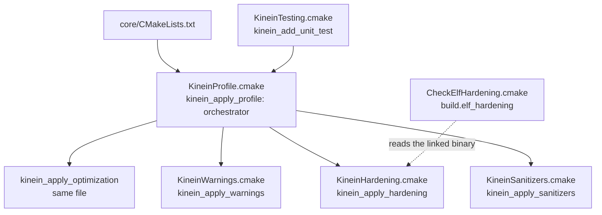

# Build profiles and hardening

Owner: the build profiles of the core, what each one enables, the source of each choice and how
to run them. The exact list of flags is in `core/cmake/`: this document explains it and does not
repeat it.

## How to run

From `core/`:

```sh
cmake --workflow --preset dev          # configure, build and test
cmake --workflow --preset asan-ubsan
cmake --workflow --preset tsan
cmake --workflow --preset lint         # Clang + clang-tidy
```

The build trees go to `build/core-<preset>/`, at the repository root, which git ignores. The
`dev-qt` preset needs `KINEIN_QT_PREFIX` pointing to the Qt of the UI (for example
`~/Qt/6.12.1/gcc_64`). clangd reads `build/core-lint/` through `core/.clangd`.

## The profiles

| Preset | Profile | Compiler | What changes | What for |
| --- | --- | --- | --- | --- |
| `dev` | dev | GCC | baseline, production semantics and `-Werror`; `-O2 -g` | The daily build: what is tested is what ships |
| `production` | production | GCC | the same, **without `-Werror`** | What is distributed: a warning of a newer compiler does not break the packager's build |
| `asan-ubsan` | asan-ubsan | GCC | ASan and UBSan, without FORTIFY and without production semantics; `-O1 -g` | Find memory errors and undefined behavior |
| `tsan` | tsan | GCC | TSan, without FORTIFY; `-O1 -g` | Find data races |
| `debug-stl` | debug-stl | GCC | `_GLIBCXX_DEBUG`; `-O0 -g3` | Invalid iterators and library preconditions; step-by-step debugging |
| `lint` | dev | Clang | clang-tidy on each unit | Static analysis, and the second compiler with `-Werror` |
| `dev-qt` | dev | GCC | builds `core/qt` | The Qt adapter |

Each target gets its profile from one orchestrator, `kinein_apply_profile(<target> <kind>)` in
`core/cmake/KineinProfile.cmake`, which commands one specialist module per concern:



Minimum versions, the maintainer's decision of 2026-11-22: **GCC 14 and Clang 20**, the floor the
CI tests on `ubuntu-26.04`. Below that, configure fails. Clang 18 does not work: up to Clang 18,
Clang's `__cpp_concepts` was 201907L, and libstdc++ declares `std::expected` only with 202002L
(`bits/version.h` of libstdc++ 16, read; Clang 19 raised the value to enable the `<expected>` of
libstdc++, [LLVM PR #87998](https://lists.llvm.org/pipermail/cfe-commits/Week-of-Mon-20240408/565418.html)).

Third-party code built together with the core (GoogleTest) gets the profile as `THIRD_PARTY`:
optimization, standard library mode, sanitizers and protections, without the warnings and
without clang-tidy (`core/cmake/KineinProfile.cmake`).

## What holds in every profile

- **Warnings:** the list of `cmake/KineinStrictOptions.cmake`, which builds the UI with
  `-Werror`, plus the OpenSSF TL;DR. NOT VERIFIED: the source of each flag outside the OpenSSF list
  in the manuals of GCC and Clang. The list is fixed per compiler: an unknown flag breaks the
  build instead of vanishing (fail closed).
- **Protections:** `-fstack-protector-strong`, `-fstack-clash-protection`,
  `-fstrict-flex-arrays=3`; on x86_64, `-fcf-protection=full` and
  `-fzero-call-used-regs=used-gpr`; on aarch64, `-mbranch-protection=standard`.
- **Standard library:** `_GLIBCXX_ASSERTIONS` and the `FAST` mode of libc++; in `debug-stl`,
  `_GLIBCXX_DEBUG` and the `DEBUG` mode of libc++.
- **Linking the executable and the tests:** `-z nodlopen`, `-z noexecstack`, `-z relro`, `-z now`,
  `--as-needed`, `--no-copy-dt-needed-entries` and PIE.

## The choices and their sources

| Choice | Source |
| --- | --- |
| The flag baseline | OpenSSF, *Compiler Options Hardening Guide for C and C++*, version of 2026-08-20, TL;DR; the conditional lines "for x86_64", "for aarch64" and "for production code" |
| `-Werror` only in development, never in the distributed source; `-Werror=format-security` in all | The same guide, TL;DR |
| `_FORTIFY_SOURCE` only with `-O1` or more, preceded by `-U_FORTIFY_SOURCE` | The same guide, Table 2 |
| No `_FORTIFY_SOURCE` in the sanitizers | AddressSanitizer FAQ: "ASan (and other sanitizers) doesn't support source fortification" |
| TSan in a separate build | Measured: GCC 16.2.1 refuses `-fsanitize=thread` together with `-fsanitize=address` |
| `_GLIBCXX_DEBUG` only in `debug-stl`, with everything built together | libstdc++ manual (Debug Mode): the flag changes the size of the containers, and the code links with code outside the mode only if no container passes between them |
| Production semantics in `dev` as well | A decision of this document: the daily build runs what ships. The sanitizers stay without it, so that UBSan sees the UB that it defines |
| `-z nodlopen` does not mark an executable | Measured on 2026-11-22: GNU ld 2.47 marks `NOOPEN` on a shared library and not on a PIE executable. The flag stays, as the guide asks, and the check applies to a shared library once there is one |
| `CMAKE_BUILD_TYPE` changes no flag | CMake's default per-configuration flags are cleared in the core's scope: the profile is the only owner |

## Checked by the build itself

- `build.contract` (`core/tests/build/build_contract_test.cpp`): the compiler checks the language
  standard, the absence of extensions, PIE, SSP, CET, `_GLIBCXX_ASSERTIONS`, the effective level
  3 FORTIFY in glibc, the absence of FORTIFY in the sanitizers and the right sanitizer in each
  profile.
- `build.elf_hardening` (`core/cmake/CheckElfHardening.cmake`): `readelf` checks `BIND_NOW`,
  `PIE`, `GNU_RELRO` and the non-executable stack in the binary of the run.
- The effectiveness of both, measured on 2026-11-22, is in
  [gates-and-effectiveness.md](gates-and-effectiveness.md#measurement-record).

## NOT VERIFIED

- MSVC and Windows: the MSVC branch of the modules comes from `KineinStrictOptions.cmake` and was
  not built on this machine.
- GCC 14 and Clang 20: the floor built and passed in the CI on 2026-11-23
  ([gates](gates-and-effectiveness.md#the-ci)), but the exact version the runner used is in the
  log, which was not read. This machine has only GCC 16.2.1 and Clang 23.1.5.
- The noise of `-Wconversion` in the code moc generates: `core/qt` has no code yet. The Qt headers
  enter as `-isystem`.
- aarch64.
