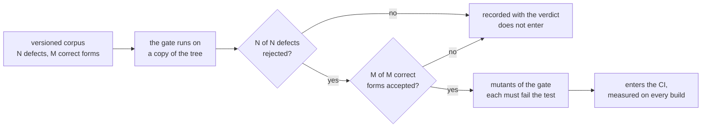

# Gates and effectiveness

Owner: the order in which the gates of the core run, how a project gate proves that it works, the
record of the measurements and the CI.

## Order

1. **Deterministic:** compiler with `-Werror`, sanitizers, clang-tidy, tests (build contract,
   unit, complexity, differential, crash) and validation of the protocol contract.
2. **Project gate**, only with its effectiveness measured by the method below and recorded in
   this file.
3. **Review** reads the diff, proposes test cases and builds the defect corpora. The numbers
   decide.

A text-heuristic gate on code does not enter (L15: in 0.3, such gates detected 36 of 120 defects
and rejected 14 of 15 correct forms).

## The method (63 §D.5 and 66 §2.1)

- **N planted defects** the gate must reject, each applied alone to a copy of the tree, never to
  the checkout.
- **M correct forms** the gate must accept, including the hard ones (comment, string literal,
  macro, generated code).
- **An equivalent mutant** (the change does not alter the property) does not count as a defect
  and is recorded as equivalent, with the reason.
- The gate enters the CI only with N of N rejected and M of M accepted. Below that, the
  measurement is recorded with the verdict "does not enter".
- The corpus is versioned with the gate, and the measurement runs again whenever the gate
  changes.

## Measurement record

### `build.contract` and `build.elf_hardening` (2026-11-22)

Measured on a copy of `core/`, one defect at a time, with GCC 16.2.1, Clang 23.1.5 and GNU ld 2.47.

| # | Planted defect | Preset | Rejected by |
| --- | --- | --- | --- |
| D01 | `CMAKE_CXX_EXTENSIONS ON` | dev | `build.contract` |
| D02 | No `-D_FORTIFY_SOURCE=3` | dev | `build.contract` |
| D03 | `_FORTIFY_SOURCE=2` | production | `build.contract` (effective glibc level) |
| D04 | FORTIFY enabled under ASan | asan-ubsan | `build.contract` |
| D05 | No `_GLIBCXX_ASSERTIONS` | dev | `build.contract` |
| D06 | `-fno-stack-protector` | dev | `build.contract` |
| D07 | `-fcf-protection=none` | dev | `build.contract` |
| D08 | No PIE at compile and link time | dev | `build.contract` |
| D09 | `-Wl,-z,lazy` | dev | `build.elf_hardening` |
| D10 | `-Wl,-z,norelro` | dev | `build.elf_hardening` |
| D11 | `-Wl,-z,execstack` | dev | `build.elf_hardening` |
| D12 | `tsan` profile without `-fsanitize=thread` | tsan | `build.contract` |
| D13 | `debug-stl` profile without `_GLIBCXX_DEBUG` | debug-stl | `build.contract` |
| D14 | `CMAKE_CXX_STANDARD 20` | dev | `build.contract` |
| D15 | `asan-ubsan` profile without ASan | asan-ubsan | `build.contract` |
| D16 | PIE at compile time, link with `-no-pie` | dev | `build.elf_hardening` |

- **Defects:** 16 of 16 rejected.
- **Equivalent:** a `-no-pie` added to the link without disabling CMake's PIE. CMake's `-pie`
  comes later on the command line and wins, and the binary stays PIE (checked with `readelf -h`).
- **Correct forms:** 12 of 12 accepted: the eight presets (dev, asan-ubsan, tsan, debug-stl,
  production, lint, cxx26-probe, dev-qt) and the asan-ubsan, tsan, production and debug-stl
  profiles built with Clang.
- **Verdict:** they enter. **Limit:** no hard correct form, because the target is a single file.
  They cover neither MSVC nor aarch64.

### `gate.launcher`: processes only through the launcher (2026-11-22)

`bugprone-unsafe-functions.CustomFunctions` in `core/.clang-tidy`
([processes](../architecture/processes-and-trust.md)). The corpus is in
`core/tests/gates/launcher/`, and the `gate.launcher` test (`lint` preset) measures the
effectiveness on every build with `tidy_corpus.py`: each line marked as a defect must be flagged,
and no other line.

- **Defects:** 40 of 40 rejected: 24 POSIX and glibc functions (fork, vfork, `_Fork`, the exec
  family, `posix_spawn`, `pidfd_spawn`, system, popen, syscall, clone, forkpty, daemon, wordexp),
  5 forms (pointer, macro, `using`, function passed as an argument, lambda), 5 `QProcess` methods
  and 6 Windows functions.
- **Correct forms:** 16 of 16 accepted, among them the hard ones: an own function with the same
  name in another namespace, a `start` method of an own class, a string literal, a comment, a
  macro with "system" in its name, `posix_spawn_file_actions_init` and `std::chrono::system_clock`.
- **Mutants of the gate**, all failed by the test: a list without `popen` (38 of 40), without
  `QProcess` (35 of 40), a regex without an anchor (3 correct forms rejected), without the option
  (2 of 40, the ones the default list of the check catches) and a corpus that does not compile
  (an unexpected diagnostic).
- **Measured limit:** the check does not match a constructor, so it cannot block `std::thread`.
- **Verdict:** it enters.

### `unit.TestFramework`: GoogleTest in the standard library mode (2026-11-22)

- **Defect:** GoogleTest built without the profile in `debug-stl`, hence without
  `_GLIBCXX_DEBUG`. Rejected at link time (`undefined reference`).
- **Mechanism:** the probe takes a `std::vector`; the return type is not part of the mangled name.
- **Correct form:** the eight presets, green.
- **Verdict:** it enters.

### `gate.detach`: no detached thread (2026-11-23)

The same clang-tidy option, with `std::thread::detach` and `std::jthread::detach`. The corpus is
in `core/tests/gates/threads/`.

- **Defects:** 10 of 10 rejected: `std::thread` and `std::jthread`, through a pointer, through a
  reference, a pointer to the member function, the member function passed to `std::invoke`,
  inside a lambda, inherited by a derived class, inside a macro and on a temporary.
- **Correct forms:** 10 of 10 accepted, among them `detach` of an own class, an own function
  named `detach`, `join`, `request_stop`, a string, a comment and a variable named `detach`.
- **Mutants of the gate**, all failed by the test: without `jthread` (9 of 10), a regex for any
  class (2 correct forms rejected) and without the entry (0 of 10).
- **Limit:** measured only with libstdc++.
- **Verdict:** it enters.

### `-Wbidi-chars=any`: Trojan Source (2026-11-23)

- **Defect:** a pair of bidirectional characters (U+202E and U+202C) in a comment. The GCC default
  does not flag the closed pair; with `=any`, it does. On a copy of the core, the defect planted
  in a test failed `dev`.
- **The Clang side does not catch the pair:** the compiler flags nothing, and clang-tidy's
  `misc-misleading-bidirectional` flags only the open pair, which GCC catches. It adds nothing to
  the CI, which always runs GCC, so it is not enabled.
- **Correct form:** the eight presets, green.
- **Verdict:** it enters, on GCC only.

### `gate.duplication`: copied logic, T1 to T3 (2026-11-23)

`core/tests/gates/duplication/clones.py`, on libclang: each function becomes the sequence of its
tree nodes, with locals and parameters unnamed and everything else by USR. It flags 44 equal
nodes in two places (window) and a function of 40 nodes or more with a similarity of 0.85 or
more (`difflib`). A function generated by a macro does not enter.

- **Corpus:** 15 of 15 defects (T1; T2 of names, literals and types; T3 with an extra, a missing
  and a replaced statement; in the file, across files and across modules; lambda, template,
  method, block inside another function), 14 of 14 correct forms (accessors, tables, sibling
  serializer, same loop with another algorithm, macro, `std::expected`, code as text, a header
  included twice), clean base.
- **Margin:** similarity of 0.87 on the smallest defect and 0.82 on the largest correct form;
  window of 45 and 36 nodes. A window from 38 to 50 and a threshold from 0.83 to 0.86 pass.
  **Mutants:** all 8 fail (no local renaming, no window, no similarity, macros enter, a header
  counted twice, an empty dependent name, a literal without its value, a window without USR).
- **GoogleTest 1.17** (41 thousand lines): 32 s, 506 MB, 101 findings: 55 copies (five read, the
  rest by name) and 46 in the 23 overloads of `UnpackStructImpl`, a repetition C++23 imposes.
- **Limits:** the tool and the corpus have the same author, and d13 (template) passes only by
  reading the dependent name from the token. Only libclang 23 and libstdc++. No measurement at
  85, 2,500 and 20,000 lines. T4 is undecidable (Rice's theorem): it is left to review.
- **Discarded:** `alpha.clone.CloneChecker` (it does not see another file) and the JSON AST
  (144 MiB for 30 lines). PMD CPD stays out: it brings a Java runtime into the toolchain.
- **Verdict:** it enters `lint`, measuring the corpus on every build (6 s). It reads `core/lib`
  from the first module on.

## The CI

The `CoreCpp 0.1` workflow (`.github/workflows/core.yml`) is the only CI of the repository. Its
single branch, `main`, takes every change through a pull request, and every pull request into `main`
and every push to it runs in full, with no path filter and without cancelling the previous run:
every commit has a verdict. The tests and gates of 0.3 fail here by construction and are not a
criterion. The reference is the local machine, and the `ubuntu-26.04` runner imitates it, with no
container; every step runs with `bash -euo pipefail` (the runner default is `bash -e`: measured in
run 45188723983).

| Jobs | Compiler | What for |
| --- | --- | --- |
| `dev` | g++-14 and clang++-20 | The declared floor |
| `dev`, `production`, `asan-ubsan`, `tsan`, `debug-stl`, `cxx26-probe` | g++-15 | Every profile, on the newest GCC of the runner |
| `lint` (with clang-tidy 22 and `python3-clang-22`), `asan-ubsan`, `tsan` | clang++-22 | The second compiler and the static analysis |

- **Security:** read-only token, checkout v7.0.1 pinned by SHA (the latest release on 2026-11-23,
  Node 24), credentials not persisted, a timeout per job, the matrix through environment
  variables (so `shellcheck` reads the real `run:` steps).
- **No environment step without a source:** the image sets `vm.mmap_rnd_bits=28`
  (actions/runner-images#9491).
- **Local machine and runner:** the image has neither GCC 16, Clang 23 nor Qt 6.12 (`dev-qt` stays
  out); bringing them in is a new dependency, the maintainer's decision. The local CMake 4.3 reads
  presets up to version 11, and the runner's 4.5 up to 13 (the `schema.json` of each CMake tag).
  No job runs the 3.25 floor.
- **Review, with no CI mechanism:** English identifiers, since a text-heuristic gate on code does
  not enter (L15).
- **On GitHub, by the maintainer** (the token of the CI does not administer): actions only from
  GitHub and by SHA, a read-only default token, approval of every outside contributor, and a
  ruleset on `main`: no deletion or force push, a pull request for every change with the jobs of
  this workflow as required checks ("commits must first be pushed to another ref where the checks
  pass", the REST documentation of the rules of GitHub), no required approval (one maintainer),
  and the head branch deleted at merge. Decided, not yet in place.
- **Approved, not yet in place:** `actionlint` and `zizmor`, Dependabot for the actions, a DCO
  check, the documentation gate (rules 6 to 12 of the [README](../README.md#rules-of-this-tree)
  and no reference to untracked local notes) with the role gate, the pinned N and M of the
  clang-tidy gates, the CMake floor tested or raised, and a job in a Fedora 45 container that
  reproduces the reference machine.

**State on 2026-11-25:** green in the 11 jobs (run 45689545378, `d7934d2b`; `gate.duplication`
in 20.9 s), at no cost on a public repository
([billing](https://docs.github.com/en/billing/concepts/product-billing/github-actions)).
