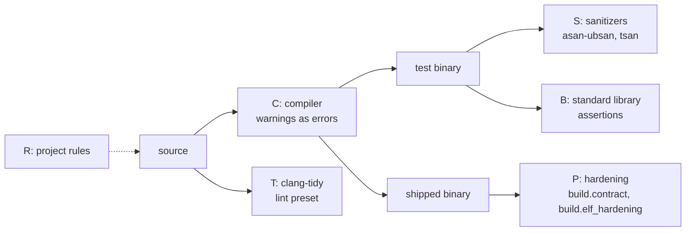

# Known C++ defects and their defenses

Owner: the classic defects of the language and the defense against each one, by layer. No defect
here depends on attention alone: each one has at least one tool that catches it.

Layers: **C** compiler (a warning is an error in the development presets), **T** clang-tidy
(`lint` preset), **S** runtime sanitizer (`asan-ubsan`, `tsan`), **B** standard library checks
(`_GLIBCXX_ASSERTIONS`; `_GLIBCXX_DEBUG` in `debug-stl`), **P** hardening of the shipped binary,
**R** project rule ([cpp23-rules.md](cpp23-rules.md)).

The check names were verified on clang-tidy 23.1.5 and the flags on GCC 16.2.1 and Clang 23.1.5,
on 2026-11-22.

## Memory and object lifetime

| Defect | Defense |
| --- | --- |
| Use after free, double free, leak | **S** ASan and LSan; **T** `clang-analyzer-cplusplus.NewDelete`, `cppcoreguidelines-owning-memory`, `cppcoreguidelines-no-malloc`; **R** RAII |
| Dangling reference or view (`string_view`, `span`, a reference to a temporary) | **C** `-Wdangling-reference` (GCC), `-Wdangling` (Clang); **T** `bugprone-dangling-handle`, `bugprone-return-const-ref-from-parameter`; **S** ASan `detect_stack_use_after_return`; **R** views only as parameters |
| A lambda that captures by reference and outlives the scope (work on another thread) | **T** `bugprone-capturing-this-in-member-variable`, `cppcoreguidelines-avoid-capturing-lambda-coroutines`; **S** ASan and TSan; **R** work receives an immutable copy |
| Use after `std::move` | **T** `bugprone-use-after-move`, `clang-analyzer-cplusplus.Move` |
| Out-of-bounds access | **B** `_GLIBCXX_ASSERTIONS` checks the containers' `operator[]`; **S** ASan; **C** `-fstrict-flex-arrays=3`; **T** `cppcoreguidelines-pro-bounds-pointer-arithmetic`, `cppcoreguidelines-pro-bounds-constant-array-index` |
| A variable read before initialization | **C** `-Wuninitialized` and `-Wmaybe-uninitialized` (in the `dev` profile, with `-O2`); **T** `cppcoreguidelines-init-variables`, `cppcoreguidelines-pro-type-member-init`; **P** `-ftrivial-auto-var-init=zero` |
| Object slicing | **T** `cppcoreguidelines-slicing` |
| A base class without a virtual destructor | **C** `-Wnon-virtual-dtor`; **T** `cppcoreguidelines-virtual-class-destructor` |
| A shallow copy through a missing special operation | **T** `cppcoreguidelines-special-member-functions`; **C** `-Wdeprecated` |
| Static initialization order across translation units | **C** `-Wglobal-constructors`, `-Wexit-time-destructors` (Clang, in `core/lib`); **T** `cppcoreguidelines-avoid-non-const-global-variables`, `cert-err58-cpp`; **S** ASan `check_initialization_order` |
| Access to an empty `std::optional` | **T** `bugprone-unchecked-optional-access`, `bugprone-optional-value-conversion` |

## Arithmetic and types

| Defect | Defense |
| --- | --- |
| A conversion that loses value or changes the sign | **C** `-Wconversion`, `-Wsign-conversion`, `-Wdouble-promotion`; **T** `bugprone-narrowing-conversions` |
| Signed integer overflow (undefined behavior) | **S** UBSan, which fails the test (`-fno-sanitize-recover=all`); **P** `-fno-strict-overflow` makes the overflow defined in what ships |
| A narrow multiplication widened afterwards | **T** `bugprone-implicit-widening-of-multiplication-result` |
| Integer division where a real one was meant | **T** `bugprone-integer-division` |
| A loop variable smaller than its bound | **T** `bugprone-too-small-loop-variable` |
| C-style casts and `reinterpret_cast` | **C** `-Wold-style-cast`, `-Wuseless-cast` (GCC); **T** `cppcoreguidelines-pro-type-cstyle-cast`, `cppcoreguidelines-pro-type-reinterpret-cast` |
| Strict aliasing violated | **P** `-fno-strict-aliasing`; **T** `cppcoreguidelines-pro-type-reinterpret-cast` |
| A null check removed by the optimizer after a dereference | **P** `-fno-delete-null-pointer-checks`; **C** `-Wnull-dereference`; **T** `clang-analyzer-core.NullDereference` |

## Control flow and format

| Defect | Defense |
| --- | --- |
| A `case` that falls through by accident | **C** `-Wimplicit-fallthrough=5` (GCC: accepts only `[[fallthrough]]`), `-Wimplicit-fallthrough` |
| An enum `switch` missing a value | **C** `-Wswitch-enum` |
| A `printf` format with a wrong argument or from outside | **C** `-Wformat=2`, `-Werror=format-security`; **T** `cppcoreguidelines-pro-type-vararg`; **R** `std::format` and `std::print`, checked at compile time |
| A discarded `std::expected` result | **T** `bugprone-unused-return-value` with `std::expected` |
| An infinite loop on a condition that never changes | **T** `bugprone-infinite-loop` |
| Variable shadowing | **C** `-Wshadow` |
| A Unicode bidirectional character that changes what the code appears to say (Trojan Source, CVE-2021-42574) | **C** `-Wbidi-chars=any` (GCC), which also catches the closed pair; the GCC default and clang-tidy catch only the open pair (measured) |

## Concurrency

| Defect | Defense |
| --- | --- |
| Data race | **S** TSan (a separate build: the compiler refuses TSan together with ASan); **R** one owner per piece of data |
| A C library function that is not thread-safe | **T** `concurrency-mt-unsafe` |
| A wait on a condition variable without a predicate (spurious wakeup) | **T** `bugprone-spuriously-wake-up-functions` |
| Blocking inside a critical section | **T** `clang-analyzer-unix.BlockInCriticalSection` |
| An exception escaping a thread or a slot | **T** `bugprone-exception-escape`; **R** `noexcept` on a thread body and on a slot |
| A thread forgotten without `join` | **R** `std::jthread`; no automatic check for a `std::thread` without `join` (clang-tidy does not match a constructor) |
| A thread detached with `detach()` | **T** `bugprone-unsafe-functions.CustomFunctions`, measured by `gate.detach` |
| Locks taken in different orders (potential deadlock) | **S** TSan, which reports `lock-order-inversion` |
| Data accessed without the lock that protects it | **C** `-Wthread-safety` (Clang), which acts only with the annotations of the thread safety analysis. Whether to use them is a design decision |

## The shipped binary

| Threat | Defense (**P**) | Checked by |
| --- | --- | --- |
| Stack and buffer overflow | `-fstack-protector-strong`, `-fstack-clash-protection`, `_FORTIFY_SOURCE=3` | `build.contract` |
| Control-flow hijacking (ROP and JOP) | `-fcf-protection=full` on x86_64, `-mbranch-protection=standard` on aarch64 | `build.contract` (`__CET__`) |
| A writable relocation table | `-Wl,-z,relro -Wl,-z,now` | `build.elf_hardening` |
| An executable stack | `-Wl,-z,noexecstack` | `build.elf_hardening` |
| A fixed address | `-fPIE -pie` | `build.contract` and `build.elf_hardening` |

## No automatic defense yet

- A forgotten thread, a capture by reference in asynchronous work and the mix of the Qt tree with
  RAII depend on review. Candidates: Clang's `-Wunsafe-buffer-usage` and a project check, each
  only after its effectiveness is measured ([gates](gates-and-effectiveness.md)).
- MemorySanitizer (uninitialized reads at run time) exists only in Clang and requires an
  instrumented standard library. It stays out.
