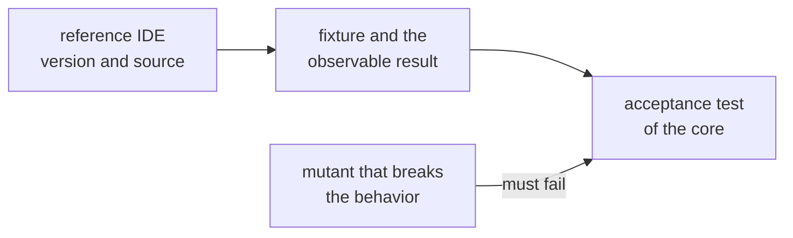

# Test strategy

Owner: the test layers of the core, the rules of every test, the acceptance against the reference
IDEs and the performance measurement.

## Rules of every test

- The proof uses the real tool; a missing tool is NOT PROVEN, never passed.
- A test never synchronizes on a fixed time: it waits for an event, or the fake tool has a lock the
  test controls (L16).
- A deadline is a test parameter, never a constant hidden in production code (L19).
- A test neither reads nor writes the home directory: `HOME` and `XDG_*` point to a temporary
  directory.
- A test describes the observable contract, not the implementation, and a refactoring does not
  edit the tests that prove it.
- Every guard has a mutant that disables it and must fail.
- A test checks the artifact of its own run, never an old binary (L17).
- The suite passes in the `dev`, `asan-ubsan` and `tsan` profiles (RNF-QUA-03).

## Layers

| Layer | What it proves | Where | State |
| --- | --- | --- | --- |
| Build contract | The promised flags reached the compiler and the binary | `core/tests/build/` | **Exists**: 2 tests |
| Unit | Rules and algorithms of `core/lib`, with no event loop and no process | `core/tests/unit/` | Framework in place; the first test of the core is born with the first code |
| Gate effectiveness | Each project gate rejects the planted defects and accepts the correct forms of its corpus | `core/tests/gates/` | **Exists**: `gate.launcher`, `gate.detach` and `gate.duplication`, in the `lint` preset |
| Complexity | No path grows faster than linearly (RNF-PERF-01) | `core/tests/complexity/` | To be created |
| Acceptance | Each requirement against its reference IDE, as an observable result on a fixture | The layer that fits each test | To be created, with each requirement |
| Ordering and concurrency | Forced interleavings: stale generation discarded, cancellation, same resource in series | `core/tests/unit/` | To be created |
| Crash | `kill -9` on each process, with the loss measured (RNF-DUR-01) and no orphan | `core/tests/crash/` | To be created |
| Hostile project | Zero marks without trust (RNF-SEG-01) | `core/tests/hostile/` | To be created |

## Acceptance against the reference IDE

- **The behavior** comes from the reference IDE that the requirement names, in the order of
  [ADR-0012](../adr/ADR-0012-cpp23-backend.md) (item 5): its source code or its official
  documentation, with the version. A behavior observed by running the IDE records the version and
  the steps.
- **The test** states that behavior as a fixture and an observable result of the core, never as a
  call into its implementation, and a mutant that breaks the behavior must fail it.
- **A divergence** from the reference is written in the requirement, with its reason (RF-ED-02
  adds a maximum delay that the backup of VS Code lacks, L04).
- **No reference** for a behavior: the test proves the expected behavior and how each failure is
  handled.

## Complexity

Each path that depends on the size of the file or of the workspace runs at the four reference
sizes (85, 2,500, 20,000 and 40,000 lines) and fails if the time ratio between two sizes exceeds
the limit of RNF-PERF-01. The measurement is the CPU time of the process, not the wall time, so
that it does not depend on the load of the machine.

## Performance

- **Before and after**, always with the same file, the same method and the same profile
  (`production`).
- **The C/C++ fixtures do not exist.** The 0.3 baselines used Rust files from the generator of
  `medir-core.py` (65:670-673). The first step is to generate C/C++ fixtures at the four sizes
  and measure the current product (UI and Rust core) on them, so that there is a baseline.
- **The method of the editor** is the one of 65 §20.3: key to frame, opening, CPU while typing
  and memory, with alternating rounds.

## Test framework

GoogleTest 1.17.0, the maintainer's decision of 2026-11-22. The module is
`core/cmake/KineinTesting.cmake`, and a unit test is born with
`kinein_add_unit_test(<name> SOURCES ... LIBRARIES ...)`. Each `TEST` becomes a CTest test with
the prefix `unit.`.

- **Built with the profile, not the system's.** In `debug-stl`, `_GLIBCXX_DEBUG` changes the ABI
  of the containers, and the framework library must be in the same mode. `unit.TestFramework.*`
  checks that at link time: it calls a library function that takes a `std::vector` parameter. The
  parameter type enters the mangled name and the return type does not, so a function that only
  returns a `std::vector` does not catch the mutant (measured on 2026-11-22). In the sanitizer
  profiles, the framework is instrumented too.
- **The tarball has a pinned hash** and is downloaded at configure. Without network access:
  `-DFETCHCONTENT_SOURCE_DIR_GOOGLETEST=<directory>`.
- The build contract test uses no framework: it is an executable that either compiles or not.
