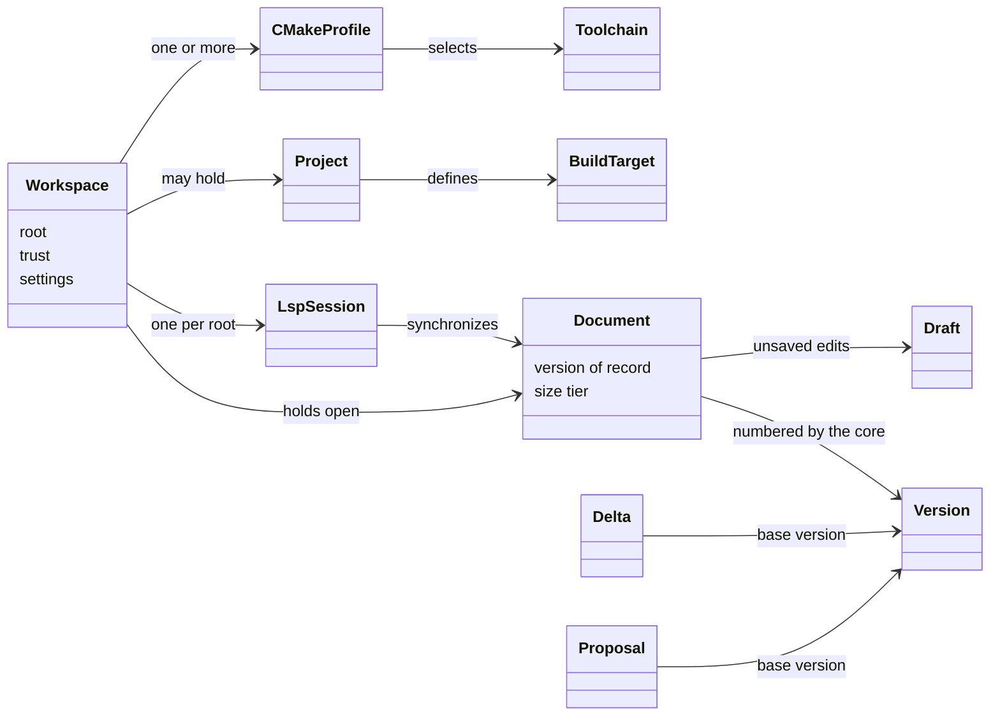

# Glossary

Owner: what each term of the domain of the core means, and which name the code gives it. The rules of each term stay in its owner, linked in the last column; the other files use
these terms and do not define them again.

One concept has one name in this tree and in the code. A term with more than one
meaning is always written with its qualifier ([Words with more than one meaning](#words-with-more-than-one-meaning)).
The method is the ubiquitous language of Evans (*Domain-Driven Design*, 2003, chapter 2). Where a
reference IDE names the concept, the term is its name (CLion first,
[ADR-0012](adr/ADR-0012-cpp23-backend.md)).

## Workspace and trust

| Term | Meaning | Name in the code | Owner |
| --- | --- | --- | --- |
| workspace | The folder the person opens in the IDE. Trust, settings, personal state, cache and the LSP session belong to it | `WorkspaceUntrusted` | [functional requirements](requirements/functional-requirements.md) (RF-WS-01) |
| root | The canonical path of the workspace folder; the identifier of the workspace derives from it | | [persistence](architecture/persistence-and-durability.md) |
| trust | The person's grant that lets a workspace run what it defines: its compiler, its tools, its git configuration and the CMake configure step. It is kept in the person's global state, by the root | | [processes and trust](architecture/processes-and-trust.md) |
| trusted folder | A folder that makes every workspace opened inside it trusted: the trusted locations of CLion 2026.3 ([project security](https://www.jetbrains.com/help/clion/project-security.html)) | | [processes and trust](architecture/processes-and-trust.md) |
| restricted mode | A workspace without trust: reading, navigating, editing and searching work, and nothing the workspace defines runs. CLion 2026.3 calls it safe mode, and VS Code, Restricted Mode | | [processes and trust](architecture/processes-and-trust.md) |
| origin | Where a program comes from: detected by the IDE, defined by the workspace, or a tool configured by the workspace. Trust is decided by it | | [processes and trust](architecture/processes-and-trust.md) |
| settings | Values that change what the IDE does, of the person or of the workspace. Those of the workspace live in `<root>/.kinein/` and travel through git | | [persistence](architecture/persistence-and-durability.md) |
| personal state | What belongs to one person in one workspace: session, drafts and local choices. It never lives in the workspace tree | | [persistence](architecture/persistence-and-durability.md) |
| cache | Derived data of a workspace that can be created again, outside its tree | | [persistence](architecture/persistence-and-durability.md) |
| project | The CMake project under the root of a workspace. CMake is its truth (RF-CMK-01), and a template creates one (RF-PRJ-01) | | [functional requirements](requirements/functional-requirements.md) |
| build target | A target of the CMake project, which the person builds, runs and tests | | [functional requirements](requirements/functional-requirements.md) (RF-BLD-01) |

## Documents and editing

| Term | Meaning | Name in the code | Owner |
| --- | --- | --- | --- |
| file | The bytes on disk. Opening and saving with no edit writes the same bytes (RNF-DUR-03) | | [text encoding](architecture/text-encoding-and-positions.md#file-content) |
| document | The core's text of an open file: UTF-8, lines split on `\n`, with its version, size tier and draft. The UI holds a copy and never decides it | | [editing engine](architecture/editing-engine.md) |
| version | The number of one state of the text of a document. The core numbers it; each accepted delta makes a new one, and the same number reaches the UI, the LSP session and every result computed for it. It is the generation of the document | | [editing engine](architecture/editing-engine.md) |
| version of record | The current version of a document in the core: the truth for the file, the draft and the LSP session | | [editing engine](architecture/editing-engine.md) |
| base version | The version a delta or a proposal was computed on | | [editing engine](architecture/editing-engine.md) |
| delta | One edit of the UI: the base version, the start (line and UTF-16 column), the number of UTF-16 code units removed and the inserted text. The core resolves the end on the text of the base version | | [text encoding](architecture/text-encoding-and-positions.md#between-the-ui-and-the-core) |
| acknowledgment | The core's answer to a delta, with the version it produced. Its whole shape belongs to the editing protocol (P22) | | [editing engine](architecture/editing-engine.md) |
| proposal | A text change of the core (format, rename, fix) sent to the UI on a base version. The UI applies it only on that version, and it comes back as a delta | | [editing engine](architecture/editing-engine.md) |
| divergence | A copy in the UI that differs from the document. The text and the version of the core replace the copy | | [editing engine](architecture/editing-engine.md) |
| resynchronization | The message that carries a whole document after a divergence, recorded as a defect: no other message after the opening carries the whole document (RNF-EDI-01) | | [editing engine](architecture/editing-engine.md) |
| draft | The core's copy of the edits not yet in the file, written within a maximum delay of each accepted delta (RNF-DUR-01) | | [persistence](architecture/persistence-and-durability.md#durability-of-typed-text) |
| size tier | Where a file falls by its size on disk: full; editing only, with no highlighting and no LSP; or not opened. The core decides it from the limits in the settings | | [editing engine](architecture/editing-engine.md#size-limits) |
| code insight limit | The size above which a file leaves the full tier for editing only | | [editing engine](architecture/editing-engine.md#size-limits) |
| opening limit | The size above which a file is not opened in the editor | | [editing engine](architecture/editing-engine.md#size-limits) |
| read only | A document shown with no highlighting, no LSP and no edit reaching the file, because its content is not valid UTF-8, does not use a single line ending (LF or CRLF), or holds U+2028 or U+2029 | | [text encoding](architecture/text-encoding-and-positions.md#file-content) |
| binary | A file with a NUL byte; it is not opened in the editor | | [text encoding](architecture/text-encoding-and-positions.md#file-content) |

## Text and positions

Every position carries its unit in its type; only the conversions of `base` change the unit, at a
boundary.

| Term | Meaning | Name in the code | Owner |
| --- | --- | --- | --- |
| line | A line of a document, from 0, ended by `\n` | `LineIndex` | [text encoding](architecture/text-encoding-and-positions.md#inside-the-core) |
| byte offset | A position in UTF-8 bytes: the unit inside the core | `ByteOffset` | [text encoding](architecture/text-encoding-and-positions.md#inside-the-core) |
| UTF-16 column | A column in UTF-16 code units, from 0: the unit between the UI and the core | `Utf16Column` | [text encoding](architecture/text-encoding-and-positions.md#between-the-ui-and-the-core) |
| display column | A screen column as GCC reports it: a tab reaches the next multiple of `-ftabstop`, and a wide character counts 2 | `DisplayColumn` | [text encoding](architecture/text-encoding-and-positions.md#between-the-core-and-the-tools) |
| line ending | LF or CRLF. The core keeps only `\n` and writes back the line ending of the file | | [text encoding](architecture/text-encoding-and-positions.md#line-endings) |

## Requests and execution

| Term | Meaning | Name in the code | Owner |
| --- | --- | --- | --- |
| intent | What the UI sends for a gesture of the person; the core decides what follows | | [boundaries](architecture/boundaries-and-responsibilities.md) |
| fact | What the core asserts and the UI shows: state, the result of a rule, an effective path, trust | | [boundaries](architecture/boundaries-and-responsibilities.md) |
| request | A message of the protocol that expects a response, identified by its id | `RequestId` | [protocol](architecture/protocol-and-contract.md) |
| deadline | The time limit that every external call and every work item carries. Its expiry ends the work with its own cause | `Deadline`, `DeadlineExceeded` | [execution](architecture/execution-and-concurrency.md) |
| cancellation | The end of a request or a work item before its result, with its own cause | `RequestCancelled` | [execution](architecture/execution-and-concurrency.md) |
| generation | The counter of a context that tells whether a result is stale: a result of an older generation is never applied (E6). For a document, the generation is its version | | [execution](architecture/execution-and-concurrency.md) |

## Processes and tools

| Term | Meaning | Name in the code | Owner |
| --- | --- | --- | --- |
| launcher | The only path that creates a process in the core. It decides by origin and trust, and sets the arguments, directory, environment, deadline, output cap and process group | | [processes and trust](architecture/processes-and-trust.md) |
| tool | An external program the core runs through the launcher: a compiler, clangd, CMake, git, clang-format | | [processes and trust](architecture/processes-and-trust.md) |
| environment | The variables an external process receives, from an allow list; never the whole inherited environment | | [processes and trust](architecture/processes-and-trust.md) |
| LSP session | One clangd per workspace root, started by the launcher. Each open document is synchronized in it by incremental `didChange` | | [editing engine](architecture/editing-engine.md) (RF-LSP-01) |
| diagnostic | A problem at a position, reported by a compiler or by clangd, with its column converted to the unit of the UI | | [text encoding](architecture/text-encoding-and-positions.md#between-the-core-and-the-tools) |

## Toolchain

| Term | Meaning | Name in the code | Owner |
| --- | --- | --- | --- |
| toolchain | The tools that build and run code: CMake, the build tool, the C and C++ compilers, the debugger and their environment, which a script can set up. A toolchain is independent of the workspace, and one is the default (CLion 2026.3, [Toolchains](https://www.jetbrains.com/help/clion/how-to-create-toolchain-in-clion.html)). VS Code CMake Tools and Qt Creator call a similar set a kit | | [functional requirements](requirements/functional-requirements.md) (RF-TC-01) |
| CMake profile | How a workspace builds its CMake project: the toolchain, the build type, the generator, the CMake options, the build options, the environment and the build directory. A CMake preset of the project becomes a read-only profile (CLion 2026.3, [CMake profiles](https://www.jetbrains.com/help/clion/cmake-profile.html), [CMake presets](https://www.jetbrains.com/help/clion/cmake-presets.html)) | | [functional requirements](requirements/functional-requirements.md) (RF-CMK-01) |
| tool setup | Installing and configuring tools and SDKs, in N1 and N2 | | [functional requirements](requirements/functional-requirements.md) (RF-SETUP-01) |
| configuration recipe | A change to the files of a workspace, shown as a preview before it is applied | | [functional requirements](requirements/functional-requirements.md) (RF-CA-01) |

## Versions of other things

| Term | Meaning | Owner |
| --- | --- | --- |
| product version | The version of Kinein Vectis: the C++ core is 0.1, with tags `CoreCpp-X.Y.Z` | [README](../README.md) |
| protocol version | The version of the contract between the UI and the core (P24) | [protocol](architecture/protocol-and-contract.md) |
| schema version | The version of the format of a file the core owns | [persistence](architecture/persistence-and-durability.md) |

## Words with more than one meaning

| Word | Written as | Never alone for |
| --- | --- | --- |
| target | build target, destination (of an atomic write) | either one |
| environment | environment: the variables of a process | tool setup |
| version | version: of a document | the product, protocol and schema versions |
| project | project: the CMake project | the folder the person opens, which is the workspace |
| settings | settings: of the person or of the workspace | a configuration recipe, or the CMake configure step |
| profile | CMake profile (of a workspace); build profile (of the core's own build, `core/CMakePresets.json`) | either one |
