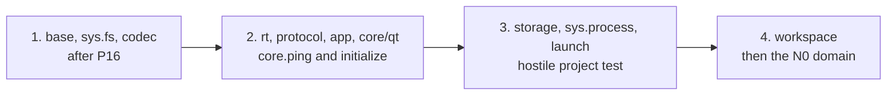

# Functional requirements of the C++ core

Owner: what the core does, at which priority level, which test accepts each capability and the
delivery order of the base. The limits of time, memory and security belong to
[non-functional-requirements.md](non-functional-requirements.md).

State: draft of 2026-11-22. No requirement is implemented. The acceptance tests cited here do not
exist yet.

## Scope

- **Languages:** C and C++. Rust and Python come back once the core is solid (ADR-0012).
- **Outside the C++ core:** databases, Grafana, remote work over SSH, containers, Cargo and
  Python.
- **Editing:** the 0.3 methods `lsp.*`, `syntaxTree.*` and `draft.*` carry the whole document
  (L01). The editing protocol replaces them and exists only in the C++ core, so the differential
  test does not cover it ([editing engine](../architecture/editing-engine.md)).
- **Origin:** each capability names the 0.3 methods that cover it today (protocol 0.223.0, route
  table of `crates/kinein-core/src/lib.rs`). The inherited acceptance is the differential test
  against the Rust core, apart from the intentional divergences
  ([test strategy](../engineering/test-strategy.md#differential)).

## Levels

| Level | Entry criterion |
| --- | --- |
| **N0** | Without it, Kinein cannot be developed in Kinein itself (dogfooding) |
| **N1** | Parity with 0.3 for C and C++ |
| **N2** | The differentiator: C/C++ environment, embedded and the project's own semantic analysis |

The dogfooding journey that defines N0 is the one of 65 §13 (65:484-497), restricted to C and
C++: open the repository, edit, use clangd, build and test with CMake, use the terminal, restart
without losing a change, and handle a missing or hung tool.

## N0: dogfooding

| ID | Capability | 0.3 methods | Acceptance |
| --- | --- | --- | --- |
| RF-CORE-01 | Life cycle: answer the ping, report the protocol version, shut down cleanly | `core.ping`, `core.shutdown` | Differential; shut down with no orphan (R5 of 65) |
| RF-CORE-02 | Every request can be cancelled and has a deadline; a long operation is a job with progress | `job.list`, `job.cancel` | Test with a fake, hung tool (RNF-EXE-02) |
| RF-WS-01 | Open, close and query the workspace; list of recent ones | `workspace.open`, `workspace.close`, `workspace.status`, `workspace.recent.*` | Differential; opening a folder without trust writes nothing in it (RNF-DADOS-05) |
| RF-WS-02 | Trust in the project: state, grant and the restricted mode | `workspace.trust` | Fixture of the hostile project with zero marks (RNF-SEG-01) |
| RF-FS-01 | Read, write (with the expected content and an atomic write), create, rename, copy, move to the trash | `fs.read`, `fs.write`, `fs.createFile`, `fs.createDirectory`, `fs.rename`, `fs.copy`, `fs.trash`, `fs.delete`, `fs.list` | Differential; a crash in the middle of a write leaves no partial file (RNF-DUR-02) |
| RF-FS-02 | Search in the project and replace | `fs.search`, `fs.findFiles`, `fs.replace` | Differential; complexity test (RNF-PERF-01) |
| RF-FS-03 | An external change on disk becomes an event | watcher events | Test with a file changed from outside |
| RF-TC-01 | C/C++ toolchain in the Detected, Selected, Effective model | `tools.detect`, `tools.status`, `toolchain.get`, `toolchain.set`, `toolchain.setKit` | Differential; the project's compiler never runs without trust |
| RF-CMK-01 | CMake: state, presets, targets, configure, cache and repair of the build directory; `compile_commands.json` of the active preset | `cmake.status`, `cmake.presets.list`, `cmake.targets.list`, `cmake.configure`, `cmake.inspectCache`, `cmake.repairBuildDir` | Differential; configuring without trust is refused |
| RF-BLD-01 | Build, run and test the target, with output and diagnostics | `build.run`, `run.start`, `run.stop`, `test.discover`, `test.run`, `runConfig.*` | Differential; cancelling kills the process group |
| RF-TERM-01 | Terminal: open, write, resize, scroll, select, close | `terminal.*` | Differential; an `exec` failure becomes a typed error (L18) |
| RF-ED-01 | Keep the document of each open file: apply the deltas of the UI in order, number the versions, propose the core's text changes with a base version, resynchronize the UI after a divergence | new | Property test: after random deltas and proposals, the copy of the UI equals the document; a proposal on a stale base is refused |
| RF-ED-02 | Write the editor's file with the guarded write and recover the text after a crash from the draft | `draft.*` leaves | A crash with zero keystrokes lost beyond the limit (RNF-DUR-01) |
| RF-ED-03 | Highlight with tree-sitter, incrementally, for a named version | `syntaxTree.*` leaves | RNF-EDI-01 at the reference sizes; complexity test (RNF-PERF-01) |
| RF-ED-04 | Place each file in its size tier (full, editing only, not opened), tell the person the limit and the size, and take the limits from the settings | new | Files one byte below and above each limit; raising a limit in the settings changes the tier |
| RF-ED-05 | Check the content of each file on opening (NUL byte, valid UTF-8 with or without a BOM, one line ending, U+2028 and U+2029), open it read only with the reason, and offer the gesture that converts it where one exists | new | One file per case reaches its state with its notice; the gesture makes it editable ([text encoding](../architecture/text-encoding-and-positions.md#file-content)) |
| RF-LSP-01 | One clangd session per root, created by the launcher, with the core's context (`compile_commands.json`, `--query-driver` only for a compiler detected without trust); the core is the LSP client of each document | `lsp.*` leaves | One clangd process per root during the journey; changing the language standard of the preset changes the diagnostics; no `didChange` carries the whole document |
| RF-SET-01 | Settings of the IDE and of the project | `settings.get`, `settings.set` | Differential |

## N1: C/C++ parity

| ID | Capability | 0.3 methods | Acceptance |
| --- | --- | --- | --- |
| RF-GIT-01 | Git: status, diff, log, blame, stage, commit, branches; off without trust | `git.*` | Differential; the project's `fsmonitor` never runs (64:119) |
| RF-DBG-01 | Debugging over DAP: start, stop, steps, stack, variables, evaluate, memory, disassembly | `debug.*` | Vertical flow of 64:914 |
| RF-CMK-02 | Assisted editing of CMake: targets, libraries, language standard, presets, sanitizers | `cmake.add*`, `cmake.set*`, `cmake.create*Preset`, `cmake.enable*`, `cmake.fetchContent`, `cmake.findPackage` | Differential; a preview before writing |
| RF-CA-01 | Configuration recipes with preview and apply | `configAction.list`, `configAction.preview`, `configAction.apply` | Differential |
| RF-PRJ-01 | Create a C/C++ project from a template | `workspace.createProject`, `workspace.createFolder` | The new template ignores the IDE's state in git (L13) |
| RF-SETUP-01 | Installation guide for the tools | `setup.list`, `toolchain.installable`, `toolchain.install` | Differential; no `--version` runs on the loop (L08) |
| RF-FMT-01 | Format with the project's `clang-format`, with trust | `format.text`, `format.capabilities` | Differential |

## N2: the differentiator

The order and the design of N2 belong to the maintainer, in the library with no Qt. The list
below only records what 0.3 covers, so that nothing is lost.

| ID | Capability | 0.3 methods |
| --- | --- | --- |
| RF-EMB-01 | Flashing and probes | `runConfig.flashProposal`, `probe.*`, `dfu.*`, `picotool.*` |
| RF-EMB-02 | Serial | `serial.*` |
| RF-EMB-03 | SDKs: ESP-IDF, Zephyr (`west`), PlatformIO | `idf.*`, `espidf.*`, `west.*`, `platformio.*` |
| RF-EMB-04 | Memory and registers | `memory.x`, `debug.readMemory`, `debug.disassemble` |
| RF-SEM-01 | The project's own semantic analysis: local index, definition, reference and scope | `index.*`, `local.*` |
| RF-SEM-02 | Quality and coverage | `quality.run`, `coverage.*` |

## The order of the base

Proposal for Phase D (P12), with the done criterion of each step written before the code:

1. `base`, `sys.fs` and `codec` ([modules](../architecture/modules-and-layers.md)), after the
   decision on the libraries (P16).
2. `rt` and `protocol` (designed by the maintainer), plus `app` and `core/qt` with only
   `core.ping` and `initialize`. It is the first milestone of the strangling: the UI starts the
   C++ core through `KINEIN_CORE_BIN`, the ping answers and everything else returns
   `MethodNotFound`. It proves the whole path, the CI and the sanitizers early, without taking the
   IDE out of dogfooding, which stays on the Rust core.
3. `storage`, `sys.process` and `launch`, with the hostile project test.
4. `workspace`, and then the N0 domain.

